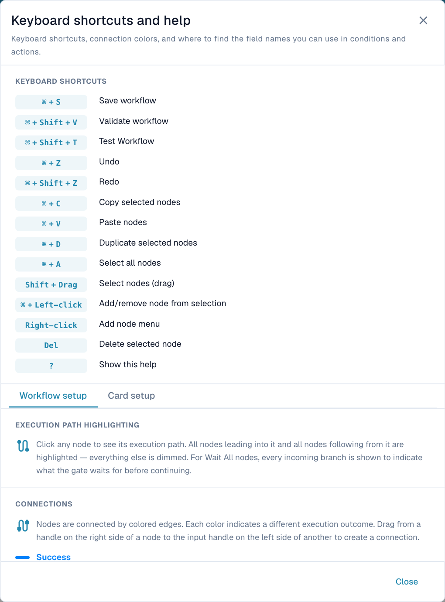

# Toolbar & Canvas

## Video: Builder and canvas

A fictional, AI-generated administrator introduces the example, then checks Workflow List and License and explains his real actions in the English DocBits designer. The demonstration remains unsaved; this account has no Advanced Workflow subscription.



[Open video](https://docbits-videos.fra1.cdn.digitaloceanspaces.com/settings-assistant/advanced_workflows_canvas-admin/v1/en.mp4) · [Captions (WebVTT)](https://docbits-videos.fra1.cdn.digitaloceanspaces.com/settings-assistant/advanced_workflows_canvas-admin/v1/en.vtt) · [Transcript (text)](https://docbits-videos.fra1.cdn.digitaloceanspaces.com/settings-assistant/advanced_workflows_canvas-admin/v1/en.txt) · 5:00

Transcript

**Meet the administrator**

I look after DocBits here. Let me show you how I build an invoice check and connect its two routes.

**Check workflow access**

I start on Workflow Dashboard and open Workflow List. Then I check License. Workflow and Advanced Workflow both need active access. With those enabled, New Workflow offers Advanced Workflow. This documentation account has no active workflow subscription, so this video continues with an unsaved designer preview.

**Name the workflow**

I'm working in the real DocBits designer. First, I give this draft a clear name. We'll check an invoice amount, then use two simple actions to show the possible routes. This demonstration stays unsaved.

**Configure the amount check**

I open Add and choose And. Under Document Field, I select the Docfield condition. I set the field to total amount. Then I choose Greater Than. And enter one thousand. Use your own document field key. Exactly one thousand does not pass this comparison.

**Add the Approval action**

Now I add a Then card from Document Field. The action sets a document field. I use the demonstration key approval route, and enter Approval. This labels the route. A real approval process needs its own business actions.

**Add the Standard action**

I add a second Then card using the same action. This time, the demonstration field gets the value Standard. Both cards are configured. They still need connections to define which action runs.

**Arrange the canvas**

I drag the cards into a readable layout. The two actions go on the right. The condition sits in the middle, with Start on the left. Moving cards changes their position. It does not create a connection.

**Connect the routes**

I drag from Start's output to the condition's input. The Success route goes to Approval, with a blue connection. The orange Failed Condition route goes to Standard. Red Error is a separate output for evaluation failures. Here it remains unconnected. In a production workflow, decide how you will handle those failures.

**Prepare test cases**

The toolbar Test button opens Select Test Document. I can select a demonstration document, or prepare complete Custom Data. Test amounts above, below, and exactly at one thousand. Check a missing amount too. This account has no Advanced Workflow subscription. I'm showing test preparation, not an executed result.

**Validate, save and activate**

I locate Validate to check connections and card settings. This account blocks validation because the subscription is unavailable. In an enabled account, I would save explicitly to the server. Then check activation separately. The switch is disabled before the first save. The automatic draft indicator refers to a local browser copy. It does not mean this workflow is saved or enabled.

[Watch all five chapters](videos.md)

Use the bottom toolbar to configure the workflow and the canvas to arrange nodes. Panning, zooming and card positions change the view or layout. Connections determine execution.

## Every toolbar control

Controls follow their left-to-right order.

| Control | Purpose and result |
| --- | --- |
| **+ Add** | When, And, Then, existing Start, Wait ALL, Wait ANY, OR and Note. See [Nodes](nodes.md). |
| **Undo / Redo** | Undo or repeat supported canvas edits. Does not roll back executed actions or independently saved organization variables. |
| **Zoom out / Zoom in** | Change the view scale. |
| **Workflow Name** | Name the workflow before saving. |
| **Edit description** | Explain the business purpose and exceptional routes. |
| **Automatic-save indicator** | Shows the last local draft save after changes; not a server-save confirmation. |
| **Variables — { }** | Open the organization-wide [variables](variables.md). |
| **Help — ?** | Shortcuts, path highlighting and connection legend. |
| **Validate — check-circle** | Report graph errors and warnings. |
| **Test — play-circle** | Choose test input for the current canvas. See [testing](validation-and-testing.md). |
| **Snap to grid** | Toggle alignment when moving nodes. |
| **Mini-map** | Show or hide an overview for large graphs. |
| **Export Image** | Download a diagram image. This is not an importable workflow configuration or execution recording. |
| **Save — disk** | Write the workflow to the server. Wait for confirmation. |
| **Activate / Deactivate — toggle** | Change the enabled state of a saved workflow. Unavailable before the first save; review any unsaved-change prompt. |
| **Hide toolbar — down arrow** | Hide it. Use the remaining up arrow to restore it. |

The current toolbar does not expose a separate Logs or Save as Template button. Open [Workflow Logs](../workflow-logs.md) from the document. Workflow List configuration import/export is separate from Export Image.

## Navigate and select

- Drag the blank background to pan; use wheel, pinch or zoom buttons to change scale.
- Drag a node to move it. Connections remain attached.
- Click a node to highlight incoming and outgoing paths; unrelated nodes dim.
- **Shift + drag** selects an area. **Cmd/Ctrl + click** adds/removes a node from the selection.
- Right-click the background for Add. The node context menu offers editing actions for the selection.

Connectivity highlighting is different from [execution evidence](../workflow-logs.md).

## Edit nodes and notes

Copy, paste or duplicate a selection to reuse a configured section, then check its fields and connections. Review the selection before deleting: removing a node also removes its connections and can disconnect a downstream path. Undo/redo corrects canvas edits.

Use **Note** to explain a decision, owner or configuration context. Edit its text and use the available color and size controls to keep it readable. Notes are annotations, not execution steps or logs.

## Keyboard shortcuts

Use **Cmd** on macOS and **Ctrl** on Windows/Linux. Finish typing in an input before using canvas-editing shortcuts. **?** opens the application's current reference.

<figure><figcaption>
Built-in help provides the current editing shortcuts. Scroll to the connection legend or select Card setup for field-name guidance.
</figcaption></figure>

| Shortcut | Action |
| --- | --- |
| **Cmd/Ctrl + S** | Save to server. |
| **Cmd/Ctrl + Shift + V** | Validate. |
| **Cmd/Ctrl + Shift + T** | Open testing. |
| **Cmd/Ctrl + Z** | Undo. |
| **Cmd/Ctrl + Shift + Z** | Redo. |
| **Cmd/Ctrl + C / V / D** | Copy / paste / duplicate selected nodes. |
| **Cmd/Ctrl + A** | Select all nodes. |
| **Shift + drag** | Area selection. |
| **Cmd/Ctrl + left-click** | Add/remove one node from selection. |
| **Right-click** | Open context menu. |
| **Delete** | Delete selection. |
| **?** | Open help. |

Before leaving, [validate, test and save](validation-and-testing.md). A local draft and an exported image do not replace a saved workflow.
