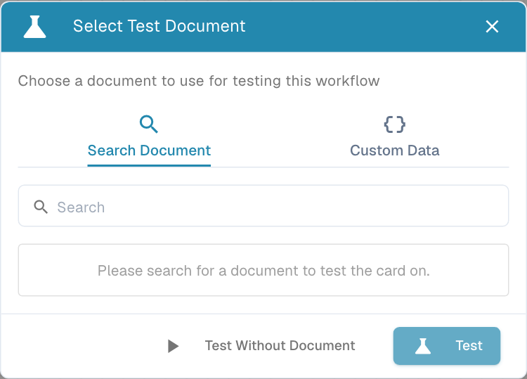
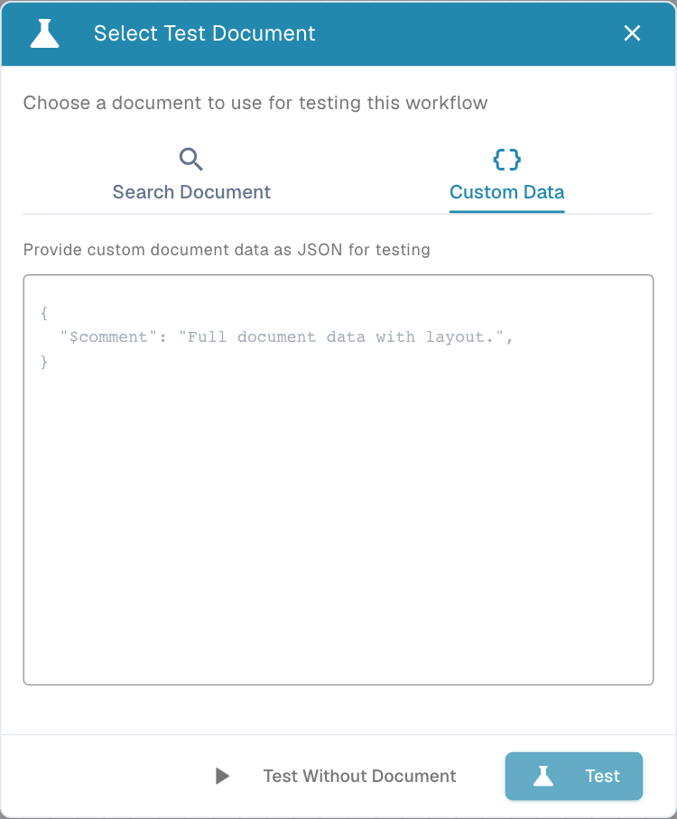

# Validation & Testing

## Video: Variables, tests and activation



[Open video](https://docbits-videos.fra1.cdn.digitaloceanspaces.com/settings-assistant/advanced_workflows_testing/v3/en.mp4) · [Captions (WebVTT)](https://docbits-videos.fra1.cdn.digitaloceanspaces.com/settings-assistant/advanced_workflows_testing/v3/en.vtt) · 1:53

Transcript (English)

Open Variables with the braces icon. Choose Text, Number, Yes or No, or Document. Search finds variable names. A Document variable stores a reference set by a dedicated workflow action. This form does not accept document values.

Choose a unique name, type and initial value. Creating, editing and deleting variables persist immediately for the organization. Other workflows can share these values. Saving or discarding the canvas cannot undo variable changes.

Select Validate. Review errors and warnings above the canvas. Click a message to focus its node. Check actions, entry connections, handles, cycles and merges. Structural validation does not prove that runtime data is correct.

Toolbar play opens Select Test Document. Choose a document, Custom Data, or Test Without Document for independent cards. Start play runs directly. Tests use the current canvas, including unsaved edits, and simulate destructive actions.

Prepare separate tests above, below and exactly at one thousand, plus missing data. After running, inspect node messages and durations: green success, orange false, red error, gray skipped. Retest fixes; use Test Manager for repeatable scenarios.

Auto-save keeps a local browser draft about every thirty seconds after changes. Save explicitly to the server. The activation toggle is unavailable before the first save. Check the enabled state in Workflow List before expecting automatic execution.

[Watch all five chapters](videos.md)

**Validate** checks graph structure. **Test** evaluates the current graph with specific input. A valid drawing or one green test does not prove that every production case is covered.

## Validate

Use the **check-circle** button or **Cmd/Ctrl + Shift + V**. Errors and warnings appear above the canvas. Click a message with a node reference to focus that node.

| Check | Correction |
| --- | --- |
| Entry | Include and connect Start or When. Entry nodes cannot be targets. |
| Action | Include at least one Then. |
| Connections | Use a supported output handle and a valid destination input. |
| Cycles | Remove self-connections and loops. |
| Merges | At least two inputs for Wait ALL/ANY; two distinct sources for OR. |
| Unused nodes | Reconnect or remove orphaned processing nodes. Notes need no connections. |
| Existing Delay | Positive duration, no more than 86,400 seconds. |
| Cards | Resolve missing-card and version-compatibility warnings. |

A warning can flag a questionable design, such as several outcome handles from one source feeding the same target. Review its meaning; it is not successful testing.

Validation cannot reliably establish that every version-specific card field contains correct runtime data. Configure the visible fields and test realistic input. Runtime tests can reveal missing data that structural checks do not detect.

## Choose test input

Use the toolbar **play-circle** or **Cmd/Ctrl + Shift + T** to open **Select Test Document**.

<figure><figcaption>
Choose the input required by your cards. Document-independent testing cannot verify document-dependent conditions.
</figcaption></figure>

| Choice | How | Appropriate use |
| --- | --- | --- |
| **Search Document** | Enter at least two characters, select a document and choose Test. | Document-dependent checks using available document data. |
| **Custom Data** | Enter valid document-data JSON and test. This requires the document-data structure, not arbitrary key/value JSON. | Controlled input and edge cases when you know the structure. |
| **Test Without Document** | Run without selecting a document. | Document-independent cards and control-flow checks. |

<figure><figcaption>
Use complete document-data JSON for controlled scenarios. The placeholder comment alone does not provide the fields a document-dependent card needs.
</figcaption></figure>

The **Start play control** tests directly without opening the picker. **Test from here** on a node starts at that point. Required downstream context must still exist. A partial test does not verify the omitted trigger and upstream checks.

After a partial test, repeat the scenario from the full entry point, especially when it includes merge nodes. A test starting halfway through the graph can have a different set of completed predecessors from a real document event.

Tests use the **current canvas**, including unsaved edits. Test mode simulates destructive actions and skips actual delays. A simulated export, email or task does not establish that the production integration completed.

## Read results

Inspect the summary and per-node result indicators on the canvas. Open result details for messages and duration per node. The result dialog offers **View in Designer**, **Re-test** and **Close** where available.

| Result | Meaning | Inspect |
| --- | --- | --- |
| **Green — Success** | Node completed successfully. | Expected action and route. |
| **Orange — Failed Condition** | Evaluated condition was false. | Orange alternative and input values. |
| **Red — Error** | Evaluation or action failed. | Exact node message and required data. |
| **Gray — Skipped** | Node did not run. | Preceding outcome, entry and branch. |

A false condition can lead to an expected alternative and a successful workflow. A successful error handler can coexist with an overall error. Read individual nodes as well as the overall badge.

Overall test duration can include setup and document loading. Per-node durations describe the individual operations; the measurements need not add up exactly.

## Repeatable tests

Use [Test Manager](../test-manager.md) for saved regression scenarios. Cover:

- True, false and error outcomes.
- Exact amount/date/tolerance boundaries.
- Missing data and unexpected document types.
- All merge inputs matching, only one matching and none matching.
- Every relevant event entry and expected downstream action.

Re-test corrections and alternatives. Then **Save**, check the enabled state in Workflow List and inspect a new real run in [Workflow Logs](../workflow-logs.md).
