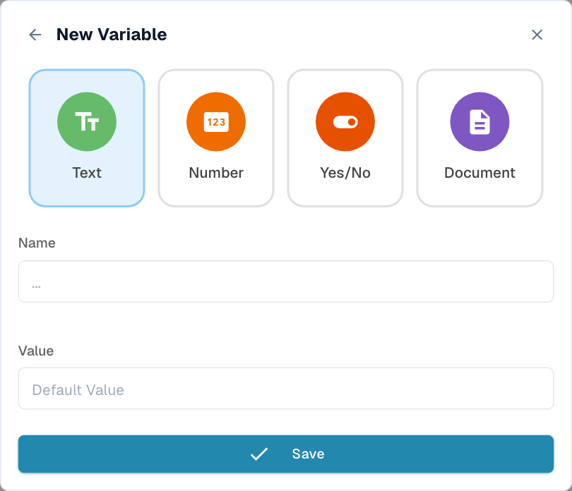

# Variables

Open **Variables** with the **{ }** toolbar icon. Compatible cards can read or update named values such as thresholds, labels, flags or document references. The panel groups variables by type; Search filters their names.

## All four types

| Type | Holds | Configuration |
| --- | --- | --- |
| **Text** | A string. | Enter an initial text value, such as a reusable label. |
| **Number** | A numeric value. | Enter a number, such as an amount threshold, without a currency symbol. |
| **Yes/No** | A Boolean flag. | Set the initial Yes/No toggle. |
| **Document** | A document reference. | Assigned by an appropriate workflow action. This form does not accept a typed document default. |

<figure><figcaption>
Select a type, enter a unique name and set the initial value where applicable.
</figcaption></figure>

## Create and use

1. Open **Variables → New Variable**.
2. Choose the type.
3. Enter a non-empty name not already used in the organization.
4. Set the initial value where applicable.
5. Select **Save** or **Create Variable**, depending on your version.
6. Select the variable in a compatible card field.

A card must support that variable type. Variables do not replace every card field, and an organization variable is different from a value extracted from a document field.

## Scope and persistence


Variables are **organization-wide**. Creating, editing or deleting one is saved to the server immediately, independently of saving the canvas. Other workflows can reference the same variable. Discarding the workflow or restoring a local draft does not undo the variable change.


Use shared values deliberately. If each invoice needs a different value, choose the document field or document-scoped data supported by the card instead of assuming a shared variable is private to an execution.

## Edit and delete

The **pencil** opens a variable's name and value for editing. Its type is retained; select the right type when creating it. Save persists the edit.

The **delete** icon opens a confirmation. Check which workflows use the variable before confirming: a deleted reference can leave a card without its expected value. Re-test affected workflows after changing a shared value.

## Example: a shared amount threshold

Create a Number variable such as `approval_threshold`. Select it in a compatible comparison card and route the result to approval or normal processing. Before changing it, identify other workflows that use it. Test below, exactly at and above the threshold. The comparison operator still matters: changing a value does not change `>` into `>=`.

Continue with [Validation & Testing](validation-and-testing.md) and [Workflow Logs](../workflow-logs.md).
