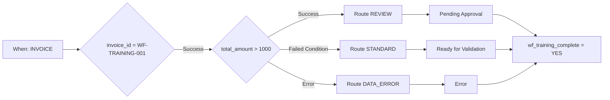

# Advanced case study: invoice routing

A training invoice above EUR 1000 needs review. Up to and including EUR 1000 it takes the standard route. A missing or invalid numeric amount follows the data-correction route. All three routes lead to a shared completion action.

## Prerequisites and design

Use a test organization with an active Advanced entitlement and the [training kit](workflow-training-kit.md). Import `advanced-workflow.json` through **Import Workflow**, keep it disabled and open the graph. Its When entry checks Invoice; the first And card restricts the exercise to `invoice_id = WF-TRAINING-001`. It has no recipients or export.

The scope check uses `invoice_id`, `eq` and `WF-TRAINING-001`; a different number skips every subsequent action. The amount check uses **Docfield is**, version 2, with `total_amount`, `gt` and `1000`. Text actions write `wf_training_route`. Status cards use version 3 and **Trigger Workflows = false**.

**v2:** The selected route’s status card connects directly to the shared Then card `complete`, which writes `wf_training_complete = YES`. There is no waiting OR node here. V1 established test behavior only: with unreached predecessors the normal scheduler can skip a merge that test mode still evaluates. The [P0 node guide](masterclass/control-nodes.md) explains the difference. A shared direct Then card is not a barrier for several concurrent mandatory actions.

## Build and verify

1. Validate the complete graph.
2. Prepare the files for your organization following the training-kit instructions.
3. Open **Test → Custom Data** and use the complete file for each case. An object containing only `total_amount` is insufficient.
4. Run from the full entry. Inspect the `amount` outcome, reached route, status message and `complete`.
5. Compare with the independent expectations. The saved test responses show the actual observed node results.

| Case | Amount | amount outcome | Route / status | Overall result |
| --- | --- | --- | --- | --- |
| above | 1785.00 | Success | REVIEW / validated_pending_approval | success |
| below | 999.00 | Failed Condition | STANDARD / ready_for_validation | success |
| boundary | 1000.00 | Failed Condition | STANDARD / ready_for_validation | success |
| just-above | 1000.01 | Success | REVIEW / validated_pending_approval | success |
| missing | absent | Error | DATA_ERROR / error | error |
| invalid-number | invalid | Error | DATA_ERROR / error | error |
| other-invoice | 1785.00 | not executed | different invoice number; no action | failed_condition |

In an error case, `data_error` and `complete` can succeed while the overall result remains **error**. Handling the error does not erase the original failed evaluation.

## Extend the business process

Tests ran on 21 October 2026 against deployed Dev DocFlow **2.10.38**. The kit contains real test responses; document field and status changes were simulated. It contains no persisted document Workflow Logs and establishes neither personal approval nor actual export delivery.

Replace routing markers with configured assignment and approval actions for your process. Attach export only to an explicitly checked approval condition. Confirm a real run on the document and delivery at the receiver, using your own training document and a designated test destination. The [troubleshooting guide](workflow-troubleshooting.md) explains the required evidence.

## WF-02: Exercise and acceptance

Run all seven cases. Record amount output, chosen route, status message, complete and overall result. Accept tests and actual document execution separately; do not mark a handled error as an error-free run just because completion succeeds.

[Learning path](workflow-learning-path.md)
