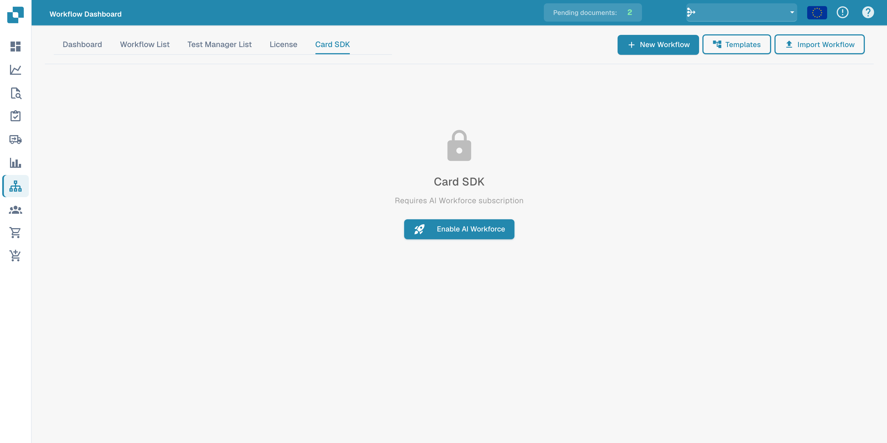

# Card SDK

The **Card SDK** lets partners and developers build custom workflow cards for DocFlow. You package a card as a partner app and upload it, or import it directly from GitHub.

<figure><figcaption>
Card SDK tab with the notice that an AI Workforce subscription is required.
</figcaption></figure>

## How it works

- **Download SDK Template** — start from the official template that contains the expected structure.
- **Upload ZIP** — the ZIP must contain `app.json` and a `.docflowcompose/flow/` folder with the card definitions (max 10 MB). Upload &#x26; Validate checks the package before it is accepted.
- **GitHub Import** — import a card definition straight from a GitHub repository.
- **Submissions** — track the status of cards you have submitted.

Once validated and accepted, your custom cards appear in the **Add Card** library alongside the built-in cards.

The Card SDK requires an AI Workforce subscription. If it is not available, the tab shows the subscription notice rather than the SDK editor.
