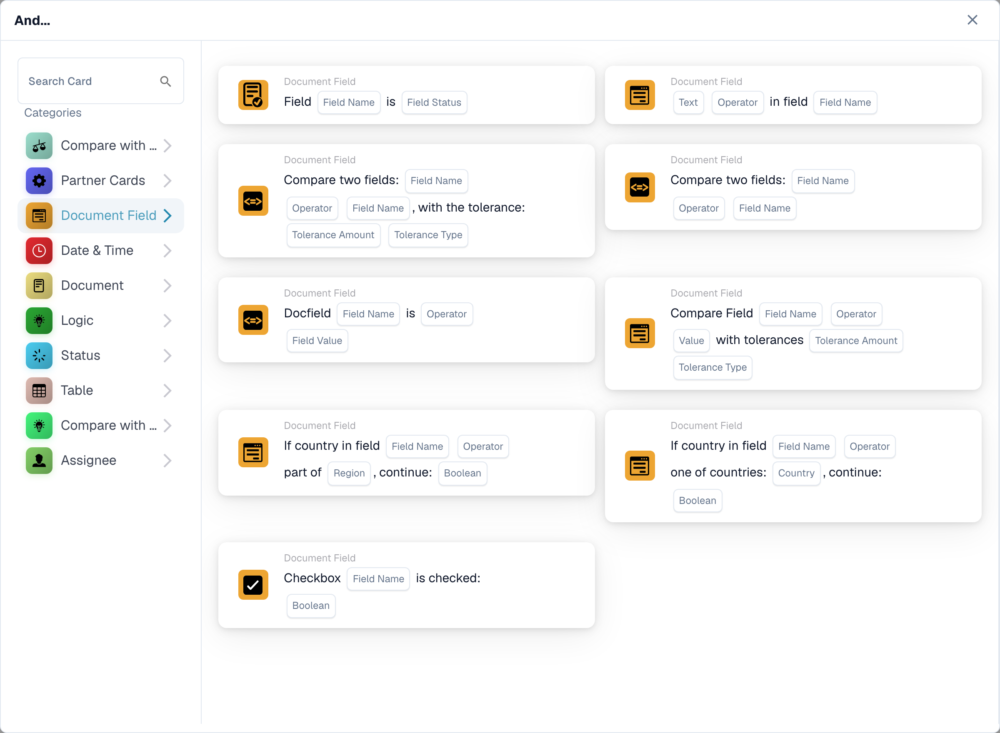
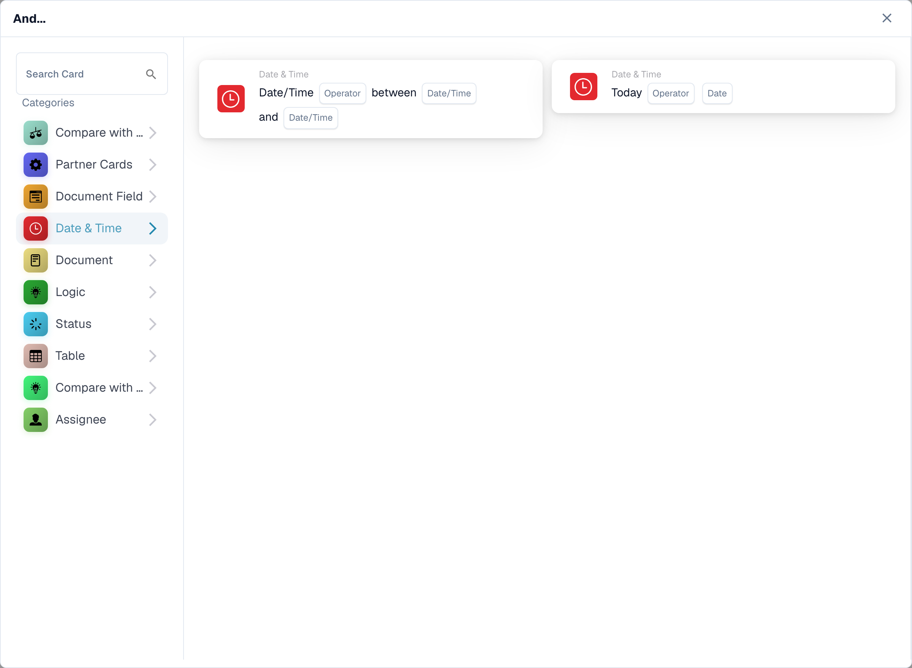
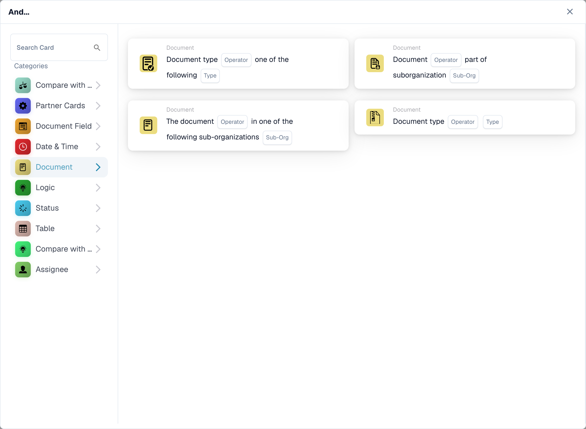
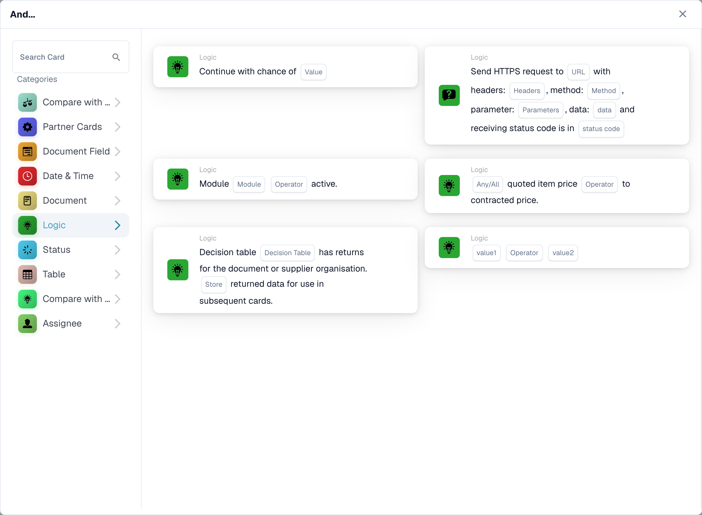
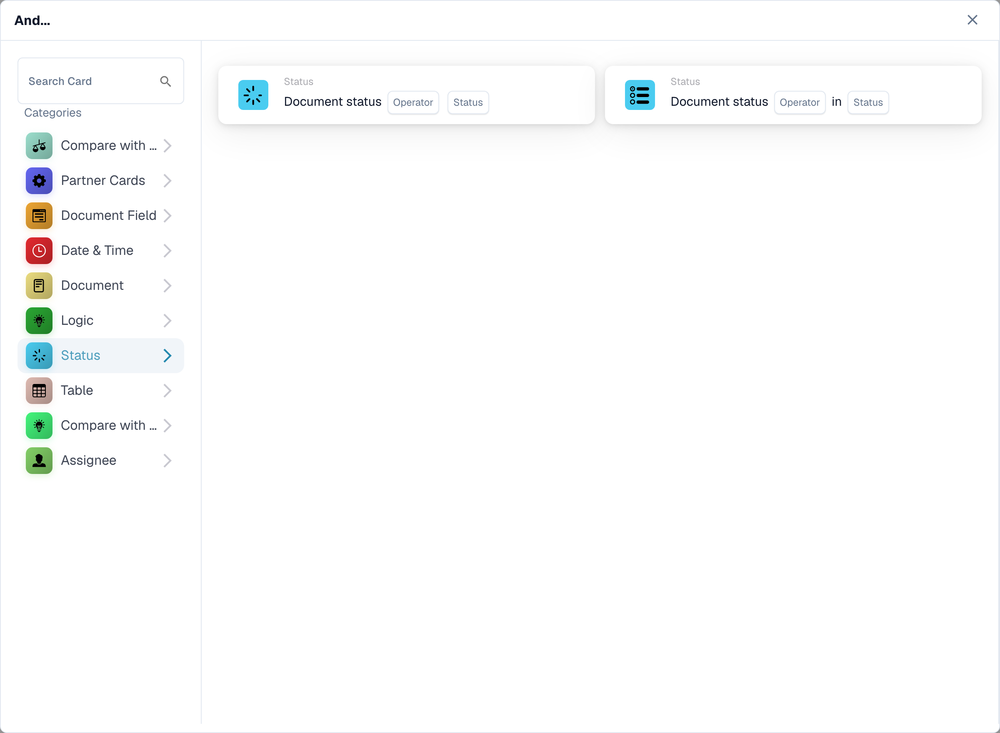
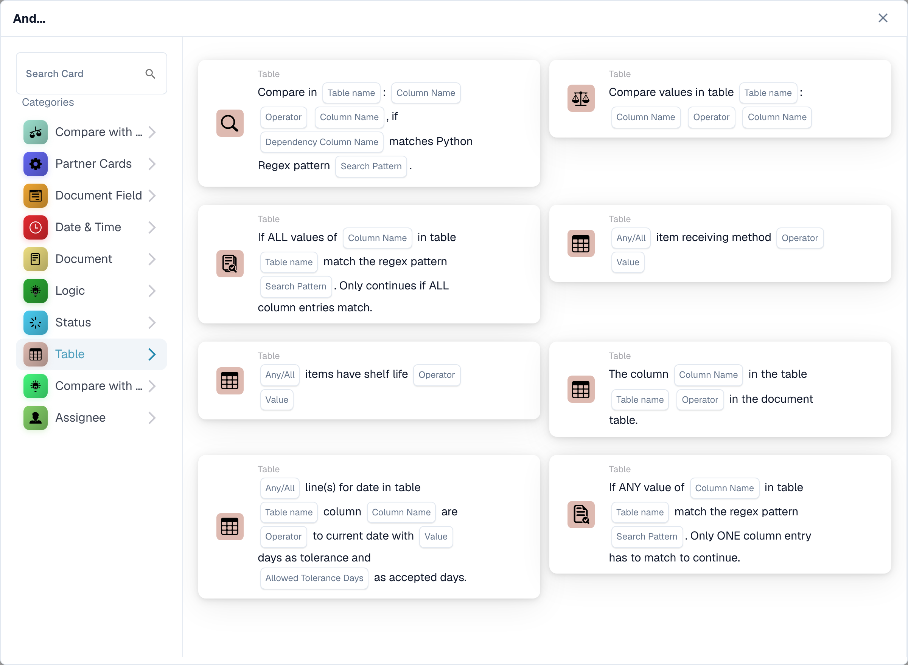
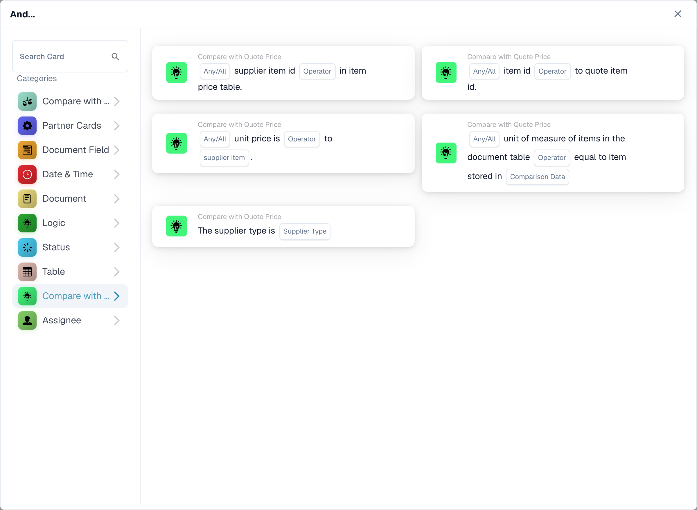
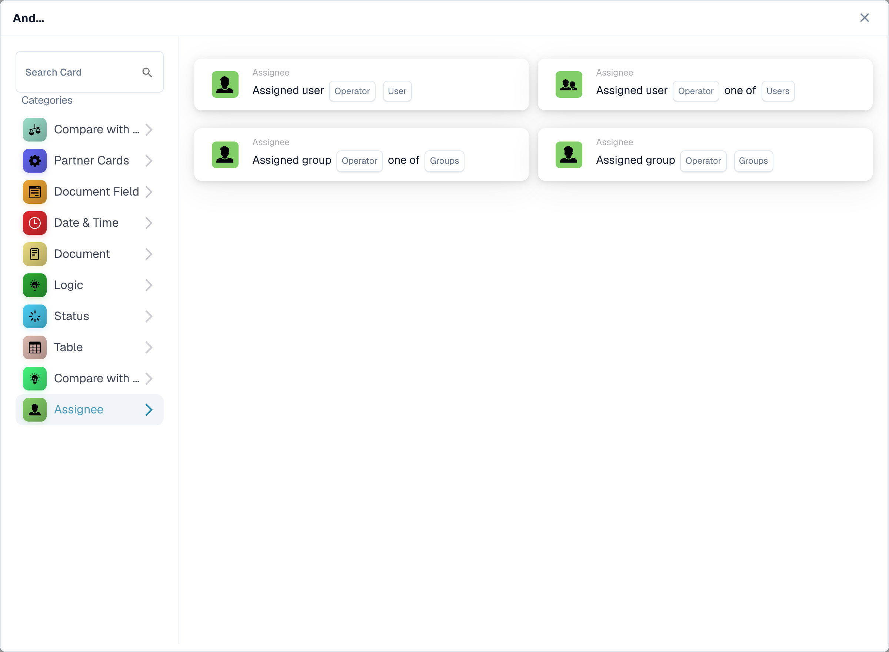

# And

Use an **And** card to decide whether a workflow should continue after its **When** trigger. Add the checks you need before the **Then** action. Each card shows fields to fill in, such as **Operator**, **Field Name**, or **Value**; the screenshots show the available card templates, not completed rules.

In the **Workflow Builder**, select **Add Card** under **And...**. Choose a category on the left, or type a card name in **Search Card**. Select a card preview to add it to the workflow. You can scroll the preview list to see more cards. Use **×** to close the picker without choosing another card. After configuring the cards, save the workflow. See [Workflow](../../) for the surrounding **When**, **And**, and **Then** steps.

## Compare with Purchase Order

Use these cards to compare order or invoice data with a purchase order, such as unit price, promised delivery date, charges, or quantity. Choose the fields, operator, and any tolerance that the selected card asks for. See [Compare with Purchase Order](compare-with-purchase-order/) for the individual cards.

<figure><figcaption>
Purchase-order comparison conditions.
</figcaption></figure>

## Document Field

Choose this category to check a checkbox or field status, compare a field with a value, or compare two fields. Fill in the **Field Name** and **Operator** placeholders on the chosen card. Some comparisons also ask for a tolerance. See [Document Field](document-field/).

<figure><figcaption>
Document-field conditions.
</figcaption></figure>

## Date & Time

Use **Date & Time** to compare a date or time with a range, or compare **Today** with a chosen date. Select the **Operator** and date values in the card. See [Date & Time](date-and-time/).

<figure><figcaption>
Date and time conditions.
</figcaption></figure>

## Document

Use these cards when a workflow should depend on the **document type** or **sub-organization**. Choose the type or organization named in the card. See [Document](document/).

<figure><figcaption>
Document conditions.
</figcaption></figure>

## Logic

This category includes checks using a decision table, an HTTPS response, module availability, a quoted item price, a chance value, or two values. Open the specific card and fill in its named placeholders; for example, the HTTPS card asks for a URL, method, and accepted status code. See [Logic](logic/).

<figure><figcaption>
Logic conditions.
</figcaption></figure>

## Status

Use **Status** to check whether a document has a chosen status or whether its status is in a selected set. Choose the **Operator** and **Status** in the card. See [Status](status/).

<figure><figcaption>
Status conditions.
</figcaption></figure>

## Table

These cards examine document table rows. The visible options include date checks, text patterns, shelf life, and comparisons between columns. Select the **Table name** and **Column Name** before choosing an operator or pattern. See [Table](table/).

<figure><figcaption>
Data-table conditions.
</figcaption></figure>

## Compare with Quote Price

Use these cards to compare an item with quoted price data. The visible choices cover item ID, supplier type, supplier item ID, unit price, and unit of measure. The **Operator** and data placeholders depend on the card you select.

<figure><figcaption>
Quote-price conditions.
</figcaption></figure>

## Assignee

Use **Assignee** when the condition depends on the assigned user or group. Choose whether to compare with one user or group or a selected set. See [Assignee](assignee/).

<figure><figcaption>
Assignment conditions.
</figcaption></figure>

[Detailed quote comparison cards and Any/All behavior](../quote-comparison-guide.md).
