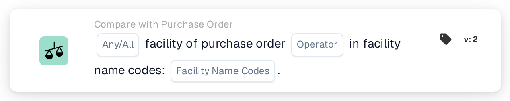

# Facility of Purchase Order

<figure><figcaption>
Version 2
</figcaption></figure>

## Purpose:

This workflow card checks the facility of the purchase orders matched to a document against a list of facility codes. It can be used to handle documents differently depending on the facility (location) the order was placed for, for example to route them to the team responsible for that facility.

Purchase order matching should run before this card. Without a matched purchase order the card reports missing data.

## Components of the Card:

1. **Any / All**
   * **Description:** How the facility codes of the matched purchase orders are evaluated against the list.
   * **Options:**
     * **Any:** At least one entry of the list is found in the facility codes of the matched purchase orders.
     * **All:** Every facility code of the matched purchase orders is in the list. If no value is set, the card uses **All**.
2. **Operator**
   * **Description:** Whether the facility should be in the list or not.
   * **Options:**
     * **Is**
     * **Is Not**
3. **Facility Name Codes**
   * **Description:** The facility codes the purchase order facility is compared with.
   * **Detail:** Several codes can be entered, separated by commas.

## Functionality:

* **Condition Evaluation:** The card reads the purchase order numbers matched to the document, loads these purchase orders and collects the facility (location) of each of them. Purchase orders without a facility are skipped. The collected facility codes are then compared with the **Facility Name Codes** on the card.
  * With **Any** and **Is**, the comparison ignores capitalisation, and an entry of the list also counts when it is part of a longer facility code (for example, the entry `WH` is found in `WH01`).
  * With **All** and **Is**, each facility code of the purchase orders should appear in the list with exactly the same spelling, including capitalisation.
  * If none of the matched purchase orders has a facility, **All** is met and **Any** is not.
  * With **Is Not**, the result is not simply the opposite of **Is**. The card log shows which codes were found and which were not matched, which helps to check the behaviour for a given setup.
* **Action Execution:**
  * **True Condition:**\
    If the condition is met, the workflow continues, for example with a step that is specific to the listed facilities.
  * **False Condition:**\
    If the condition is not met, the workflow stops with an unmet condition.
* **Missing Data:** If no facility codes are entered on the card, or the document has no matched purchase order, the card does not evaluate the condition and reports the missing data in the workflow log.

## Setup and Configuration:

* The card can be added as an And condition after purchase order matching, from the **Compare with Purchase Order** category. After that, **Any** or **All**, the operator and the facility codes, separated by commas, can be set. Entering the codes in the same spelling as on the purchase order is the safest choice, because **All** compares them exactly.
* **Test Card** in the card menu of the Workflow Builder can be used to try the configuration on an existing document. The card log lists the matched purchase orders, the facility codes found on them and the codes that were not matched.

## Conclusion:

The "Facility of Purchase Order" workflow card makes the facility of the ordered goods available as a workflow condition. This lets one workflow treat documents for different facilities differently, based on the purchase order data rather than on what is printed on the document.
