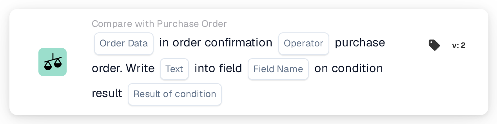

# In Order Confirmation Purchase Order

<figure><figcaption>
Version 2
</figcaption></figure>

Use **Compare with Purchase Order** in the Workflow Builder when an order confirmation needs to be checked against its purchase order. Add the card under **And...**, then choose the order data, an operator, and what should happen with the result. The screenshots below show two available card versions in the English interface. Their fields are still placeholders; set them for your own workflow before saving.

## Write the result into a field

<figure><figcaption>
Version 2: write text into a field based on the condition result.
</figcaption></figure>

Choose **Order Data** from the order confirmation and an **Operator** for the comparison with the purchase order. Enter the **Text** to write, select the **Field Name**, and choose the **Result of condition** that should trigger the write.

## Compare the data

<figure><figcaption>
Version 4: compare selected order confirmation data with purchase order data.
</figcaption></figure>

Choose **Any/All** to decide whether one or all selected conditions must match. Then select the **Order Data**, **Operator**, and **Comparison Data** for the purchase order comparison.

For the surrounding steps, see [Workflow](../../../) and [Compare with Purchase Order](./).

<!-- workflow-card-practical-example-20261021 -->

## Practical example

**When to use:** Check an order confirmation against its linked purchase order.

**Configuration:** Use a demo order and confirmation with the same supplier, article reference and compared values. Select the intended comparison direction and the fields this version offers.

**Expected result and counterexample:** The matching comparison passes. Change one compared item value in a separate test case and verify that it is detected; a missing linked order is a separate data problem.

This is an illustrative configuration and expected outcome. Use fields, users and groups configured in your test organization; it is not a claim that this example was executed.
