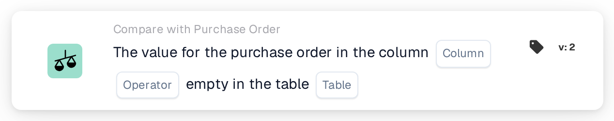

# Purchase Order Column Empty

<figure><figcaption>
Version 2
</figcaption></figure>

## Purpose:

This workflow card checks whether a column of the purchase order data is empty. It looks directly at the stored purchase order, its lines or its distributed charges, and can be used, for example, to hold back documents whose purchase order is missing information that later steps rely on.

## Components of the Card:

1. **Column**
   * **Description:** The purchase order column that is checked.
   * **Detail:** The list contains the columns of the purchase order header, the purchase order lines and the distributed charges, for example **Supplier ID**, **Unit Price**, **Qty** or **Charge Type**. The column should belong to the table selected in **Table**.
2. **Operator**
   * **Description:** Whether the column should be empty or not.
   * **Options:**
     * **Is:** The condition is met if the column is empty in at least one checked record.
     * **Is Not:** The condition is met if the column has a value in every checked record.
3. **Table**
   * **Description:** The purchase order table the column is read from.
   * **Options:**
     * **Purchase Order:** The purchase order header (one record).
     * **Purchase order line:** All lines of the purchase order.
     * **Purchase order distributed charge:** All distributed charges of the purchase order.

## Functionality:

* **Purchase Order Used:** If the workflow run carries a purchase order of its own, that purchase order is checked. Otherwise the card uses the purchase order of the first matched document line or, if no line is matched, the first purchase order loaded for the document.
* **Condition Evaluation:** The card reads all records of the selected table that belong to the purchase order and checks the selected column in each of them. A column counts as empty if it has no value, an empty text or a numeric value of 0. A yes/no value always counts as filled, also when it is "no".
* **Column not in the table:** If the selected column does not exist in the selected table, the card does not report an error. With **Is** the condition is treated as met, with **Is Not** as not met.
* **Action Execution:**
  * **True Condition:**\
    With **Is**, the column is empty in at least one record; with **Is Not**, it has a value in every record. The workflow continues.
  * **False Condition:**\
    Otherwise the workflow stops with an unmet condition.
* **Missing Data:** The card does not evaluate the condition and reports missing data in the workflow log when no purchase order is available (neither from the workflow run nor matched to the document), when **Column** or **Table** is not set, or when no record of the selected table exists for the purchase order.

## Setup and Configuration:

* The card can be added as an And condition from the **Compare with Purchase Order** category. After that, the **Column**, the operator and the **Table** can be selected. Choosing a column that belongs to the selected table avoids the silent result described above.
* **Test Card** in the card menu of the Workflow Builder can be used to try the card on an existing document.

## Conclusion:

The "Purchase Order Column Empty" workflow card checks the completeness of the purchase order data itself. It helps to stop documents early when the purchase order lacks a value that approval, export or other workflow steps depend on.
