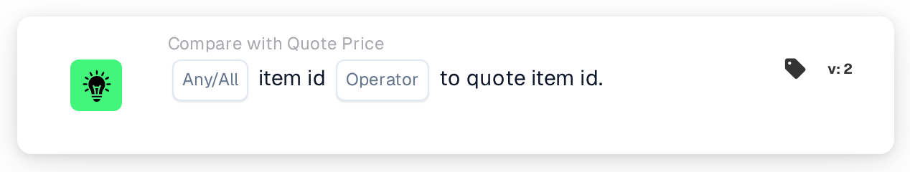

# Item ID to Quote Item ID

<figure><figcaption>
Version 2
</figcaption></figure>

## Purpose:

This workflow card compares the item number on each line of a document with the item number stored for the same supplier item in the supplier item price table. It can be used to detect lines where the document names a different item than the one the price data refers to. Based on the result, the workflow continues with the true or the false condition.

## Components of the Card:

1. **Any/All**
   * **Description:** Defines whether one line or every compared line of the document table should meet the condition.
   * **Options:**
     * **Any:** The condition is true if at least one compared line meets the condition.
     * **All:** The condition is true only if every compared line meets the condition.
2. **Operator**
   * **Description:** Defines how the item number in the supplier item price table is compared with the item number on the document line.
   * **Options:**
     * **Equals:** The item numbers are the same. Item numbers that can both be read as numbers are compared as numbers (for example "007" and "7" are equal); otherwise they are compared as text without distinguishing between upper and lower case.
     * **Not Equals:** The item numbers differ. Item numbers that can both be read as numbers are compared as numbers; otherwise they are compared as text, and here upper and lower case are distinguished.
     * **Greater Than, Greater or Equals, Less Than, Less or Equals:** Also offered by the card. With these operators the item numbers are always compared as text, character by character, so for example "10" counts as less than "9".

## Functionality:

* **Condition Evaluation:** For every line in the document table, the card looks up the line's supplier item ID (column `SUPPLIER_ITEM_NUMBER`) in the supplier item price table and compares the item number stored there with the item number of the line (column `ITEM_NUMBER`). The results of all compared lines are then combined with **Any** or **All**.
* **Skipped Lines:** A line is left out of the comparison if the supplier item price table has no entry for its supplier item ID, or if the entry has no item number. Each skipped line is noted in the workflow log.
* **Validity Dates:** If an entry in the supplier item price table has a start or end date and the document date lies outside that period, the card notes this in the workflow log. This note does not change the result of the card.
* **Action Execution:**
  * **True Condition:**\
    The item numbers meet the selected operator for any or all compared lines. The workflow continues with the true condition.
  * **False Condition:**\
    If the condition is not met, the workflow continues with the false condition, for example to send the document for a manual review. The false condition is also used if none of the lines could be compared, because no line had an item number in the supplier item price table.
* **Missing Data:** If the document has no table, has more than one table, or no lines could be read from the table, the card does not evaluate the condition and reports the missing data in the workflow log. If no **Any/All** option is set, the card notes this in the log and uses **All**.

## Setup and Configuration:

* The card can be added from the **Compare with Quote Price** category. After that, **Any** or **All** and the operator can be selected. For a check on matching item numbers, **Equals** or **Not Equals** is the usual choice. Finally, the continue condition (true or false) is set, which determines the next step in the workflow.
* The card works on documents with exactly one table, whose lines carry the supplier item ID and the item number.

## Conclusion:

The "Item ID to Quote Item ID" workflow card makes sure that the items on a document match the items the supplier item price table refers to. Lines without price data are skipped instead of being counted as differences, so the result only reflects lines that can actually be compared.
