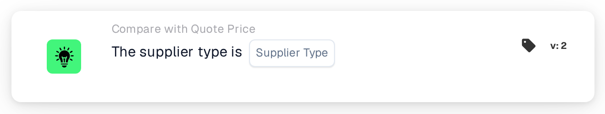

# Supplier Type

<figure><figcaption>
Version 2
</figcaption></figure>

## Purpose:

This workflow card checks the supplier type of the items in the supplier item price data of a document, for example whether the items are contract items or managed items. It can be used to apply different approval rules depending on how the supplier's items are managed. Based on the result, the workflow continues with the true or the false condition.

## Components of the Card:

1. **Supplier Type**
   * **Description:** The supplier type the document is checked against.
   * **Options:**
     * **Contract:** Matches entries whose managed class is "contract".
     * **Managed:** Matches entries whose managed class is "managed".
     * **NonManaged:** Matches entries whose managed class is "unmanaged".

## Functionality:

* **Condition Evaluation:** The card reads the supplier type (managed class) of every entry in the supplier item price data of the document and compares it with the supplier type selected on the card. The comparison does not distinguish between upper and lower case.
* **Action Execution:**
  * **True Condition:**\
    Every entry in the supplier item price data has the selected supplier type. The workflow continues with the true condition, for example to apply the rules for this supplier type.
  * **False Condition:**\
    If at least one entry has a different supplier type or no managed class, the workflow continues with the false condition.
* **Missing Data:** If no supplier type is selected on the card, or the document has no supplier item price data, the card does not evaluate the condition and reports the missing data in the workflow log.

## Setup and Configuration:

* The card can be added from the **Compare with Quote Price** category. After that, the supplier type can be selected in the **Supplier Type** field. Finally, the continue condition (true or false) is set, which determines the next step in the workflow.

## Conclusion:

The "Supplier Type" workflow card lets a quote workflow branch on the supplier type of the items, so that contract, managed and non-managed items can each be handled with their own rules.
