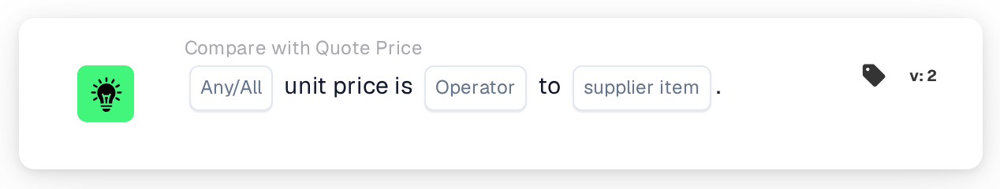

# Unit Price to Supplier Item Price

<figure><figcaption>
Version 2
</figcaption></figure>

## Purpose:

This workflow card compares the unit price on each line of a document with a price from the supplier item price table, either the managed price or the last price paid for the same supplier item. It can be used to check whether a quoted price matches, exceeds or stays below the known price before the document is approved. Based on the result, the workflow continues with the true or the false condition.

## Components of the Card:

1. **Any/All**
   * **Description:** Defines whether one line or every compared line of the document table should meet the condition.
   * **Options:**
     * **Any:** The condition is true if at least one compared line meets the condition.
     * **All:** The condition is true only if every compared line meets the condition.
2. **Operator**
   * **Description:** Defines how the unit price on the document is compared with the selected supplier item price.
   * **Options:**
     * **Equals:** The unit price is the same as the supplier item price.
     * **Not Equals:** The unit price differs from the supplier item price.
     * **Greater Than:** The unit price is higher than the supplier item price.
     * **Greater or Equals:** The unit price is higher than or the same as the supplier item price.
     * **Less Than:** The unit price is lower than the supplier item price.
     * **Less or Equals:** The unit price is lower than or the same as the supplier item price.
3. **supplier item**
   * **Description:** The price from the supplier item price table that the unit price is compared with.
   * **Options:**
     * **ManagedPrice:** The managed price stored for the supplier item.
     * **LastPrice:** The last price paid for the supplier item.

## Functionality:

* **Condition Evaluation:** For every line in the document table, the card looks up the line's supplier item ID (column `SUPPLIER_ITEM_NUMBER`) in the supplier item price table and compares the unit price of the line (column `UNIT_PRICE`) with the selected price. Both prices are compared as numbers. The results of all compared lines are then combined with **Any** or **All**.
* **Skipped Lines:** A line is left out of the comparison if its unit price is empty or cannot be read as a number, or if no price of the selected kind is stored for its supplier item, for example because the supplier item is not in the supplier item price table. Each skipped line is noted in the workflow log, together with the side that had no price.
* **Action Execution:**
  * **True Condition:**\
    The unit prices meet the selected operator for any or all compared lines. The workflow continues with the true condition, for example to approve the document.
  * **False Condition:**\
    If the condition is not met, the workflow continues with the false condition, for example to send the document for a price review.
* **Missing Data:** The card does not evaluate the condition and reports the missing data in the workflow log if:
  * no supplier item price is selected on the card,
  * the document has no matched quote data,
  * the document has no table, has more than one table, or no lines could be read from the table,
  * none of the lines could be compared because every line was skipped.

  If no **Any/All** option is set, the card notes this in the log and uses **All**.
* **Errors:** If a line of the table has no `SUPPLIER_ITEM_NUMBER` or no `UNIT_PRICE` column, the card ends with an error.

## Setup and Configuration:

* The card can be added from the **Compare with Quote Price** category. After that, **Any** or **All**, the operator and, in the **supplier item** field, the price to compare with can be selected. Finally, the continue condition (true or false) is set, which determines the next step in the workflow.
* The card works on documents with exactly one table, whose lines carry the supplier item ID and the unit price.

## Conclusion:

The "Unit Price to Supplier Item Price" workflow card checks quoted prices against the managed price or the last price paid. Lines without a price on either side are skipped, so a single incomplete line does not decide the result, and a document without any comparable line is reported as missing data.
