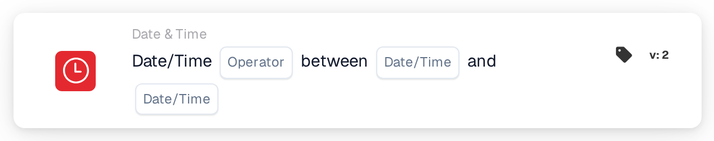

# Date or Time

<figure><figcaption>
Version 2
</figcaption></figure>

## Purpose:

This workflow card checks whether the current date and time lie inside or outside a window set on the card. It can be used to limit steps to certain hours, for example to working hours or a planned maintenance window.

## Components of the Card:

1. **Operator**
   * **Options:**
     * **Is:** The current date and time are inside the window.
     * **Is Not:** The current date and time are outside the window.
2. **First date/time**
   * **Description:** One end of the window, as date and time or as a time only.
3. **Second date/time**
   * **Description:** The other end of the window.

## Functionality:

* **Condition Evaluation:** When the workflow reaches the card, it takes the current date and time in UTC and checks whether they lie between the two values on the card. The earlier value is used as the start, so the order of the two fields does not matter.
  * A value with only a time (for example `09:00`) is used with today's date, so the window repeats every day.
  * Start and end belong to the window: at exactly the start or end time, **Is** is true.
  * A window across midnight can be entered as times only, for example `22:00` to `04:00`. The card then checks for the time from 22:00 until 04:00; the exact start and end times do not belong to the window in this case.
  * A window across midnight with full dates (for example `2026-11-01 22:00` to `2026-11-02 04:00`) is currently not evaluated correctly and should not be used.
* **Action Execution:**
  * **True Condition:**\
    If the condition is met, the workflow continues with the next cards.
  * **False Condition:**\
    If it is not met, the workflow stops with an unmet condition.
* **Missing Data:** If one of the two values is missing on the card, the card does not evaluate the condition and reports the missing input in the workflow log.

## Setup and Configuration:

* The card can be added as an And condition from the **Date & Time** category. Then the two values and the operator are set. All times should be entered in UTC.
* **Example:** With **Is**, `09:00` and `17:00`, the card is met when the workflow runs between 09:00 and 17:00 UTC on any day.

## Conclusion:

The "Date or Time" workflow card makes the time of the run a workflow condition. Steps can be limited to fixed hours or a single planned window without changing the workflow each time.
