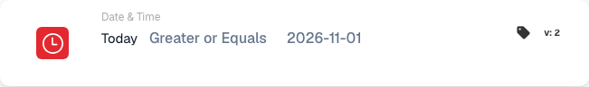

# Today

<figure><figcaption>Version 2 example: Greater or Equals, 2026-11-01. The comparison uses today&#x27;s UTC date.</figcaption></figure>

## What this card checks

This condition compares **today's UTC date at workflow execution** with a configured date. The time of day is ignored. Use it under **And → Date & Time** for a date cutoff or rollout rule.

## Configuration

Select the required comparison: equals (`eq`), not equals (`neq`), after (`gt`), on or after (`ge`), before (`lt`), or on or before (`le`). Enter an explicit date such as `2026-11-01`.

## Practical example

<!-- workflow-card-practical-example-20261023 -->

**When to use:** Allow a following action only from a planned rollout date onward.

**Configuration:** Choose **Greater or Equals** (`ge`) and `2026-11-01`.

**Expected result:** On `2026-11-01` UTC the condition is met, and it remains met on `2026-11-02` UTC. On `2026-10-31` UTC it is not met. The document's own dates do not determine this comparison.

Configure the workflow trigger and the following action separately. To evaluate a time window, use the separate Date or Time card.
