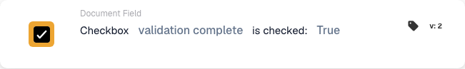

# Checkbox is checked

## When and where to use it

Use this condition when a later action depends on a checkbox on the document. For example, let an invoice continue only after its review flag has been checked.

In the workflow designer, add the card under **And… → Document Field**. The card compares the field value when the workflow runs; it does not continuously monitor an ERP field or change the checkbox.

## Prerequisites

The document type must contain a Boolean field for the checkbox. Use its exact technical identifier. This example uses `validation_complete`; replace it with the corresponding field in your organization.

## Configure the card

1. Choose **Checkbox … is checked** under **Document Field**.
2. Enter `validation_complete` in **Field Name** and confirm the value.
3. Select **True** in **Boolean** to require a checked checkbox. Select **False** to check that it is unchecked.

## Practical example: continue after review

**When to use it:** an invoice needs a prior review, and the process records completion in `validation_complete`.

**Where to put it:** in the **And…** conditions, before the follow-up action configured in **Then…**. Configure the action and the event that starts the workflow separately.

**Example configuration:** field `validation_complete`, comparison **True** (`true`), card version 2.

<figure><figcaption>
Version 2 example: validation complete compared with True.
</figcaption></figure>

The expected results for this configuration are:

| Field value on the document | Condition result |
| --- | --- |
| Existing, checked checkbox (`true`) | The condition passes. |
| Existing, unchecked checkbox (`false`) | The condition does not pass. |
| Existing checkbox with an empty value (`None`) | Treated as unchecked; the condition does not pass. |
| The field is missing from the document | `NOT_FOUND_IN_DOCUMENT`; this differs from an existing, unchecked checkbox. |

If you select **False**, an existing unchecked checkbox passes and a checked checkbox does not. A missing field still produces a different error result.

## Check before activating

Check that the selected field is Boolean and belongs to the document type in use. Test a document with the checkbox checked, another with it unchecked, and the missing-field case. Inspect the card result and subsequent workflow path in each case.

This card checks the checkbox state; the preceding process must set the review flag. Checking it automatically without performing the review does not demonstrate that a review was completed.
