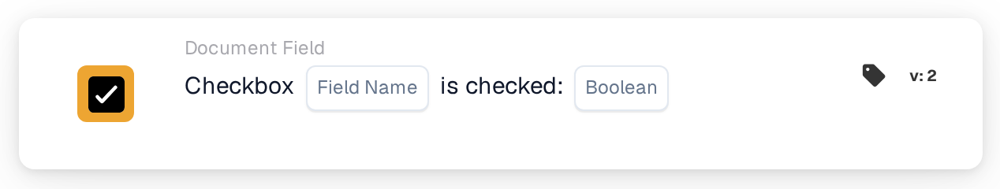

# Checkbox is checked

<figure><figcaption>
Version 2
</figcaption></figure>

## Purpose:

This workflow card checks whether a checkbox field on the document is checked or unchecked. It can be used to let a workflow continue only after a flag has been set on the document, for example a review flag.

## Components of the Card:

1. **Field Name**
   * **Description:** The technical name of the checkbox field on the document.
   * **Detail:** The field should be a checkbox (Boolean) field of the document type.
2. **Boolean**
   * **Description:** The state the checkbox should have.
   * **Options:**
     * **True:** The checkbox should be checked.
     * **False:** The checkbox should be unchecked.

## Functionality:

* **Condition Evaluation:** When the workflow reaches the card, it reads the current value of the field on the document and compares it with **Boolean**. The card does not watch the field over time and does not change it.
  * An empty checkbox value counts as unchecked.
  * If no **Boolean** value is selected, the card checks for an unchecked checkbox.
  * If the field is not a checkbox field, the card notes this in the workflow log and still compares its value.
* **Action Execution:**
  * **True Condition:**\
    If the checkbox state matches **Boolean**, the workflow continues with the next cards.
  * **False Condition:**\
    If it does not match, the workflow stops with an unmet condition.
* **Missing Data:** If the field does not exist on the document, the card does not evaluate the condition. It reports that the field was not found on the document, which is a different result from an unchecked checkbox.

## Setup and Configuration:

* The card can be added as an And condition from the **Document Field** category. Then the technical name of the checkbox field is entered in **Field Name** and **True** or **False** is selected.
* **Test Card** in the card menu of the Workflow Builder can be used to check the configuration on a document with the checkbox checked, one with it unchecked, and one without the field.

## Conclusion:

The "Checkbox is checked" workflow card turns a checkbox on the document into a workflow condition. This lets a workflow wait for a manual step, such as a completed review, before the following actions run.
