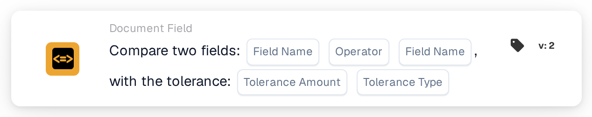

# Compare two Fields with Tolerance

<figure><figcaption>
Version 2
</figcaption></figure>

## **Purpose:**

This workflow card is designed to automate actions by comparing the values of two specified document fields, with the added ability to apply a tolerance value. This feature enables the system to consider a margin of error (tolerance) when comparing field values, allowing for more flexible decision-making within workflows.

## **Components of the Card:**

1. **Field Name (1)**
   * **Description:** Specifies the first document field to be compared.
   * **Detail:** This must match the exact identifier of the first field within the document.
2. **Operator**
   * **Description:** Defines the type of comparison to be performed between the two fields.
   * **Options:**
     * **Equals (=):** Checks if the values of the two fields are equal.
     * **Not Equals (≠):** Ensures the values of the two fields are different.
     * **Greater Than (>):** Confirms that the value of the first field is greater than the second field.
     * **Greater or Equals (≥):** Validates that the value of the first field is equal to or greater than the second field.
     * **Lesser Than (<):** Checks if the value of the first field is less than the second field.
     * **Less or Equals (≤):** Ensures the value of the first field is less than or equal to the second field.
3. **Field Name (2)**
   * **Description:** Specifies the second document field to be compared against the first field.
   * **Detail:** This should match the exact identifier of the second field within the document.
4. **Tolerance Amount**
   * **Description:** Defines the acceptable margin of error for the comparison.
   * **Detail:** The tolerance amount is a numeric value that indicates the maximum allowable difference between the two field values for the comparison to be considered true.
5. **Tolerance Type**
   * **Description:** Specifies the unit of measurement for the tolerance amount.
   * **Options:**
     * **Value:** The tolerance is an absolute value, meaning the two fields can differ by the specified tolerance amount.
     * **Percent:** The tolerance is calculated as a percentage of the second field value, allowing for a relative margin of error.

## **Functionality:**

* **Condition Evaluation:** The system evaluates whether the values in the two specified fields satisfy the comparison condition, considering the defined tolerance. If the absolute or relative difference between the two fields falls within the tolerance, the condition is considered true.
* **Action Execution:**
  * **True Condition:**\
    If the values of the two fields, after considering the tolerance, match the comparison condition, the system triggers the associated actions. These actions could include progressing the workflow, updating records, triggering alerts, or enabling certain operations.
  * **False Condition:**\
    If the values of the two fields, after considering the tolerance, do not match the specified condition, alternative actions or no actions may be executed, depending on the configuration of the workflow.

## **Setup and Configuration:**

* Users configure the card by selecting the two fields to be compared from a list of available fields in the system. The operator is selected from a dropdown list of available comparison options. Users enter the tolerance amount and choose the tolerance type (value or percent).

## **Conclusion:**

The "Compare Two Fields with Tolerance" workflow card is a powerful tool for comparing document fields while accounting for permissible deviations in the data. By applying tolerance to field comparisons, this card adds flexibility to the workflow, enabling it to handle real-world data variations. It improves decision-making, supports data validation, and enhances overall workflow automation.

<!-- workflow-card-practical-example-20261021 -->

## Practical example

**When to use:** Accept a small difference between an extracted amount and a separately calculated amount.

**Configuration:** Select numeric fields `net_total` and `calculated_total`, equality comparison and an absolute tolerance of `5`. Use values `103` and `100`.

**Expected result and counterexample:** The difference is `3`, so it is within the tolerance. With `110` and `100`, the difference is `10` and the equality-with-tolerance condition fails.

This is an illustrative configuration and expected outcome. Use fields, users and groups configured in your test organization; it is not a claim that this example was executed.
