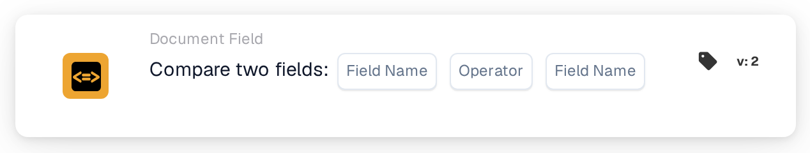

# Compare two Fields

<figure><figcaption>
Version 2
</figcaption></figure>

## **Purpose:**

This workflow card is designed to automate actions by comparing the values of two specified document fields. It enables dynamic decision-making based on field data and ensures workflows execute based on comparisons between different document values.

## **Components of the Card:**

1. **Field Name (1)**
   * **Description:** Specifies the first document field to be compared.
   * **Detail:** This must match the exact identifier of the first field within the document.
2. **Operator**
   * **Description:** Defines the type of comparison to be performed between the two fields.
   * **Options:**
     * **Equals (=):** Checks if the values of the two fields are equal.
     * **Not Equals (≠):** Ensures the values of the two fields are different.
     * **Greater Than (>):** Confirms that the value of the first field is greater than the second field.
     * **Greater or Equals (≥):** Validates that the value of the first field is equal to or greater than the second field.
     * **Lesser Than (<):** Checks if the value of the first field is less than the second field.
     * **Less or Equals (≤):** Ensures the value of the first field is less than or equal to the second field.
3. **Field Name (2)**
   * **Description:** Specifies the second document field to be compared against the first field.
   * **Detail:** This should match the exact identifier of the second field within the document.

## **Functionality:**

**Condition Evaluation:** The system evaluates whether the values in the two specified fields satisfy the comparison condition defined by the operator.

**Action Execution:**

* **True Condition:**\
  If the values of the two fields match the comparison condition, the system triggers the associated actions. These actions could include updating records or triggering alerts.
* **False Condition:**\
  If the values of the two fields do not match the specified condition, alternative actions or no actions may be executed, depending on the configuration of the workflows.

## **Setup and Configuration:**

* Users configure the card by selecting the two fields to be compared from a list of available fields in the system. The operator is selected from a dropdown list of available comparison options.

## **Conclusion:**

The "Compare Two Fields" workflow card is an essential tool for comparing data between fields within documents. By automating actions based on field comparisons, this card helps optimize decision-making, supports data validation, and enhances workflow automation.

<!-- workflow-card-practical-example-20261021 -->

## Practical example

**When to use:** Check that a copied reference equals the original reference.

**Configuration:** Select text fields `purchase_order_number` and `confirmed_order_number` and the equals operator.

**Expected result and counterexample:** Values `PO-DEMO-001` and `PO-DEMO-001` pass. A second value of `PO-DEMO-002` fails.

This is an illustrative configuration and expected outcome. Use fields, users and groups configured in your test organization; it is not a claim that this example was executed.
