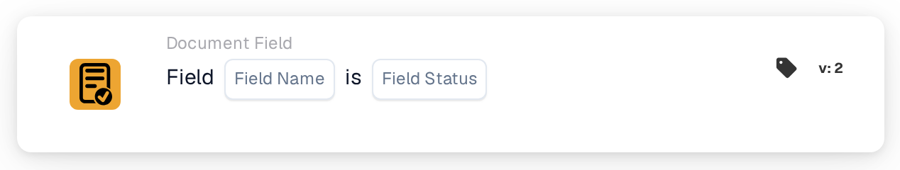

# Field is

<figure><figcaption>
Version 1
</figcaption></figure>

<figure><figcaption>
Version 2
</figcaption></figure>

## When to use it

Use this card to check whether a document field is empty or missing, for example when an invoice has no invoice number and needs an additional check. This is a condition; configure the subsequent action separately.

**Where:** Standard workflow → additional conditions (AND) → Document Field.

## Configuration — version 2

| Setting | Example value |
| --- | --- |
| Field | `invoice_id` — invoice number |
| Field status | Empty or missing (`field_empty`) |

Select an actual field configured in your organization. The `field_not_empty` option checks whether the field contains a value.

<!-- workflow-card-practical-example-20261021 -->

## Practical example

| Example value | Expected result for `field_empty` |
| --- | --- |
| Empty or missing field | Condition met |
| `DEMO-001` | Condition not met |
| Number present but incorrect | Condition not met — the field still contains a value |

These are expected-result examples. Add an appropriate content condition to validate the number itself; this card checks the field state. In version 2, leading and trailing spaces are removed from text before checking whether the field is empty.

## Administrator example video

When I use the card, where to find it and how to detect missing invoice numbers. The examples show expected results.



[Open video with English captions](https://docbits-videos.fra1.cdn.digitaloceanspaces.com/settings-assistant/workflow-card-field-status-admin/v1/en-theme-v4.html)

[Read transcript](https://docbits-videos.fra1.cdn.digitaloceanspaces.com/settings-assistant/workflow-card-field-status-admin/v1/en.txt)
