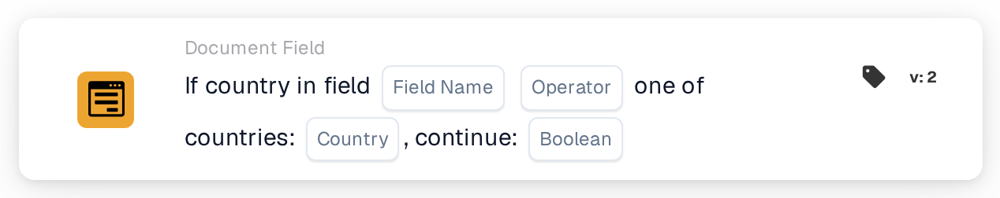

# If Country in Field is One of

<figure><figcaption>
Version 2
</figcaption></figure>

Use this condition when an additional processing step should apply to documents from selected countries, for example Germany and France. The card compares the country read from a document field with a configured country list.

**Where:** Standard workflow → additional conditions (AND) → Document Field. Configure the subsequent action separately under THEN.

## Configuration — version 2

| Setting | Value |
| --- | --- |
| Field | An existing text field containing the country name |
| Operator | `is` |
| Countries | `Germany, France` |
| Continue value | `true` |

<!-- workflow-card-practical-example-20261021 -->

## Practical example

| Country field value | Expected condition |
| --- | --- |
| `Germany` | Met |
| `France` | Met |
| `United States` | Not met |

The country names shown as code are fixed input values for this example.

## Limits and checks

`false` does not invert the comparison. Even a matching country does not produce a positive condition with that setting. To check the opposite condition, select `isnot` with `true`.

Handle missing fields and empty country values separately; they can return a missing-data result rather than an ordinary non-match.

Source inspection of the development version dated 22 October 2026 shows a conversion error for ISO inputs such as `DE` and `DEU`. These examples therefore use full country names. Check ISO-code handling separately in your installed version.
