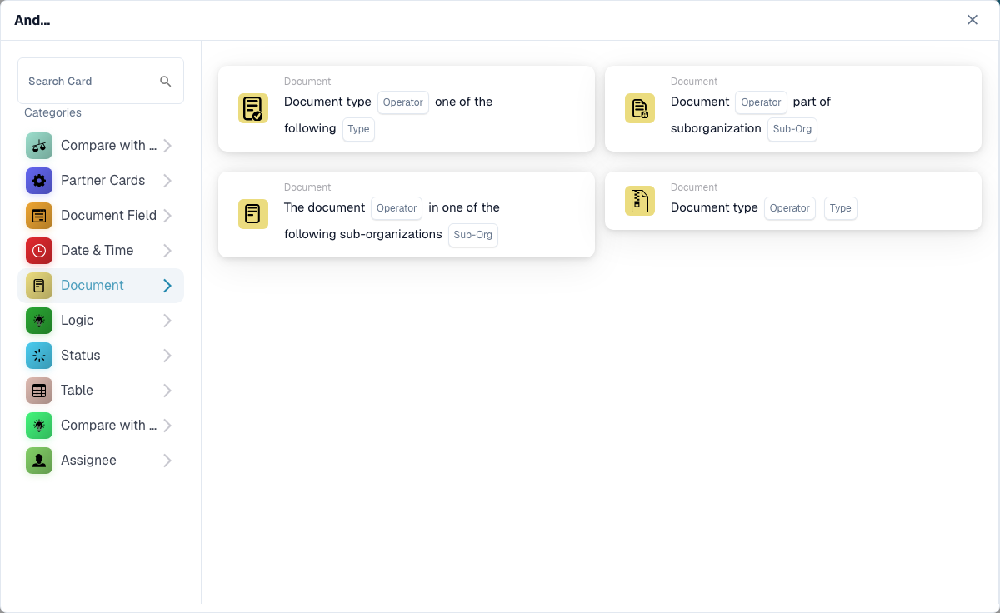

# Document

The cards in this category, shown in the **Add Card** library of the Workflow Builder:

<figure><figcaption>
The cards in this category.
</figcaption></figure>

<!-- workflow-card-example-condition_sub_org_is_isnot_in_list-20261021 -->

### Document in one of several suborganizations

<figure><figcaption>
Card fields in the displayed version. The placeholders are not configured.
</figcaption></figure>

`CONDITION_SUB_ORG_IS_ISNOT_IN_LIST` · version 2

Select is-one-of and configured suborganizations `Demo North` and `Demo South`. A document belonging to either selected unit passes; `Demo Default` fails. This checks the document suborganization; it does not change it.
