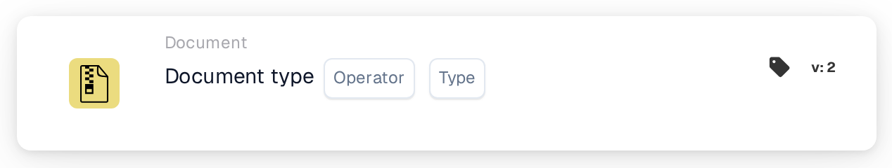

# Document Type

<figure><figcaption>
Version 1
</figcaption></figure>

<figure><figcaption>
Version 2
</figcaption></figure>

## Purpose:

This workflow card is designed to evaluate whether a document matches a specific type. By checking if the document corresponds to the given type, workflows can continue or take alternative actions based on this condition. This helps to automate processes where the document type dictates the next steps in the workflow.

## Components of the Card:

1. **Operator**
   * **Description**: Defines whether the document should be of the specified type or not.
   * **Options**:
     * **Is**: The document must match the specified type for the condition to be true.
     * **Is Not**: The document must not match the specified type for the condition to be true.
2. **Type**
   * **Description**: Specifies the document type to compare against.
   * **Detail**: This includes a variety of document types such as "Invoice", "Purchase Order", etc., based on which the condition (is/is not) will be evaluated.

## Functionality:

* **Condition Evaluation**: The system evaluates whether the document type in the specified field matches the condition defined by the operator. It compares the field value with the provided document type.
* **Action Execution**:
  * **True Condition**: If the document type matches the specified type (or does not, based on the operator), the workflow proceeds with the true condition. This can trigger actions such as further processing of the document, sending it for approval, or applying specific rules based on the document type.
  * **False Condition**: If the document type does not match the specified type, the workflow proceeds with the false condition. This can trigger alternative actions, such as routing the document to a different process or stopping further actions.

## Setup and Configuration:

* Users configure the card by selecting the document field that contains the document type from a list of available fields. Then, the operator is selected to define whether the document must be the specified type or not. Finally, users set the continue condition (true or false), which determines the next action based on the document type.

## Conclusion:

The "Document Type Comparison" workflow card is essential for ensuring that workflows proceed based on the type of document being processed. By comparing the document type, it helps organizations automate document routing and processing tasks, ensuring that documents are handled appropriately based on their type.

<!-- workflow-card-practical-example-20261021 -->

## Practical example

**When to use:** Run an invoice-specific check.

**Configuration:** Select document type `Invoice` and the equals operator.

**Expected result and counterexample:** An invoice passes. A credit note does not pass this condition.

This is an illustrative configuration and expected outcome. Use fields, users and groups configured in your test organization; it is not a claim that this example was executed.
