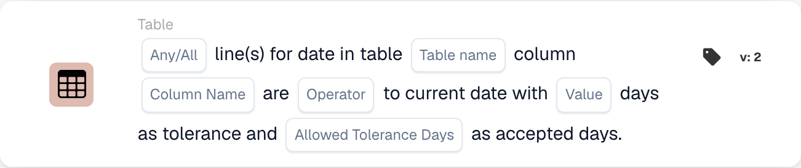

# Table

The cards in this category, shown in the **Add Card** library of the Workflow Builder:

<figure><figcaption>
The cards in this category.
</figcaption></figure>

<!-- workflow-card-example-condition_table_column_exists-20261021 -->

### Document table contains a column

<figure><figcaption>
Card fields in the displayed version. The placeholders are not configured.
</figcaption></figure>

`CONDITION_TABLE_COLUMN_EXISTS` · version 2

Select table `lines`, column `article_number` and the exists operator. A populated table containing that column passes; the same table without the column fails the existence comparison. An absent or empty table may produce a missing-data result and is not proof of a successful negative comparison.

<!-- workflow-card-example-condition_compare_table_date_to_current_date-20261021 -->

### Dates in a table against the reference date

<figure><figcaption>
Card fields in the displayed version. The placeholders are not configured.
</figcaption></figure>

`CONDITION_COMPARE_TABLE_DATE_TO_CURRENT_DATE` · version 2

For reference date `2026-10-21`, compare table `lines`, column `delivery_date`, later-than, All, and zero day tolerance. Rows dated `2026-10-22` and `2026-10-23` satisfy the comparison. A row dated `2026-10-20` makes All fail. Test missing and invalid dates separately.
