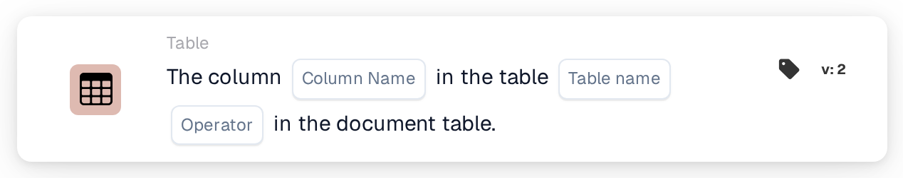

# Column Exists in Table

<figure><figcaption>
Version 2
</figcaption></figure>

## Purpose:

This workflow card checks whether a document table contains a specific column. It can be used to run follow-up cards only for documents whose table carries the required data, for example a delivery date or an item number column, or to route documents with a different table layout elsewhere. Based on the result, the workflow continues with the true or the false condition.

## Components of the Card:

1. **Column Name**
   * **Description:** The name of the column the card looks for.
   * **Detail:** The column name is compared without distinguishing between upper and lower case.
2. **Table name**
   * **Description:** The name of the document table that is checked.
   * **Detail:** The table name is compared without distinguishing between upper and lower case.
3. **Operator**
   * **Description:** Defines whether the column should be present in the table or not.
   * **Options:**
     * **Is:** The condition is true if the table contains the column.
     * **Is Not:** The condition is true if the table does not contain the column.

## Functionality:

* **Condition Evaluation:** The card looks for the document table with the given name and checks whether the first row of that table has a column with the given name. The column found, or the columns that were present instead, are noted in the workflow log.
* **Action Execution:**
  * **True Condition:**\
    With **Is**, the column is in the table. With **Is Not**, it is not. The workflow continues with the true condition, for example to run a comparison on this column.
  * **False Condition:**\
    If the condition is not met, the workflow continues with the false condition.
* **Missing Data:** The card does not evaluate the condition and reports the missing data in the workflow log if no column name or no table name is set on the card, if the document has no table with the given name, or if that table has no rows or its first row has no columns.
* **Errors:** If no operator or an operator other than **Is** or **Is Not** is set, the card reports a setup error.

## Setup and Configuration:

* The card can be added from the **Table** category. After that, the column name, the table name and the operator (**Is** or **Is Not**) can be set. Finally, the continue condition (true or false) is set, which determines the next step in the workflow.

## Conclusion:

The "Column Exists in Table" workflow card checks the layout of a document table before its data is used. Placed before other table cards, it helps make sure that those cards only run on documents that carry the expected column.
