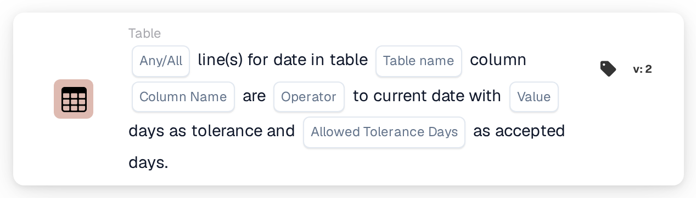

# Table Date to Current Date

<figure><figcaption>
Version 2
</figcaption></figure>

How the tolerance window is calculated, with examples such as "today or tomorrow", is explained on [Date Tolerances](../../date-tolerances.md).

## Purpose:

This workflow card compares a date in each line of a document table, for example a delivery date, with the current date. A tolerance in days can be set, and the days of the week that count can be chosen, so that for example only business days are used. It can be used to check whether the dates on a document are in the past, today, within a few days, or in the future. Based on the result, the workflow continues with the true or the false condition.

## Components of the Card:

1. **Any/All**
   * **Description:** Defines whether one line or every line of the table should meet the condition.
   * **Options:**
     * **Any:** The condition is true if at least one line meets the condition.
     * **All:** The condition is true only if every line meets the condition.
2. **Table name**
   * **Description:** The name of the document table that holds the dates.
3. **Column Name**
   * **Description:** The column of the table that holds the date.
4. **Operator**
   * **Description:** Defines how the date in the table is compared with the current date, taking the tolerance into account.
   * **Options:**
     * **Equals:** The date lies within the tolerance range around the current date.
     * **Not Equals:** The date lies outside the tolerance range.
     * **Greater Than:** The date lies after the tolerance range.
     * **Greater or Equals:** The date lies within or after the tolerance range.
     * **Less Than:** The date lies before the tolerance range.
     * **Less or Equals:** The date lies within or before the tolerance range.
5. **Value**
   * **Description:** The tolerance in days.
   * **Detail:** The tolerance range reaches this number of days before and after the current date. Only the days selected under **Allowed Tolerance Days** are counted. If no value is set, a tolerance of 0 days is used, so the range is the current date only.
6. **Allowed Tolerance Days**
   * **Description:** The days of the week that count as accepted days.
   * **Options:** Monday to Sunday, several days can be selected.

## Functionality:

* **Condition Evaluation:** The card reads the date in the selected column for every line of the first table with the given name and compares it with the current date (the date in UTC). The tolerance range is calculated by counting the given number of days forward and backward from the current date. Days of the week that are not selected are not counted, so the range extends past them, and they stay inside the range. For example, with a tolerance of 2 days, only Monday to Friday selected and a Friday as the current date, the range runs from Wednesday to the following Tuesday.
* **Accepted Days:** In addition to the comparison, the date of each line should fall on one of the selected days of the week. A line meets the condition only if both checks pass. The results of all lines are then combined with **Any** or **All**.
* **Action Execution:**
  * **True Condition:**\
    The dates meet the selected operator and fall on accepted days, for any or all lines. The workflow continues with the true condition.
  * **False Condition:**\
    If the condition is not met, the workflow continues with the false condition, for example to send the document for a manual review.
* **Missing Data:** The card does not evaluate the condition and reports the missing data in the workflow log if no table name, column name or accepted days are set on the card, if the document has no table with the given name, if a line of the table does not have the column, or if the table has no lines. If no **Any/All** option is set, the card notes this in the log and uses **All**.
* **Errors:** If a value in the date column cannot be read as a date, the card ends with an error.

## Setup and Configuration:

* The card can be added from the **Table** category. After that, **Any** or **All**, the table name, the column name, the operator, the tolerance in days and the accepted days of the week can be set. Finally, the continue condition (true or false) is set, which determines the next step in the workflow.

## Conclusion:

The "Table Date to Current Date" workflow card checks line-item dates against today, with a tolerance that can be limited to business days or any other set of weekdays. This helps flag documents with dates that are too early, too late or on days that are not accepted.
