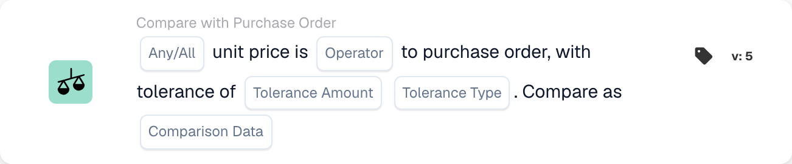

# Card versions and availability

<figure><figcaption>
Card fields in the displayed version. The placeholders are not configured.
</figcaption></figure>

A card in a saved workflow retains its card ID and version. A newer template can add fields or change behavior without changing every previously saved workflow. Check the version on the actual card before applying instructions for a newer version.

## Before changing a saved card

1. Record its fields and current result on representative test data.
2. Compare its version with the reference, including defaults and missing-data behavior.
3. Upgrade or replace the card only through the supported builder action and review its settings again.
4. Validate the graph and test passing, failing and missing-data cases before activating the changed workflow.

Do not edit a stored technical card type merely to correct its spelling. Existing workflows can depend on that identifier. An unsupported version is an execution error, not a false business condition.

## If a documented card is absent

Check the selected When, And or Then group, category, Standard versus Advanced builder, enabled modules, permissions and deployed release with your administrator. A card mentioned in a technical integration or newer reference is not necessarily enabled for your organization. Do not create or import a guessed card definition to work around a missing template.

The additional calendar conditions described in some development material are not a confirmed selectable set in every release. The Document-variable setter is also implemented without a generally seeded UI template. Use the cards actually available in your environment and request clarification before depending on an unavailable one.

## References that depend on the version

- [Export cards](export-cards-guide.md): result status and immediate versus queued export.
- [PO comparison cards](po-comparison-versions-guide.md): comparison direction and tolerance base.
- [Quote comparison cards](quote-comparison-guide.md): Any/All and missing comparable prices.
- [Logic cards](logic-cards-guide.md): tags, organization variables and input types.

Use [Workflow Logs](../workflow-logs.md) to distinguish success, a false condition, missing data, a setup error and a skipped card. Record the document state and card settings with a test result; a screenshot of the card picker alone does not establish runtime behavior.
