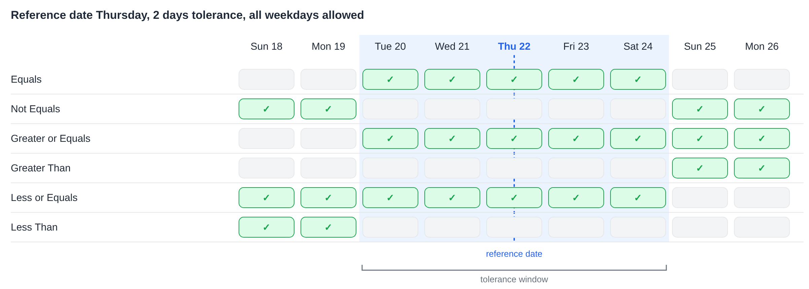
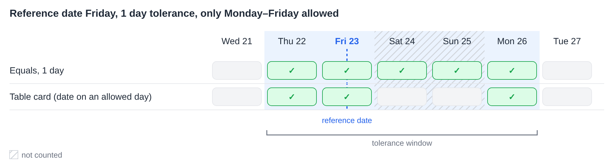
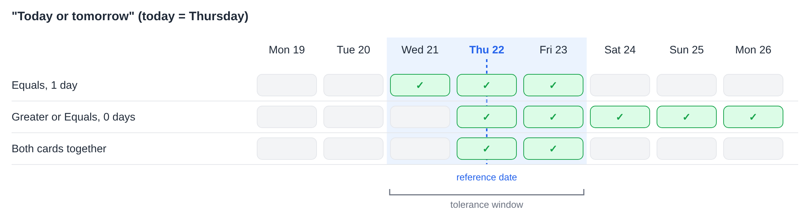

# Date Tolerances

Several workflow cards compare a date with a reference date and accept a tolerance of a number of days. They all calculate the tolerance the same way. This page explains that calculation, what each operator means, how the **Allowed Tolerance Days** work, and how to combine two cards for ranges such as "today or tomorrow".

The cards that use this calculation:

* [Table Date to Current Date](and/table/table-date-to-current-date.md) – a date in a document table compared with the current date.
* [Promised delivery date for line items in table with promised delivery date](and/compare-with-purchase-order/promised-delivery-date-for-line-items-in-table-with-promised-delivery-date/README.md) – promised delivery dates of line items compared with the current date.
* [Promised Delivery Date on Purchase Order](and/compare-with-purchase-order/promised-delivery-date-on-purchase-order.md) – delivery dates of line items compared with the delivery date on the purchase order.

## The Tolerance Window

From the reference date, the tolerance is counted backwards and forwards. The result is a **tolerance window**: from the start date to the end date, both included.

* With a tolerance of **0 days**, the window is only the reference date itself.
* With a tolerance of **2 days**, the window reaches 2 days before and 2 days after the reference date.
* The **current date** is the date on the DocBits servers, which run in **UTC**.

Each operator compares the date with this window:

| Operator | True when the date is … |
|---|---|
| **Equals** | inside the window |
| **Not Equals** | outside the window |
| **Greater or Equals** | on or after the **start** of the window |
| **Greater Than** | after the **end** of the window |
| **Less or Equals** | on or before the **end** of the window |
| **Less Than** | before the **start** of the window |

Note that the tolerance also widens **Greater or Equals** and **Less or Equals**: with 2 days, **Greater or Equals** already accepts a date 2 days before the reference date.

<figure><figcaption>
Reference date Thursday 22, 2 days tolerance: the window runs from Tuesday 20 to Saturday 24.
</figcaption></figure>

## Allowed Tolerance Days

Cards that offer **Allowed Tolerance Days** only count the selected weekdays when the window is calculated. Weekdays that are not selected are skipped while counting, but they stay inside the window.

**Example:** reference date Friday, 1 day tolerance, only Monday to Friday selected. Counting backwards reaches Thursday. Counting forwards skips Saturday and Sunday and reaches Monday. The window is **Thursday to Monday**.

**Table Date to Current Date** adds one more check: the date in the table also has to fall on one of the selected weekdays. A Saturday inside the window is therefore not accepted by this card. The two other cards do not have this extra check.

<figure><figcaption>
Only Monday to Friday are counted, so 1 day after Friday is Monday.
</figcaption></figure>

## Example: Today or Tomorrow

A single card cannot accept exactly "today or tomorrow", because the window always reaches the same number of days in both directions. Two cards one after the other can:

1. **Equals** with **1 day** tolerance accepts yesterday, today and tomorrow.
2. **Greater or Equals** with **0 days** tolerance accepts today and every later day.

Only dates that pass both cards remain: **today and tomorrow**.

<figure><figcaption>
Today is Thursday 22: together the two cards accept Thursday 22 and Friday 23.
</figcaption></figure>

The same way, other ranges can be built:

| Range | First card | Second card |
|---|---|---|
| Today or tomorrow | **Equals**, 1 day | **Greater or Equals**, 0 days |
| Yesterday or today | **Equals**, 1 day | **Less or Equals**, 0 days |
| Today up to 3 days ahead | **Equals**, 3 days | **Greater or Equals**, 0 days |
| Not today | **Not Equals**, 0 days | – |
| From the day after tomorrow | **Greater Than**, 1 day | – |

When only Monday to Friday are selected as **Allowed Tolerance Days**, "tomorrow" on a Friday is the following Monday.

## Conclusion

All date cards with a tolerance use one window around the reference date. Knowing where the window starts and ends makes it clear what each operator accepts, and two cards together can cover ranges that a single card cannot.
