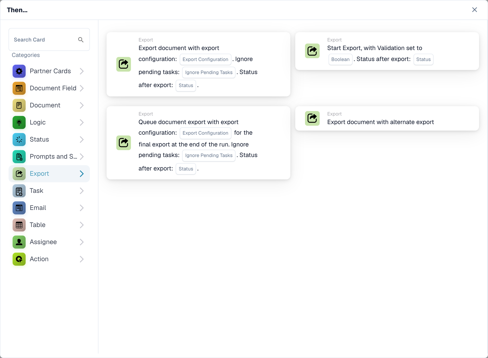

# Workflow export cards and document status

<figure><figcaption>
Available cards in the selected category. Configure the placeholders before use.
</figcaption></figure>

Choose whether to export immediately or queue a configuration for the final export at the end of the run. These choices are separate from the status the document should have after a successful export.

| Card | When the export runs | Important settings |
| --- | --- | --- |
| Start Export with Validation (`EXPORT`) | Starts the export using the document's configured export settings. | Validation and, from v4, Status after export. |
| Export with Export Configuration (`ACTION_EXPORT_WITH`) | Exports using the selected configuration during card execution. | Export configuration, Ignore pending tasks and, from v3, Status after export. |
| Queue export with configuration (`ACTION_EXPORT_WITH_CONFIG_DEFERRED`) | Collects the configuration for the final export at the end of the run. Adding an export request to the queue does not prove that the final export succeeded. | Export configuration, Ignore pending tasks and, from v3, Status after export. |
| Alternate Export (`ACTION_ALTERNATE_EXPORT`) | Uses the alternate export route documented on its card. | Do not assume it has the same version or status options as the three cards above. |

## Status after export

| Value | Meaning after a successful export | Typical use |
| --- | --- | --- |
| `finished` | Exported and closed. | Processing is complete. |
| `exported` | Exported but remains open for further processing. | Approval or another workflow still needs to follow. |

Start Export v4, Export with Export Configuration v3 and queued export v3 offer this selection. Earlier versions retain `finished`. A missing selection falls back to `finished` and is logged; an invalid value is rejected before export. A saved old card does not acquire the new behavior merely because a new template version exists. Inspect the card version and retest any explicit upgrade.

The document-status conditions and Change Status also offer `exported` in releases containing the corresponding status update. Changing status alone does not perform an export. Use the export result and logs to establish that data actually reached its destination.

## Immediate export with configuration

1. Add the card under Then and select a valid export configuration.
2. Choose whether to ignore pending tasks. Keep this off if tasks must block export.
3. On v3 select `finished` or `exported` deliberately.
4. Test with a document in an allowed processing status, then inspect the card result and destination.

If pending tasks prevent export, the card records a refused export. Resolve the tasks and arrange the intended workflow trigger or retry. This card does not promise to wait and resume automatically. A timeout also does not prove that the remote system did nothing; inspect the export history before repeating an operation that could create duplicates.

## Queue export with configuration

Add this card when the export should be collected for the final step of the run. Select the configuration, pending-task policy and result status. The card records the requested configuration; inspect the final-export result separately. The message confirming the queued request is not a confirmation of an accounting posting.

For example, select `exported` when a successful export must leave the document available for a later approval. Select `finished` when no further processing is required. Recheck the final state as well as the export destination.

## Required checks

Test a valid configuration, a missing configuration, pending tasks with both settings, and both result statuses. Test the version already used in an existing workflow before changing it. For a queued export verify the final execution; for an immediate export verify its own result. Review [Workflow Logs](../workflow-logs.md) and do not confuse a skipped card with success.

<!-- workflow-card-complete-example-20261021 action_export_with_config_deferred -->

### Deferred export example

**Configuration:** On v3 choose test configuration `DEMO_EXPORT`, leave Ignore pending tasks off and select `exported` as the status after export. Place the card in the intended validated route.

**Expected result and counterexample:** The card collects an export request for the end of the workflow execution. Only successful final execution establishes that the destination received the data and that the document remains open as `exported`. A queued-card success alone does not prove export; an unresolved blocking task must not be treated as delivery.

This is an illustrative test configuration and expected outcome; it was not executed. Use data and recipients configured in your test organization.
