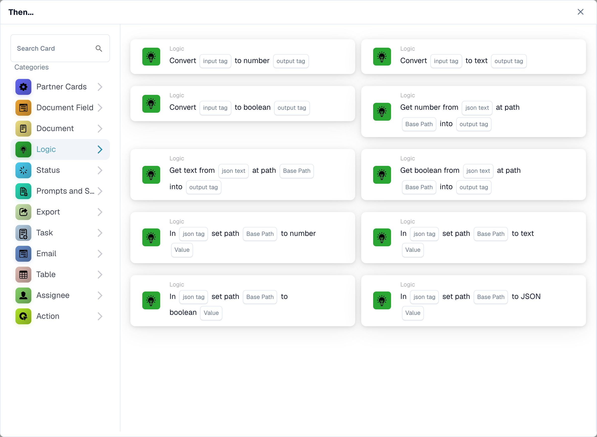

# Logic cards: variables, conversions, JSON and triggers

<figure><figcaption><p>Conversion and JSON cards in the card library. Organization-variable cards require the Advanced Builder; visible templates also depend on the release.</p></figcaption></figure>

Use these cards in the Advanced Workflow Builder where the selected card is available. Card visibility depends on your release and enabled templates. The references below describe version 2. Keep the version stored in an existing workflow in mind when comparing its fields with this guide.

## Choose the right value store

An organization workflow variable selected from the Variables panel is shared across workflows and is saved independently of the canvas. A named tag used by conversion, JSON and tag-comparison cards belongs to the current execution context. Creating a tag does not create an organization variable. Enter the tag name without an internal storage prefix. A document field is a third, separate source of data.

An organization variable and an execution tag remain separate even when their names match. Select a compatible variable field or explicitly supply the value the receiving card expects. See [Variables](../advanced-workflow-builder/variables.md) for organization scope and immediate persistence.

## Organization-variable actions

Create the variable with the correct type first and select it on the card. An absent variable reference reports `MISSING_VARIABLE`. The cards that set variables record the previous and new value in the card log. Avoid real personal or confidential data in test values and shared logs.

| Card | Required input | Result and example | Failure or boundary case |
| --- | --- | --- | --- |
| `ACTION_LOGIC_SET_TEXT_VAR` | Text variable and `value` | Stores text; for example, set a routing label to `review`. | A missing value is different from an intentionally empty text value. |
| `ACTION_LOGIC_SET_NUMBER_VAR` | Variable of type Number and numeric `value` | Stores a finite number; for example, set a threshold to `1000.50`. | Invalid numeric text, infinity and NaN are rejected. Use a decimal point, without a currency symbol. |
| `ACTION_LOGIC_CALC_NUMBER` | Number variable and `expression` | Stores the arithmetic result; `(100 + 20) / 2` gives `60`. | Supports numeric literals, parentheses, `+`, `-`, `*`, `/`, `%` and `**`. Names, function calls and document-field references are not accepted in the expression. Invalid expressions or division by zero fail. |
| `ACTION_LOGIC_SET_BOOLEAN_VAR` | Yes/No variable and `value` | Sets the flag to Yes or No. | Use the Boolean value offered by the card rather than a translated free-text synonym. |
| `ACTION_LOGIC_INVERT_BOOLEAN` | Yes/No variable | Reverses its current value; Yes becomes No. | Initialize the variable before relying on a particular first result. |

### Document-reference action

`ACTION_LOGIC_SET_DOCUMENT_VAR` stores the current document ID in a selected Document variable. It needs a current document; without one it reports `NO_DOCUMENT`. A triggered workflow receives the document ID, not a serialized document object. The checked implementation has no seeded UI card template for this action, so do not expect it to appear in every card picker. Use it only if your administrator confirms that a matching template is available; entering a document ID into the variable-creation form is not a substitute.

## Tags and type conversions

These actions use tag names in the current execution context. Produce the input tag before reading it. A missing input tag or missing name reports `MISSING_VARIABLE`; an invalid numeric conversion reports a setup error. The output is a new or overwritten tag, not an extracted document field.

| Card | Inputs | Output and example |
| --- | --- | --- |
| `ACTION_LOGIC_CREATE_TEXT_TAG` | `tag_name`, `value` | Creates a text tag; `raw_amount` with value `125.50`. An empty text value is allowed. |
| `ACTION_LOGIC_CONVERT_TO_NUMBER` | `input_tag`, `output_tag` | Converts `125.50` to the number `125.5`. A Boolean becomes `1` or `0`. Text such as `EUR 125,50` is not valid numeric input. |
| `ACTION_LOGIC_CONVERT_TO_TEXT` | `input_tag`, `output_tag` | Converts the stored value to text. It does not format a currency or localize decimal separators. |
| `ACTION_LOGIC_CONVERT_TO_BOOLEAN` | `input_tag`, `output_tag` | Converts an existing Boolean directly; a nonzero number becomes true and zero becomes false. Use `true` or `false` for predictable text input and test other accepted representations. |

### Conversion example

1. Create text tag `raw_amount` with value `125.50`.
2. Convert `raw_amount` to Number, writing to `amount_number`.
3. Use Number greater than with `tag_name` set to `amount_number` and `value` set to `100`.
4. Check that the condition succeeds for `125.50`, fails for `100`, and reports a conversion error for `EUR 125,50` at step 2.

## Read values from JSON

All three read cards take `json_text`, `json_path` and `output_tag`. Despite its name, `json_text` is the name of a tag containing JSON, not a box for pasting a literal JSON document. Produce that tag first, for example with Create text tag.

Paths are dot-separated keys and zero-based list indexes: `invoice.lines.0.amount`. Do not use JSONPath syntax such as `$.invoice.lines[0].amount`. If a key is missing, an index is invalid or JSON is invalid, the result is `ERROR_CARD_SETUP`; a missing source tag reports `MISSING_VARIABLE`.

| Card | Output |
| --- | --- |
| `ACTION_LOGIC_JSON_TO_NUMBER` | Numeric value; numeric text is converted, and a Boolean becomes `1` or `0`. Invalid numeric text fails. |
| `ACTION_LOGIC_JSON_TO_TEXT` | Text representation of the selected value. This is not a promise of JSON serialization for nested objects. |
| `ACTION_LOGIC_JSON_TO_BOOLEAN` | A Boolean; text `true`, `1` or `yes` is true after lowercasing, while other text is false. Numbers follow their zero/nonzero value. |

For a tag `payload` containing the following JSON, reading `invoice.lines.0.amount` into `amount` with JSON to number produces `125.5`:

```json
{"invoice":{"lines":[{"amount":"125.50"}],"approved":false}}
```

Also test a nonexistent path, an out-of-range index and malformed JSON. A failed read must not be treated as a valid zero or a successful approval.

## Update JSON

The four write cards take `json_tag`, `json_path` and `value`. `json_tag` names an existing tag containing JSON. They update that tag with serialized JSON. The same dot-separated path syntax applies; missing intermediate object keys can be created, but list indexes must identify existing elements. They do not extend a list or support wildcard paths.

| Card | Value and effect |
| --- | --- |
| `ACTION_LOGIC_JSON_SET_NUMBER` | A numeric value, such as `125.5`; stores a JSON number. Invalid numeric text fails. |
| `ACTION_LOGIC_JSON_SET_TEXT` | Text, such as `review`; stores a JSON string. |
| `ACTION_LOGIC_JSON_SET_BOOLEAN` | Text `true`, `1` or `yes` sets true after lowercasing; other text sets false. Prefer `true` and `false`. |
| `ACTION_LOGIC_JSON_SET_JSON` | Valid JSON, such as `{"status":"review"}`; inserts that parsed value, not its quoted text. Invalid JSON fails. |

For example, set path `invoice.approved` to `true` in `payload` with JSON set Boolean. Then read the same path with JSON to Boolean and verify true. A missing source tag, invalid JSON, or invalid path must be diagnosed in the card log before continuing.

## Conditions

All six conditions below are version 2. A false condition is a business result, not a successful action or an execution error. In a Standard-style condition sequence it prevents the following actions; in an Advanced workflow connect the result to the intended branch.

| Card | Fields | Evaluation and important boundary |
| --- | --- | --- |
| `CONDITION_LOGIC_VALUE_EQUALS` | `tag_name`, `value` | Compares text representations exactly, including case. Do not use this as a presence check: a missing tag is not automatically reported as an error. |
| `CONDITION_LOGIC_BOOLEAN_IS` | `tag_name` | Checks whether the tag is true. A missing tag evaluates false. Use a real Boolean for reliable results. |
| `CONDITION_LOGIC_TEXT_CONTAINS` | `tag_name`, `value` | Case-sensitive substring search. A missing tag is treated as empty text. An empty search string matches; always set the search value deliberately. |
| `CONDITION_LOGIC_NUMBER_LESS` | `tag_name`, numeric `value` | Strictly less than. A missing tag or omitted comparison value defaults to zero; invalid numeric data is a setup error. |
| `CONDITION_LOGIC_NUMBER_GREATER` | `tag_name`, numeric `value` | Strictly greater than. A value equal to the threshold does not satisfy this condition. The same zero defaults and numeric-error behavior apply. |
| `CONDITION_LOGIC_EXPRESSION` | `value1`, `operator`, `value2` | Supports `==`, `!=`, `<`, `<=`, `>`, `>=`, `contains`, `not_contains`. It first tries numeric comparison and otherwise compares text. It is not an arbitrary Python-expression field. |

For Number greater than `100`, test `99`, `100` and `101`. For Text contains `ABC`, test `ABC`, `abc` and an empty search. Check both the branch and the log; a gray node was skipped and proves no successful comparison.

## Triggers

| Card | Configuration | When it matches |
| --- | --- | --- |
| `CONDITION_LOGIC_VAR_CHANGED` | Select an organization variable. The stored reference uses its ID, so renaming the variable does not intentionally change the target. | The supplied current and previous variable values differ. Repeating the same value is not a change. A missing variable reference reports `MISSING_VARIABLE`. |
| `CONDITION_LOGIC_WEBHOOK_EVENT` | Optional `event_name`. | A webhook payload is present in the workflow execution context. With a name, the payload's `event` value must match exactly; without a name any supplied webhook event matches. No event means false. |

Selecting Webhook event does not create a public webhook endpoint or its authentication. Your integration must supply the event through a configured entry point. Test the matching event, another event and no event. For a variable trigger, test a real value change and an unchanged value, and avoid a chain that repeatedly rewrites the same shared variable.

## Test and diagnose

Validate the graph, test each branch with representative input, and inspect [Workflow Logs](../workflow-logs.md). Include missing tags, invalid JSON, wrong variable types, numeric boundaries and false conditions. A test without a document cannot prove a document-dependent action. Recheck the saved card version and enabled state before relying on automatic execution.

<!-- workflow-card-logic-examples-20261021 -->

## Worked examples for each logic card

These are illustrative inputs and expected results for version 2. Use organization-variable cards only where the Advanced Builder exposes their templates.

| Card | Example configuration | Expected result and counterexample |
| --- | --- | --- |
| `ACTION_LOGIC_SET_TEXT_VAR` | Set organization text variable `routing_label` to `review`. | The shared variable contains `review`. A later workflow can read the same organization variable. |
| `ACTION_LOGIC_SET_NUMBER_VAR` | Set Number variable `approval_limit` to `1000.50`. | It stores numeric `1000.5`. Text `EUR 1000,50` is not valid numeric input. |
| `ACTION_LOGIC_CALC_NUMBER` | Store expression `(100 + 20) / 2` in Number variable `calculated_limit`. | The result is `60`. A document-field name or division by zero is not a valid substitute. |
| `ACTION_LOGIC_SET_BOOLEAN_VAR` | Set the Yes/No variable `review_required` to the offered Boolean `true`. | The organization flag is true. Use Boolean `false` in a separate case to clear it. |
| `ACTION_LOGIC_INVERT_BOOLEAN` | Start with organization variable `demo_flag` equal to `true`. | One execution makes it `false`. Executing again makes it `true`, so repeated execution is not idempotent. |
| `ACTION_LOGIC_CREATE_TEXT_TAG` | Create execution tag `raw_amount` with text `125.50`. | The tag contains that text in this execution; it is not a new organization variable or document field. |
| `ACTION_LOGIC_CONVERT_TO_NUMBER` | Convert input tag `raw_amount`, containing `125.50`, to output tag `amount_number`. | The output is numeric `125.5`. `EUR 125,50` produces a conversion error. |
| `ACTION_LOGIC_CONVERT_TO_TEXT` | Convert numeric tag `amount_number` containing `125.5` to `amount_text`. | The output is text `125.5`; it is not localized as a currency amount. |
| `ACTION_LOGIC_CONVERT_TO_BOOLEAN` | Convert a numeric input tag containing `1` to output tag `has_value`. | The output is true. Numeric `0` produces false. |
| `ACTION_LOGIC_JSON_TO_NUMBER` | Create source tag `payload` with `{"invoice":{"amount":"125.50"}}`; read path `invoice.amount` to `amount_number`. | The output is numeric `125.5`. An absent path is an error, not a valid zero. |
| `ACTION_LOGIC_JSON_TO_TEXT` | Use source tag `payload` containing `{"invoice":{"status":"review"}}` and path `invoice.status`. | The output tag contains text `review`. |
| `ACTION_LOGIC_JSON_TO_BOOLEAN` | Use source tag `payload` containing `{"invoice":{"approved":false}}` and path `invoice.approved`. | The output is Boolean false. A missing path is not the same as a stored false. |
| `ACTION_LOGIC_JSON_SET_NUMBER` | Use existing JSON tag `payload` containing `{"invoice":{}}`; set `invoice.total` to `125.5`. | The tag contains a JSON numeric total, not a quoted numeric string. |
| `ACTION_LOGIC_JSON_SET_TEXT` | Use existing JSON tag `payload` containing `{"invoice":{}}`; set `invoice.status` to `review`. | The stored JSON value is a string: `{"invoice":{"status":"review"}}`. |
| `ACTION_LOGIC_JSON_SET_BOOLEAN` | Use existing JSON tag `payload` containing `{"invoice":{}}`; set `invoice.approved` with text `true`. | The stored JSON value is Boolean true. Use `false` to clear it. |
| `ACTION_LOGIC_JSON_SET_JSON` | Use existing JSON tag `payload` containing `{"invoice":{}}`; set `invoice.metadata` to valid JSON `{"source":"demo"}`. | The inserted value is an object. Invalid JSON must be reported, not stored as a successful object update. |
| `CONDITION_LOGIC_VALUE_EQUALS` | Create tag `route` with text `review` and compare it with `review`. | It passes. Comparing with `Review` fails because the comparison is case-sensitive. |
| `CONDITION_LOGIC_BOOLEAN_IS` | Use tag `review_required` containing real Boolean `true`. | It passes; false or a missing tag does not establish a true result. |
| `CONDITION_LOGIC_TEXT_CONTAINS` | Use tag `note` with text `manual review` and search for `review`. | It passes. Searching for uppercase `REVIEW` fails. An empty search string matches and should be avoided unless intended. |
| `CONDITION_LOGIC_NUMBER_LESS` | Use numeric tag `amount` equal to `50` and comparison value `100`. | It passes. A value of `100` fails the strict less-than comparison. |
| `CONDITION_LOGIC_NUMBER_GREATER` | Use numeric tag `amount` equal to `125` and comparison value `100`. | It passes. `100` fails the strict greater-than comparison. |
| `CONDITION_LOGIC_EXPRESSION` | Select value1 `120`, operator `>` and value2 `100`. | The numeric comparison passes. Use `80` as value1 for a false branch; this is not a free-form Python expression. |
| `CONDITION_LOGIC_VAR_CHANGED` | Select an organization variable whose previous value is `new` and supplied current value is `review`. | The changed-value event matches. Repeating `review` as both previous and current value does not match. |
| `CONDITION_LOGIC_WEBHOOK_EVENT` | Select event name `invoice.ready` and supply a configured integration event with payload `{"event":"invoice.ready"}`. | It matches. `{"event":"invoice.updated"}` and no event do not match. The card does not create a webhook endpoint. |

The optional document-reference action `ACTION_LOGIC_SET_DOCUMENT_VAR` has no seeded template in the checked source. If your administrator provides a supported template, select a Document variable and execute with a current demo document: it stores that document ID. Without a document it reports `NO_DOCUMENT`. Do not treat it as an available card merely because the implementation exists.
