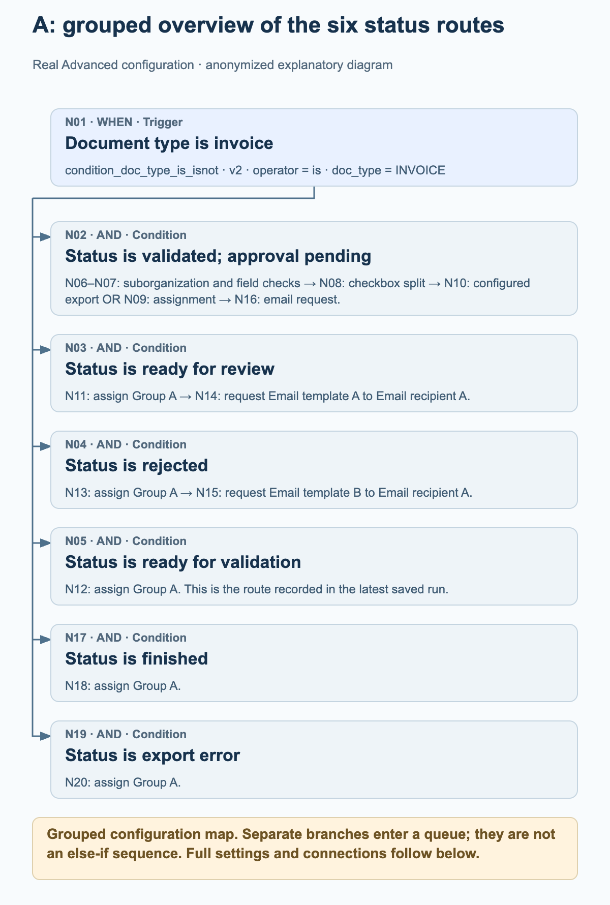
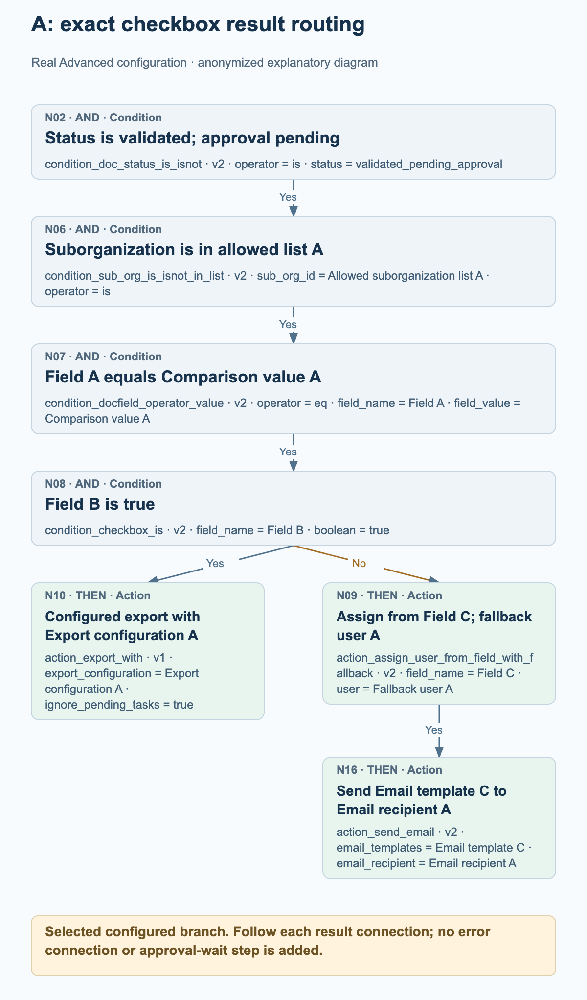
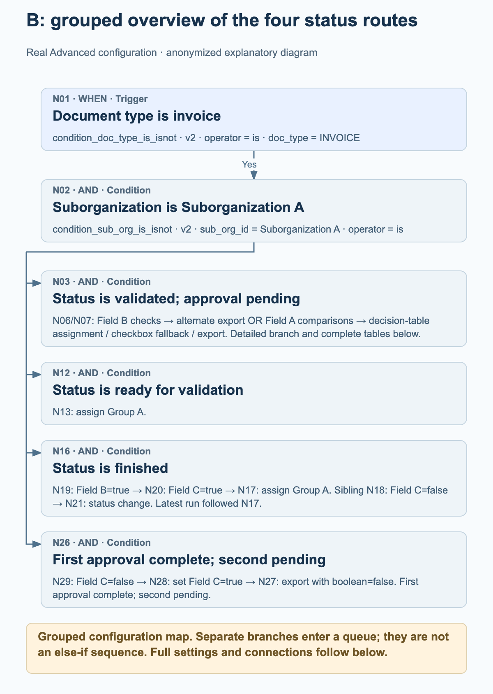
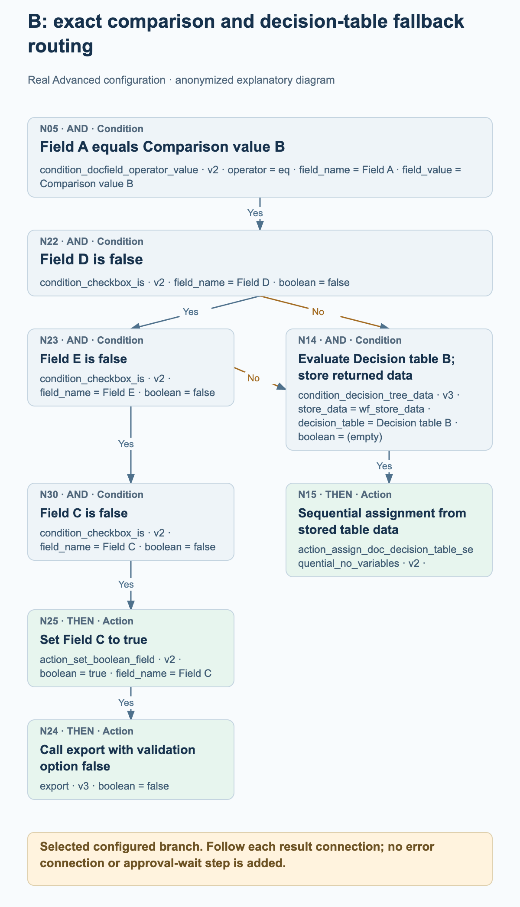

# Advanced production workflow examples

Two active Advanced workflows from production show how real invoice routing combines status branches, checkbox decisions, assignment and configured export actions. The four process graphics explain selected parts of each graph; the complete node settings and connections are listed separately.

Read-only source review on 27 October 2026: both current configurations match the node, card, version, setting and connection data saved with their latest recorded runs. Example A has 20 nodes and 19 connections; example B has 30 nodes and 30 connections. Both recorded runs have overall status failed_condition, although each contains a successful group-assignment action. These are observed configurations and saved execution records, not newly executed tests. Organization, field, user, group, table, template and recipient values are anonymized. Aliases preserve distinctions within each example and do not identify the same real entity across examples.

## How to read these graphs

Each connection follows a specific result: success, failed_condition or error. These examples contain success and failed_condition connections; neither graph configures an error connection. A failed condition is a normal condition result and must not be read as a technical error.

Several outgoing success connections add several destinations to the execution queue. They do not create an else-if chain and do not mean that actions run in parallel. A destination is processed at most once in a single graph run. Follow the actual connections rather than inferring control flow from the position of a card.

A destination with more than one incoming connection is not automatically a wait-for-all join. In example B, either configured failed_condition connection can queue the ordinary condition card N14; it is not a separate ALL or ANY gateway.

Assignments do not prove that a person approved a document. No waiting step, approval completion or external-system receipt may be inferred from an assignment or a configured export card. The diagrams do not add any such steps.

Grouped overviews summarize status routes and explicitly group downstream nodes. The detail graphics expand the selected checkbox or fallback paths. Use the complete node and connection lists to inspect the entire configured graph.

## A. Status routing with a checkbox-controlled export or assignment path

An invoice fans out to six status checks. The validated-pending-approval branch additionally checks an allowed suborganization list, compares Field A and tests Field B. The checkbox result selects a configured export card or an assignment-from-field action followed by an email. Other status routes assign Group A, and two of those routes then send a configured email.

### A: grouped overview of the six status routes

<figure><figcaption>N01 fans out to six separate status checks. The overview groups the longer N02 branch and shows the configured assignment and email routes for the other statuses. It is a grouped map of the configuration, not an execution trace or an else-if sequence.</figcaption></figure>

### A: exact checkbox result routing

<figure><figcaption>Expanded branch N02 → N06 → N07 → N08. Field B=true follows success to configured export card N10 with ignore_pending_tasks=true. The failed_condition connection leads to assignment-from-field card N09, whose success leads to email card N16. No export outcome, human approval or waiting step is implied.</figcaption></figure>

### What the latest saved run actually shows

Saved run: 26 October 2026, 12:01:54 UTC. N01 and the ready_for_validation check N05 returned success; assignment N12 then returned success. The other five status checks returned failed_condition, and the remaining nodes have no recorded result in this run. The overall record is failed_condition. This run therefore demonstrates the N01 → N05 → N12 group-assignment route; it does not demonstrate the checkbox, export or email routes.

- After N01 succeeds, status checks N02, N03, N04, N05, N17 and N19 are queued through separate success connections. They are not an else-if ladder.
- The detailed approval branch is N02 → N06 → N07 → N08 on success. N08 tests Field B against true. Its success connection leads to N10; its failed_condition connection leads to N09.
- N10 is action_export_with v1, configured with Export configuration A and ignore_pending_tasks=true. The graphic states the configuration and does not claim a successful export or external receipt. In this card, ignore_pending_tasks=true disables the pending-task check for the export request; this is an example-specific option.
- N09 is configured to assign from Field C with Fallback user A. Only its success connection leads to N16, configured with Email template C and Email recipient A.
- Field C must contain a user ID. A nonmatching user ID can use the configured fallback; a missing document field may fail before fallback is reached. The fallback does not guarantee assignment for every missing-field case.
- N11, N12, N13, N18 and N20 all configure the same Group A within this example. Only N11 and N13 have connected follow-up email nodes, N14 and N15.

Complete node configuration

| Node | Card | Configuration |
| --- | --- | --- |
| N01 | condition_doc_type_is_isnot · v2 | operator = is; doc_type = INVOICE |
| N02 | condition_doc_status_is_isnot · v2 | operator = is; status = validated_pending_approval |
| N03 | condition_doc_status_is_isnot · v2 | operator = is; status = ready_for_review |
| N04 | condition_doc_status_is_isnot · v2 | operator = is; status = rejected |
| N05 | condition_doc_status_is_isnot · v2 | operator = is; status = ready_for_validation |
| N06 | condition_sub_org_is_isnot_in_list · v2 | sub_org_id = Allowed suborganization list A; operator = is |
| N07 | condition_docfield_operator_value · v2 | operator = eq; field_name = Field A; field_value = Comparison value A |
| N08 | condition_checkbox_is · v2 | field_name = Field B; boolean = true |
| N09 | action_assign_user_from_field_with_fallback · v2 | field_name = Field C; user = Fallback user A |
| N10 | action_export_with · v1 | export_configuration = Export configuration A; ignore_pending_tasks = true |
| N11 | doc_group_assign · v2 | groups = Group A; use_decision_table = (empty) |
| N12 | doc_group_assign · v2 | groups = Group A; use_decision_table = (empty) |
| N13 | doc_group_assign · v2 | groups = Group A; use_decision_table = (empty) |
| N14 | action_send_email · v2 | email_templates = Email template A; email_recipient = Email recipient A |
| N15 | action_send_email · v2 | email_templates = Email template B; email_recipient = Email recipient A |
| N16 | action_send_email · v2 | email_templates = Email template C; email_recipient = Email recipient A |
| N17 | condition_doc_status_is_isnot · v2 | operator = is; status = finished |
| N18 | doc_group_assign · v2 | groups = Group A; use_decision_table = (empty) |
| N19 | condition_doc_status_is_isnot · v2 | operator = is; status = export_error |
| N20 | doc_group_assign · v2 | groups = Group A; use_decision_table = (empty) |

Complete configured connections

| Node | Result path | Node |
| --- | --- | --- |
| N01 | success | N02 |
| N01 | success | N03 |
| N01 | success | N04 |
| N01 | success | N05 |
| N08 | failed_condition | N09 |
| N08 | success | N10 |
| N07 | success | N08 |
| N06 | success | N07 |
| N02 | success | N06 |
| N03 | success | N11 |
| N04 | success | N13 |
| N05 | success | N12 |
| N13 | success | N15 |
| N11 | success | N14 |
| N09 | success | N16 |
| N01 | success | N17 |
| N17 | success | N18 |
| N19 | success | N20 |
| N01 | success | N19 |

## B. Decision-table routing with checkbox fallbacks and status branches

An invoice in Suborganization A fans out to four status checks. The validated-pending-approval route uses Field B, two alternative comparisons of Field A, decision tables and additional checkbox checks. The finished route uses Fields B and C before assigning Group A or configuring a status change. A separate pending-second-approval route sets Field C and calls export when its configured condition succeeds.

### B: grouped overview of the four status routes

<figure><figcaption>N01 and N02 lead to four separately connected status checks. The overview groups the larger decision-table branch, retains the ready-for-validation assignment route and the finished-document checkbox split, and summarizes the pending-second-approval export route. The complete node and connection lists preserve all 30 nodes and 30 connections.</figcaption></figure>

### B: exact comparison and decision-table fallback routing

<figure><figcaption>Selected configured branch after N01 → N02 → N03 → N07: N05 compares Field A with Comparison value B. Either failed_condition connection from N22 (Field D=false) or N23 (Field E=false) can queue decision table B at ordinary condition card N14, then sequential assignment N15. N23 success instead continues through N30 → N25 → N24. No ALL join, ANY card, completed approval or external receipt is implied.</figcaption></figure>

### What the latest saved run actually shows

Saved run: 27 October 2026, 11:56:25 UTC. N01, N02, the finished status check N16, Field B=true check N19, Field C=true check N20 and group assignment N17 returned success. N03, N12, N18 and N26 returned failed_condition; the other nodes have no recorded result in this run. The overall record is failed_condition. This run demonstrates the finished-document assignment route, not either decision-table route, a status change or an export.

- After the invoice and Suborganization A checks succeed, N02 queues status checks N03, N12, N16 and N26. The graph does not wait for one status branch to complete before defining another.
- On N03 success, N06 tests Field B=false and N07 tests Field B=true. N06 success leads to setting Field B=true at N10 and then alternate export card N11. N07 success queues both Field A comparisons, N04 and N05.
- N06 and N07 are queued before the Field B update N10. Both checks evaluate before that update; setting Field B=true does not make N07 succeed later in the same traversal. Later queued cards can observe values returned by earlier actions; branches are not isolated snapshots.
- The Comparison value A route leads to decision table A at N08 and sequential assignment N09. The Comparison value B route checks Field D=false at N22, Field E=false at N23 and Field C=false at N30 before setting Field C=true at N25 and calling export N24.
- A failed_condition result from either N22 or N23 can queue N14, the ordinary condition card for decision table B. N14 is not a wait-for-all join or a newly introduced ANY card. Its success connection leads to sequential assignment N15.
- For finished documents, N19 tests Field B=true and then queues both N18 and N20. Field C=true at N20 leads to Group A assignment N17. Field C=false at N18 leads to status-change card N21, configured with validated_pending_approval and trigger_docflow=true. This is not a waiting step.
- The approved_pending_second_approval route runs N29 → N28 → N27 on success: test Field C=false, set Field C=true, then call export. The export cards N24 and N27 retain boolean=false. This is a validation option, not an instruction to disable the export call.
- Both decision-table condition cards store data under wf_store_data. Their sequential-assignment actions have no own settings. The table rules and actual recipients are not published, and the graph does not prove approval completion.
- Alternate export N11 depends on export attributes of the document type. No export configuration or destination can be inferred from its empty node settings. Status-change N21 requests subsequent workflow triggering; it adds no implicit connection back into this same traversal.

Complete node configuration

| Node | Card | Configuration |
| --- | --- | --- |
| N01 | condition_doc_type_is_isnot · v2 | operator = is; doc_type = INVOICE |
| N02 | condition_sub_org_is_isnot · v2 | sub_org_id = Suborganization A; operator = is |
| N03 | condition_doc_status_is_isnot · v2 | operator = is; status = validated_pending_approval |
| N04 | condition_docfield_operator_value · v2 | operator = eq; field_name = Field A; field_value = Comparison value A |
| N05 | condition_docfield_operator_value · v2 | operator = eq; field_name = Field A; field_value = Comparison value B |
| N06 | condition_checkbox_is · v2 | field_name = Field B; boolean = false |
| N07 | condition_checkbox_is · v2 | field_name = Field B; boolean = true |
| N08 | condition_decision_tree_data · v3 | store_data = wf_store_data; decision_table = Decision table A; boolean = (empty) |
| N09 | action_assign_doc_decision_table_sequential_no_variables · v2 | — |
| N10 | action_set_boolean_field · v2 | boolean = true; field_name = Field B |
| N11 | action_alternate_export · v2 | — |
| N12 | condition_doc_status_is_isnot_in_list · v2 | operator = is; status = ready_for_validation |
| N13 | doc_group_assign · v2 | groups = Group A; use_decision_table = (empty) |
| N14 | condition_decision_tree_data · v3 | store_data = wf_store_data; decision_table = Decision table B; boolean = (empty) |
| N15 | action_assign_doc_decision_table_sequential_no_variables · v2 | — |
| N16 | condition_doc_status_is_isnot_in_list · v2 | operator = is; status = finished |
| N17 | doc_group_assign · v2 | groups = Group A; use_decision_table = (empty) |
| N18 | condition_checkbox_is · v2 | field_name = Field C; boolean = false |
| N19 | condition_checkbox_is · v2 | field_name = Field B; boolean = true |
| N20 | condition_checkbox_is · v2 | field_name = Field C; boolean = true |
| N21 | staus_change · v3 | status = validated_pending_approval; trigger_docflow = true |
| N22 | condition_checkbox_is · v2 | field_name = Field D; boolean = false |
| N23 | condition_checkbox_is · v2 | field_name = Field E; boolean = false |
| N24 | export · v3 | boolean = false |
| N25 | action_set_boolean_field · v2 | boolean = true; field_name = Field C |
| N26 | condition_doc_status_is_isnot_in_list · v2 | operator = is; status = approved_pending_second_approval |
| N27 | export · v3 | boolean = false |
| N28 | action_set_boolean_field · v2 | boolean = true; field_name = Field C |
| N29 | condition_checkbox_is · v2 | field_name = Field C; boolean = false |
| N30 | condition_checkbox_is · v2 | field_name = Field C; boolean = false |

Complete configured connections

| Node | Result path | Node |
| --- | --- | --- |
| N01 | success | N02 |
| N02 | success | N03 |
| N03 | success | N06 |
| N03 | success | N07 |
| N07 | success | N04 |
| N07 | success | N05 |
| N06 | success | N10 |
| N10 | success | N11 |
| N02 | success | N12 |
| N12 | success | N13 |
| N16 | success | N19 |
| N20 | success | N17 |
| N19 | success | N20 |
| N19 | success | N18 |
| N18 | success | N21 |
| N04 | success | N08 |
| N02 | success | N16 |
| N05 | success | N22 |
| N22 | success | N23 |
| N25 | success | N24 |
| N02 | success | N26 |
| N22 | failed_condition | N14 |
| N23 | failed_condition | N14 |
| N28 | success | N27 |
| N26 | success | N29 |
| N29 | success | N28 |
| N23 | success | N30 |
| N30 | success | N25 |
| N08 | success | N09 |
| N14 | success | N15 |

## Before adapting an example

Replace every neutral alias with an appropriate value from your own organization. Preserve which settings refer to the same field and which refer to distinct fields; do not reuse these placeholders as real identifiers.

Check every result connection explicitly, including failed_condition routing and destinations that have several incoming connections. Choose error handling for your own process rather than assuming that an unconnected error path is handled by the graph.

Review export settings, validation choices and pending-task handling against your own requirements. A configured export action or a successful node record is not evidence of receipt by an external system.

Validate the adapted workflow in an authorized test environment, including each relevant condition outcome and missing assignment data. These production examples were read without changing or re-running them.
