# Decision Logic Pattern

**Pattern Type:** Conditional Routing & Logic **Complexity:** Medium **Estimated Setup:** 30-45 minutes **Common Use Cases:** Multi-path routing, conditional processing, decision trees, business rule implementation

***

In the Standard designer, open **Add Card** in the **And....** group, then select **Logic**. The partial view below shows a condition card based on a decision table, displayed in the library before selection and configuration. Configure the table to use and where to store its results for subsequent cards. The other conditions, actions and connections in this pattern still need to be defined and verified. The condition uses the table’s results for the document or the supplier organisation.

<figure>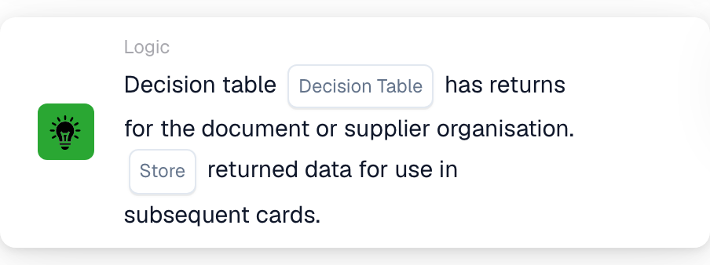<figcaption><p>Condition card in the Logic category of the library, before selection and configuration. The decision table and storage of results still need to be configured.</p></figcaption></figure>

***

## Pattern Overview

#### Diagram: Overview

<figure>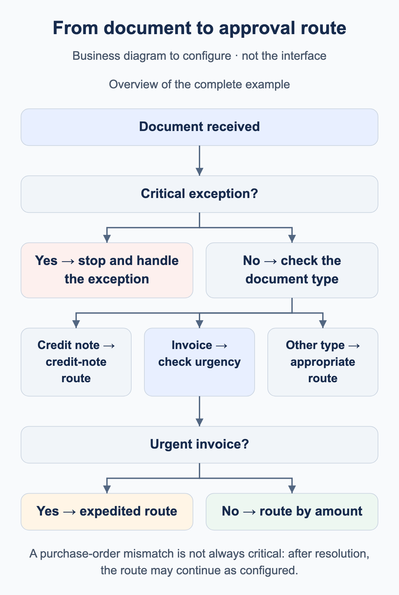<figcaption><p>Overview of the complete example: check critical exceptions, document type and urgency before choosing the approval route. Every action and connection must be configured; the diagram does not represent automatic product behavior.</p></figcaption></figure>

These diagrams explain business rules to configure. They complement the existing library image above. In Advanced, explicitly connect each route. In a linear Standard sequence, define the conditions that allow its actions.

This pattern demonstrates how to implement complex decision logic in DocBits workflows using condition cards to route documents through different processing paths based on document attributes, field values, and business rules.

**What This Pattern Does:**

1. Evaluates multiple conditions in sequence or parallel
2. Routes documents to different paths based on conditions
3. Implements business rules and policies
4. Handles complex decision trees
5. Combines multiple criteria for routing decisions

***

## When to Use This Pattern

Use this pattern when you need to:

* ✅ Route documents by amount thresholds
* ✅ Apply different rules for different document types
* ✅ Implement multi-level approval logic
* ✅ Handle complex business policies
* ✅ Create dynamic routing based on multiple criteria
* ✅ Implement exception handling logic
* ✅ Create approval matrices

**Don't use this pattern when:**

* ❌ Simple linear workflow is sufficient
* ❌ All documents follow same path
* ❌ No conditional processing needed

***

## Decision Logic Types

The IF-THEN, AND, OR and nested examples below are independent. Their thresholds illustrate each principle; they do not form one approval matrix. The complete matrix later uses four non-overlapping bands. An unknown value or evaluation error is not automatically False: define and test its handling separately.

### 1. Simple IF-THEN Logic

#### Diagram: Simple condition

<figure>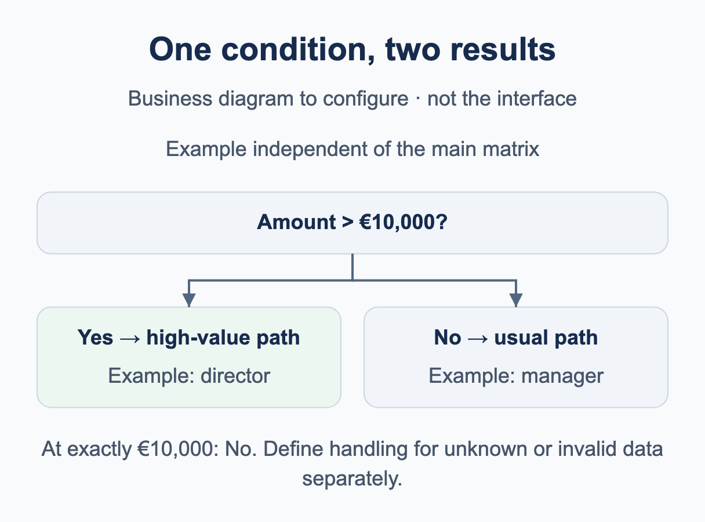<figcaption><p>Independent IF-THEN example: an amount strictly greater than €10,000 selects the director; otherwise, the manager. Equality stays in the second branch. Destinations must be configured.</p></figcaption></figure>

<details>
<summary>IF-THEN principle: one condition, two results</summary>

```
IF condition:
  → Action A
ELSE:
  → Action B
```

</details>

**Example:**

Visual explanation: [simple condition](#diagram-simple-condition).

<details>
<summary>IF-THEN example: amount threshold</summary>

```
IF Amount > €10,000:
  → Assign to Director
ELSE:
  → Assign to Manager
```

</details>

#### Diagram: AND and OR criteria

<figure>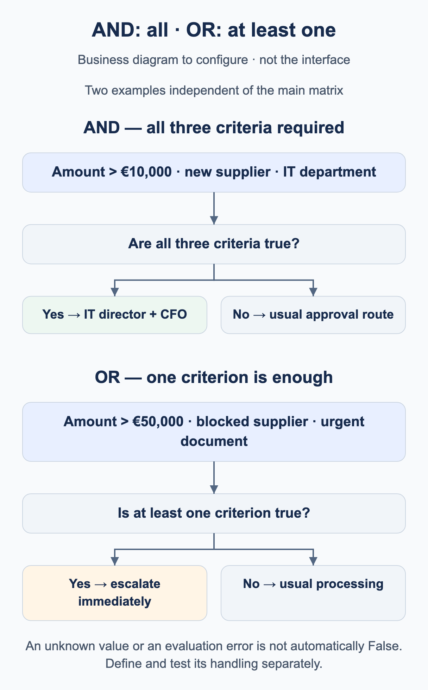<figcaption><p>Two independent examples: AND requires all three criteria; OR requires at least one. Their illustrative thresholds do not replace the bands in the complete matrix. Outputs and the handling of unknown values or errors must be configured.</p></figcaption></figure>

### 2. Multiple Criteria (AND Logic)

<details>
<summary>AND principle: all criteria</summary>

```
IF condition1 AND condition2 AND condition3:
  → Action A
ELSE:
  → Action B
```

</details>

**Example:**

Visual explanation: [and and or criteria](#diagram-and-and-or-criteria).

<details>
<summary>AND example: three criteria</summary>

```
IF Amount > €10,000 AND Supplier = "New" AND Department = "IT":
  → Assign to IT Director + CFO (dual approval)
ELSE:
  → Standard approval workflow
```

</details>

### 3. Alternative Criteria (OR Logic)

Visual explanation: [and and or criteria](#diagram-and-and-or-criteria).

<details>
<summary>OR principle: at least one criterion</summary>

```
IF condition1 OR condition2 OR condition3:
  → Action A
ELSE:
  → Action B
```

</details>

**Example:**

Visual explanation: [and and or criteria](#diagram-and-and-or-criteria).

<details>
<summary>OR example: amount, blocking or urgency</summary>

```
IF Amount > €50,000 OR Supplier is "Blocked" OR Document has "Urgent" flag:
  → Escalate immediately
ELSE:
  → Standard processing
```

</details>

### 4. Nested Decision Tree

#### Diagram: Nested decisions

<figure>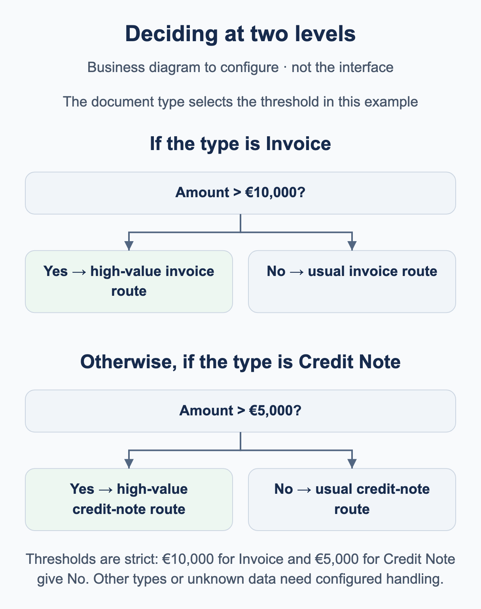<figcaption><p>Independent nested example: the document type selects an amount test. Thresholds are strict: €10,000 for an invoice and €5,000 for a credit note do not satisfy the “greater than” test. Define handling for other types and unknown data.</p></figcaption></figure>

<details>
<summary>Nested decision principle</summary>

```
IF condition1:
  IF condition2:
    → Action A
  ELSE:
    → Action B
ELSE:
  IF condition3:
    → Action C
  ELSE:
    → Action D
```

</details>

**Example:**

Visual explanation: [nested decisions](#diagram-nested-decisions).

<details>
<summary>Nested example: invoice and credit note</summary>

```
IF Document_Type = "Invoice":
  IF Amount > €10,000:
    → High-value invoice workflow
  ELSE:
    → Standard invoice workflow
ELSE IF Document_Type = "Credit Note":
  IF Amount > €5,000:
    → High-value credit workflow
  ELSE:
    → Standard credit workflow
```

</details>

***

## Complete Workflow Example

### Scenario: Invoice Approval Matrix

**Business Rules:**

1. Before routing by amount, stop and handle critical exceptions, including a blocked supplier. A purchase-order mismatch is not always critical: after procurement resolves it, the route may continue as configured. Then check the document type.
2. For an urgent invoice, follow this example’s expedited route instead of the ordinary amount bands.
3. For a non-urgent invoice with a valid amount:
   * amount < €1,000: automatic approval;
   * €1,000 ≤ amount < €10,000: manager approval;
   * €10,000 ≤ amount < €50,000: supplier checks followed by director approval; a non-blocked supplier less than 180 days old requires the director’s approval followed by the CFO’s approval; other suppliers also undergo a risk check;
   * amount ≥ €50,000: executive approval as detailed in Path D.
4. A missing or invalid amount goes to explicitly configured manual review in this example. This is an example policy, not an automatic product fallback.
5. After creating a task, wait for its result. Rejection stops the chain and follows configured handling; pending results do not allow continuation. Create the CFO task only after the director’s positive approval.

#### Diagram: Amount bands

<figure>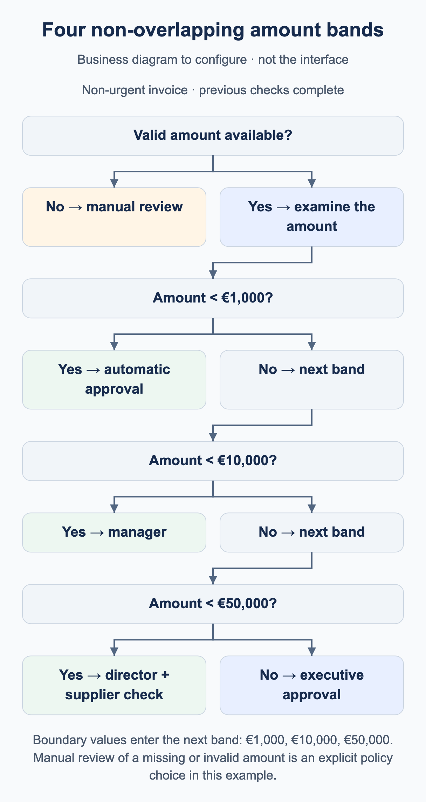<figcaption><p>Level 2 thresholds: below €1,000; from €1,000 inclusive to €10,000 exclusive; from €10,000 inclusive to €50,000 exclusive; €50,000 or more. Each test follows the negative result of the previous one. Manual review of a missing or invalid amount must be explicitly configured.</p></figcaption></figure>

Boundary values €1,000, €10,000 and €50,000 enter the higher band. Configure and test earlier checks, waiting for results and connections between routes. A created task proves neither approval nor document export.

**Illustrative implementation:** Adapt technical names and pseudocode to the cards actually available in your version. These blocks describe an example to configure, rather than an importable file. Verify execution results and side effects.

Visual explanation: [overview](#diagram-overview), [amount bands](#diagram-amount-bands), [supplier analysis](#diagram-supplier-analysis), [automatic route](#diagram-automatic-route), [manager task](#diagram-manager-task), [executive approval](#diagram-executive-approval), [rule record](#diagram-rule-record).

<details>
<summary>Complete matrix pseudocode</summary>

```
PRECHECK: Critical Exceptions
  IF Critical_Exception = TRUE OR Supplier_Status = "BLOCKED":
    → Stop & handle exception before routing

STEP 1: Check for PO Mismatch
  IF PO_Match_Status = "FAIL":
    → Route to Procurement for PO resolution
    → After resolution, continue below as configured

STEP 1b: Check Document Type
  IF Document_Type = "Credit Note":
    → Configured Credit Note workflow
  ELSE IF Document_Type is not "Invoice":
    → Configured workflow for this document type
  ELSE:
    → Continue below

STEP 2: Check Urgent Flag
  IF Urgent_Flag = TRUE:
    → Skip amount checks
    → Direct to highest approver
    → Set priority = URGENT
    → 1-day deadline

STEP 3: Amount-Based Routing (Invoice, if not urgent)
  IF Amount is missing or invalid:
    → Manual review (explicit example policy)
    → Do not enter amount bands

  ELSE IF Amount < €1,000:
    → Auto-approve
    → Export immediately

  ELSE IF Amount < €10,000:
    → Create task for Manager
    → Priority: Medium
    → Deadline: 3 days

  ELSE IF Amount < €50,000:
    CHECK Supplier Status and Risk:
      IF Supplier_Status = "BLOCKED":
        → Stop & handle exception
      ELSE IF Supplier_Age < 180 days (New):
        → Create task for Director (Task 1)
        → Wait for positive Director approval before creating CFO task (Task 2)
        → Wait for positive CFO approval before continuing
        → Any rejection: Stop chain & handle rejection as configured
        → Pending: Do not continue
        → Priority: High
        → Deadline: 2 days each
      ELSE IF Supplier_Risk_Rating = "HIGH":
        → Additional checks and Manager pre-approval
        → Wait for positive Manager approval before Director approval
        → Pending or rejection: Do not continue the approval chain
      ELSE (Existing Supplier):
        → Create task for Director only
        → Priority: High
        → Deadline: 2 days

  ELSE (Amount ≥ €50,000):
    → Executive approval path (see Path D)
```

</details>

***

## Step-by-Step Implementation

### Step 1: Define Condition Cards

**Condition 1: Amount Threshold**

#### Diagram: Independent parameters

<figure>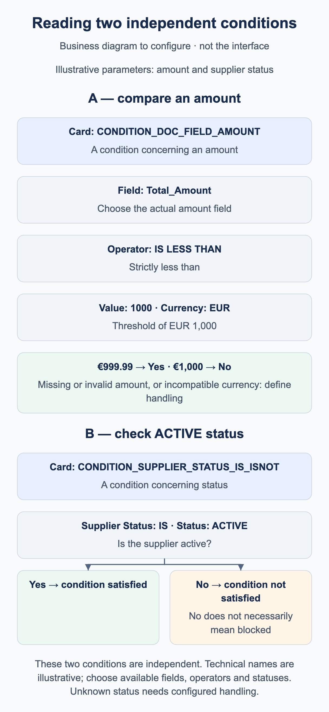<figcaption><p>Two independent conditions: an amount strictly below EUR 1,000 and a supplier with ACTIVE status. Amount equality gives No; an inactive supplier is not necessarily blocked. Technical parameters are illustrative and must be adapted to the actual configuration.</p></figcaption></figure>

<details>
<summary>Illustrative parameters: amount threshold</summary>

```
Card: CONDITION_DOC_FIELD_AMOUNT
Field: Total_Amount
Operator: IS LESS THAN
Value: 1000
Currency: EUR
```

</details>

**Condition 2: Document Type Check**

#### Diagram: Document types

<figure>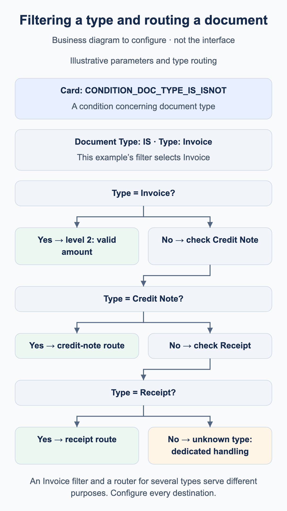<figcaption><p>The Invoice filter and type router illustrate complementary aspects of this example. The router distinguishes invoice, credit note, receipt and unknown type. Card and workflow names are illustrative; every destination must be configured.</p></figcaption></figure>

<details>
<summary>Illustrative parameters: document type</summary>

```
Card: CONDITION_DOC_TYPE_IS_ISNOT
Document Type: IS
Type: Invoice
```

</details>

**Condition 3: Supplier Status**

Visual explanation: [independent parameters](#diagram-independent-parameters).

<details>
<summary>Illustrative parameters: active status</summary>

```
Card: CONDITION_SUPPLIER_STATUS_IS_ISNOT
Supplier Status: IS
Status: ACTIVE
```

</details>

**Condition 4: New Supplier Check**

For this example, calculate the date 180 days before the evaluation date, then compare the first transaction date with that cutoff. “IS AFTER” means strictly after: equality gives No. Choose the actual field and calculate or enter the cutoff date; the card and field names and {{TODAY_MINUS_180_DAYS}} marker are illustrative. Separately check that the first transaction date is valid and does not exceed the evaluation date; configure handling for missing or invalid values.

#### Diagram: 180-day condition

<figure>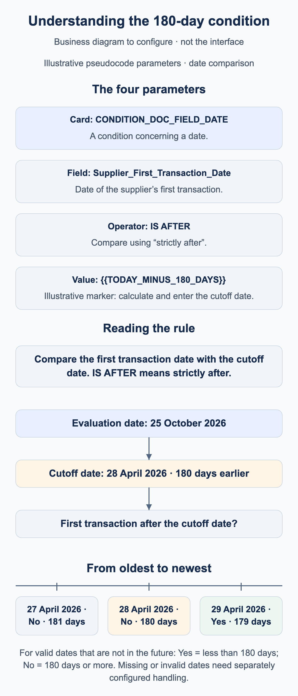<figcaption><p>Comparison example: on 25 October 2026, the cutoff date is 28 April 2026. “IS AFTER” excludes equality: 29 April gives Yes; 28 and 27 April give No. The card and field names and the {{TODAY_MINUS_180_DAYS}} marker are illustrative: choose the actual field and calculate or enter the cutoff date. Dates are assumed valid and not in the future; handling of missing or invalid dates must still be configured.</p></figcaption></figure>

<details>
<summary>Copy the illustrative parameters for this example</summary>

```
Card: CONDITION_DOC_FIELD_DATE
Field: Supplier_First_Transaction_Date
Operator: IS AFTER
Value: {{TODAY_MINUS_180_DAYS}}
```

</details>


**Guide Reference:** [Condition Cards Complete Guide](../condition-cards-complete-guide.md)

***

### Step 2: Build Decision Tree

**Level 1: Document Type**

Visual explanation: [document types](#diagram-document-types).

<details>
<summary>Illustrative document-type router</summary>

```
Workflow: "Invoice Processing"

IF Document_Type = "Invoice":
  → Continue to Level 2

ELSE IF Document_Type = "Credit Note":
  → Branch to "Credit Note Processing"

ELSE IF Document_Type = "Receipt":
  → Branch to "Receipt Processing"

ELSE:
  → Route to "Unknown Document Type" handling
```

</details>

**Level 2: Amount Thresholds (non-urgent invoices, valid amount)**

Visual explanation: [amount bands](#diagram-amount-bands).

<details>
<summary>Four amount bands: pseudocode</summary>

```
IF Amount < €1,000:
  → Branch to "Auto-Approve Path"

ELSE IF Amount < €10,000:
  → Branch to "Manager Approval Path"

ELSE IF Amount < €50,000:
  → Branch to "Director Approval Path"
  → Check Level 3 conditions

ELSE (Amount ≥ €50,000):
  → Branch to "Executive Approval Path"
  → Dual or triple approval required
```

</details>

**Level 3: Supplier Analysis (for high-value invoices)**

#### Diagram: Supplier analysis

<figure>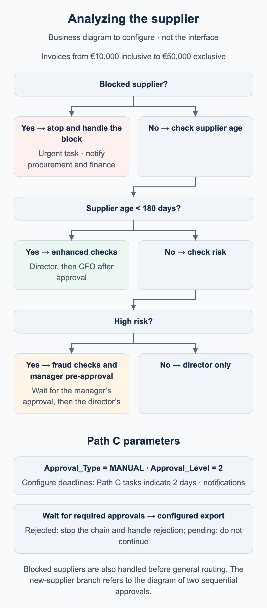<figcaption><p>Supplier-route detail: handle blocked status, then supplier age, then risk. The branch for suppliers less than 180 days old refers to the diagram of two sequential approvals. Path C tasks, deadlines, notifications and actions must be configured.</p></figcaption></figure>

<details>
<summary>Supplier analysis: blocking, age and risk</summary>

```
IF Supplier_Status = "BLOCKED":
  → STOP processing
  → Create urgent escalation task
  → Notify procurement and finance

ELSE IF Supplier_Age < 180 days (New):
  → Additional approval required
  → Add CFO to approval chain
  → Enhanced verification

ELSE IF Supplier_Risk_Rating = "HIGH":
  → Additional checks required
  → Fraud detection review
  → Manager pre-approval; wait for positive approval
  → Director approval; wait for positive approval

ELSE:
  → Standard high-value workflow
```

</details>

***

### Step 3: Create Routing Actions

**Path A: Auto-Approve (Amount < €1,000)**

#### Diagram: Automatic route

<figure>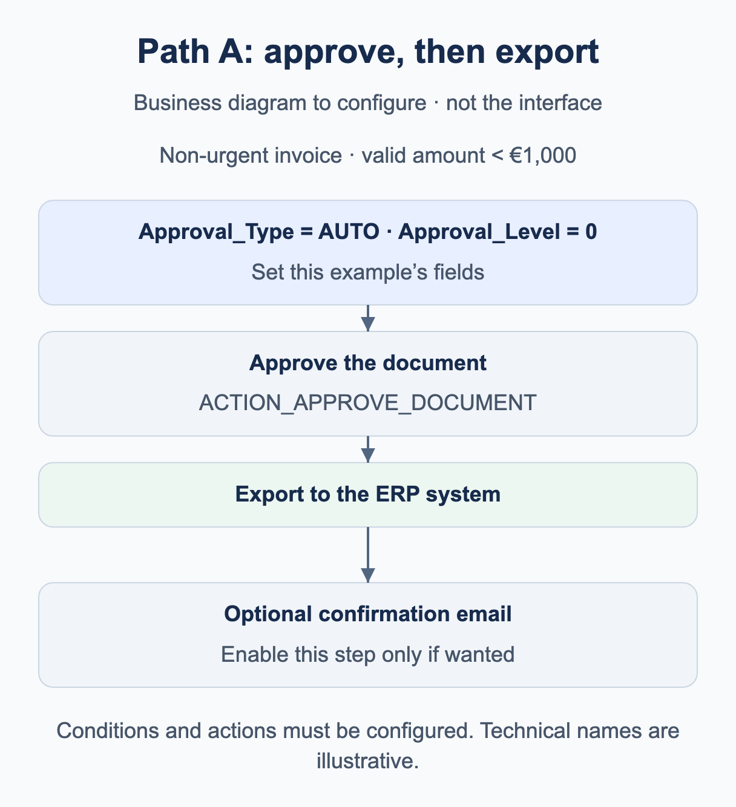<figcaption><p>Path A example: set approval fields, approve the document, then export. The confirmation email is optional. This diagram describes actions to configure, not an observed execution.</p></figcaption></figure>

<details>
<summary>Path A actions: automatic approval</summary>

```
Actions:
1. Set field "Approval_Type" = "AUTO"
2. Set field "Approval_Level" = "0"
3. ACTION_APPROVE_DOCUMENT
4. Export to ERP
5. Send confirmation email (optional)
```

</details>

**Path B: Manager Approval (€1,000 ≤ amount < €10,000)**

#### Diagram: Manager task

<figure>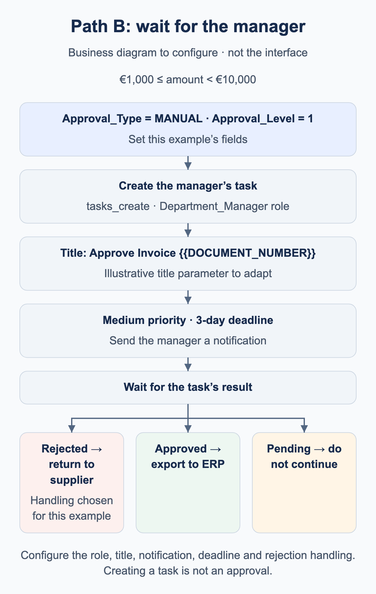<figcaption><p>Path B example: create a manager task, notify the manager and wait for its result. Only approval allows export; rejection returns the document to the supplier here. The three-day deadline and recipients are configuration choices.</p></figcaption></figure>

<details>
<summary>Path B actions: manager task</summary>

```
Actions:
1. Set field "Approval_Type" = "MANUAL"
2. Set field "Approval_Level" = "1"
3. tasks_create:
   - Title: "Approve Invoice {{DOCUMENT_NUMBER}}"
   - Assign to: Department_Manager
   - Priority: Medium
   - Deadline: 3 days
4. Send email notification to manager
5. Wait for task completion
6. If approved: Export to ERP
7. If rejected: Return to supplier
```

</details>

**Path C: Director Approval (€10,000 ≤ amount < €50,000)**

Visual explanation: [supplier analysis](#diagram-supplier-analysis), [sequential approvals](#diagram-sequential-approvals).

<details>
<summary>Path C actions: checks and required approvals</summary>

```
Actions:
1. Set field "Approval_Type" = "MANUAL"
2. Set field "Approval_Level" = "2"
3. Check Supplier_Age and Supplier_Risk_Rating:
   IF New (< 180 days):
     - Create Task 1: Director approval
     - Wait for positive Task 1 approval before creating Task 2: CFO approval
     - Wait for positive Task 2 approval before continuing
     - Pending: Do not continue
     - Any rejection: Stop chain & handle rejection as configured
     - Both positive approvals required
   ELSE IF Supplier_Risk_Rating = "HIGH":
     - Additional risk checks and Manager pre-approval
     - Wait for positive Manager approval before Director approval
     - Wait for positive Director approval before export
     - Pending or rejection: Stop progression and handle result as configured
   ELSE:
     - Create Task: Director approval only
4. Priority: High
5. Deadline: 2 days for Path C approval tasks; configure risk-check deadlines separately
6. Send email notifications
7. Wait for completion
8. If all approved: Export
9. If any rejected: Return to supplier
```

</details>

#### Diagram: Sequential approvals

<figure>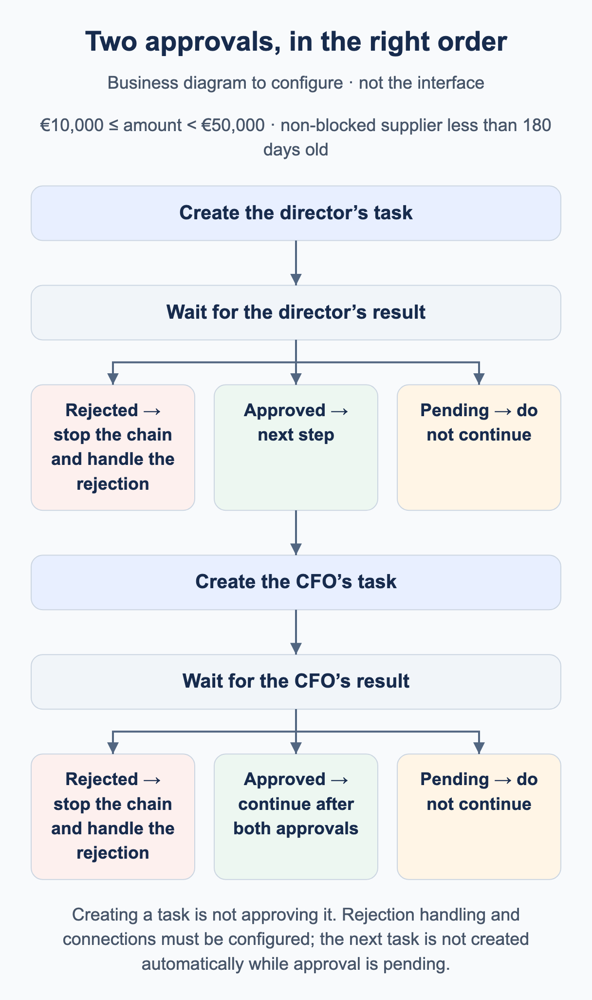<figcaption><p>Sequential approval example: create the CFO’s task only after the director’s approval, then wait for its result. Continue only after both approvals. Rejection stops the chain and follows the configured handling; a pending result does not allow continuation.</p></figcaption></figure>

Depending on configuration, rejection may return the document to the supplier or follow another route. The diagram only requires stopping this approval chain; it does not prescribe manual review in every case.

**Path D: Executive Approval (≥ €50,000)**

#### Diagram: Executive approval

<figure>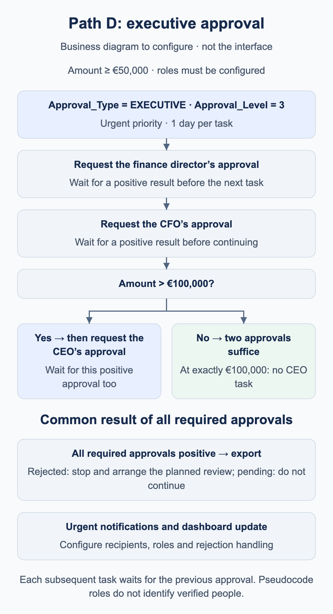<figcaption><p>Path D example: two sequential approvals from €50,000, with a third only above €100,000. Each subsequent task waits for the previous approval. Configure roles, deadlines, notifications and rejection handling.</p></figcaption></figure>

<details>
<summary>Path D actions: executive approval</summary>

```
Actions:
1. Set field "Approval_Type" = "EXECUTIVE"
2. Set field "Approval_Level" = "3"
3. Sequential approvals:
   - Task 1: Finance Director
   - Task 2: CFO
   - Task 3: CEO (if > €100,000)
4. Priority: Urgent
5. Deadline: 1 day each
6. Send urgent notifications
7. Executive dashboard update
8. Wait for all approvals
9. If all approved: Export
10. If any rejected: Executive review meeting
```

</details>

***

## Advanced Decision Logic Patterns

The following patterns are independent variants. Scores, departmental thresholds and time rules do not automatically add to the complete matrix above; choose and configure the rules for your case.

### Pattern 1: Score-Based Routing

**Calculate an integer risk score and route accordingly in this example:**

#### Diagram: Risk score

<figure>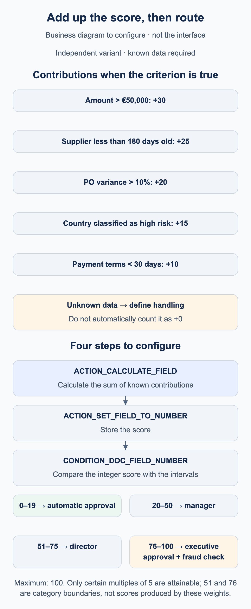<figcaption><p>Independent variant: five known contributions produce an integer score from 0 to 100, then a route. The boundaries 51 and 76 define categories; these five weights do not actually produce those scores. Define handling for unknown data separately.</p></figcaption></figure>

<details>
<summary>Risk score calculation and intervals</summary>

```
Risk Score Calculation:
  Score = 0

  IF Amount > €50,000: Score += 30
  IF Supplier_Age < 180 days: Score += 25
  IF PO_Variance > 10%: Score += 20
  IF Supplier_Country = "High Risk Country": Score += 15
  IF Payment_Terms < 30 days: Score += 10

  Total Score Range: 0-100

Routing:
  IF Score < 20: Auto-approve
  IF Score 20-50: Manager approval
  IF Score 51-75: Director approval
  IF Score > 75: Executive approval + fraud check
```

</details>

**Implementation:**

Visual explanation: [risk score](#diagram-risk-score).

<details>
<summary>Illustrative score implementation</summary>

```
1. ACTION_CALCULATE_FIELD: Calculate risk score
2. ACTION_SET_FIELD_TO_NUMBER: Store score
3. CONDITION_DOC_FIELD_NUMBER: Check score thresholds
4. Route based on score
```

</details>

***

### Pattern 2: Department-Based Matrix

**Different approval rules by department:**

#### Diagram: Department matrix

<figure>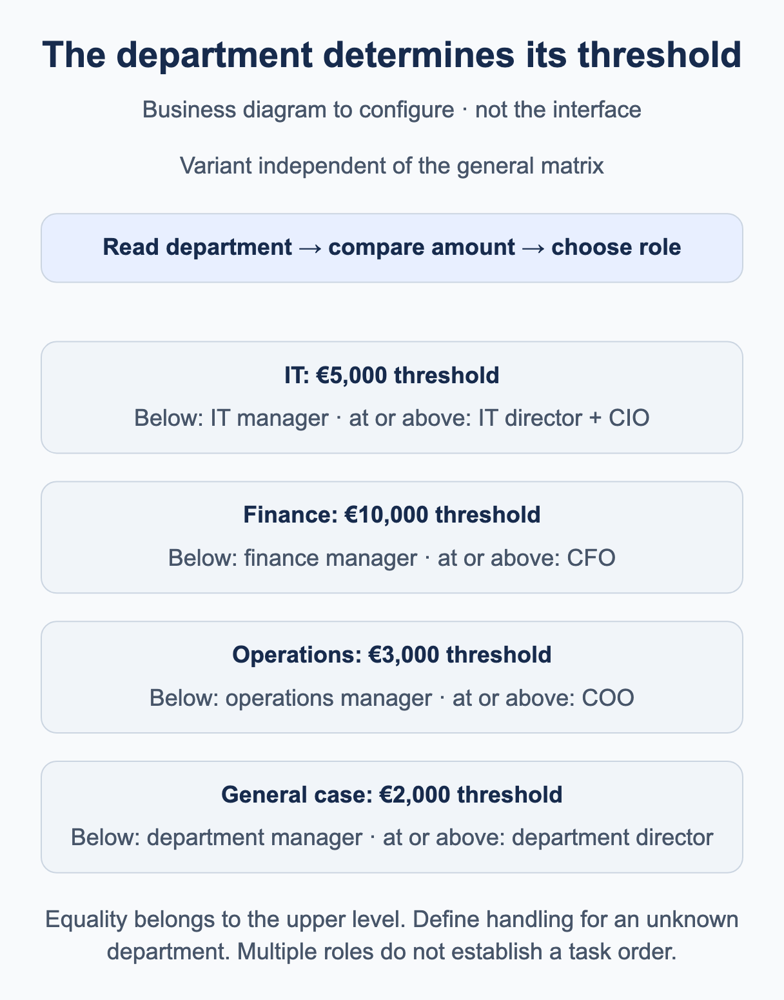<figcaption><p>Independent departmental matrix: thresholds differ for IT, finance, operations and the general case. Equality selects the upper band. Multiple roles must be configured; their presence does not prove sequential approval.</p></figcaption></figure>

<details>
<summary>Department threshold matrix</summary>

```
Department Matrix:

  IT Department:
    Amount < €5,000: IT Manager
    Amount ≥ €5,000: IT Director + CIO

  Finance Department:
    Amount < €10,000: Finance Manager
    Amount ≥ €10,000: CFO

  Operations Department:
    Amount < €3,000: Operations Manager
    Amount ≥ €3,000: COO

  General:
    Amount < €2,000: Department Manager
    Amount ≥ €2,000: Department Director
```

</details>

**Implementation:**

Visual explanation: [department matrix](#diagram-department-matrix).

<details>
<summary>Illustrative department matrix implementation</summary>

```
1. Check Department field
2. Based on department, check amount threshold
3. Route to appropriate approver
4. Different thresholds per department
```

</details>

***

### Pattern 3: Time-Based Logic

**Different rules based on timing:**

#### Diagram: Time variants

<figure>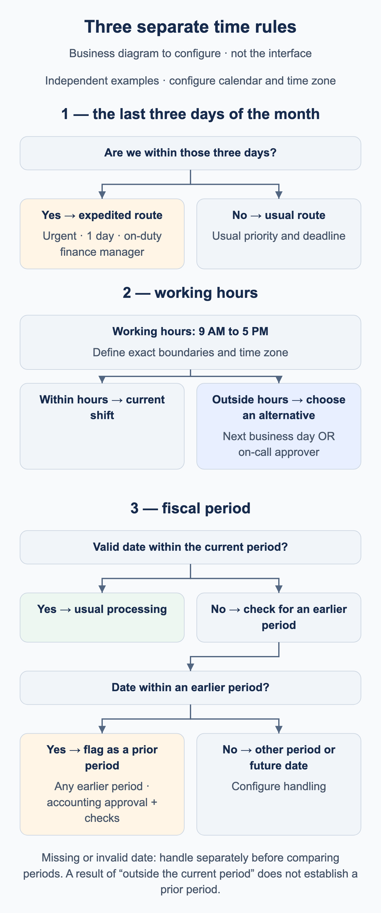<figcaption><p>Three independent variants: month-end, working hours and fiscal period. Queueing and on-call approval are alternatives to choose between. A date outside the current period is not necessarily earlier; check its case separately.</p></figcaption></figure>

<details>
<summary>Three independent time variants</summary>

```
Month-End Processing (Last 3 days of month):
  IF Today in last 3 days of month:
    - Priority: URGENT
    - Deadline: 1 day
    - Approver: On-duty finance manager
    - Expedited workflow
  ELSE:
    - Standard priority
    - Standard deadline
    - Standard workflow

Business Hours vs After Hours:
  IF Time between 9 AM - 5 PM:
    - Assign to current shift
  ELSE:
    - Queue for next business day
    - OR route to on-call approver

Fiscal Period (independent illustrative policy):
  IF Document_Date is missing or invalid:
    - Handle invalid or unknown date as configured
  ELSE IF Document_Date in Current_Fiscal_Period:
    - Standard processing
  ELSE IF Document_Date in any Fiscal_Period before Current_Fiscal_Period:
    - Flag as "Prior Period"
    - Require accounting approval
    - Additional checks
  ELSE:
    - Future or other fiscal period: Handle as configured
```

</details>

***

### Pattern 4: Exception-Based Routing

**Route exceptions separately:**

#### Diagram: Exception severity

<figure>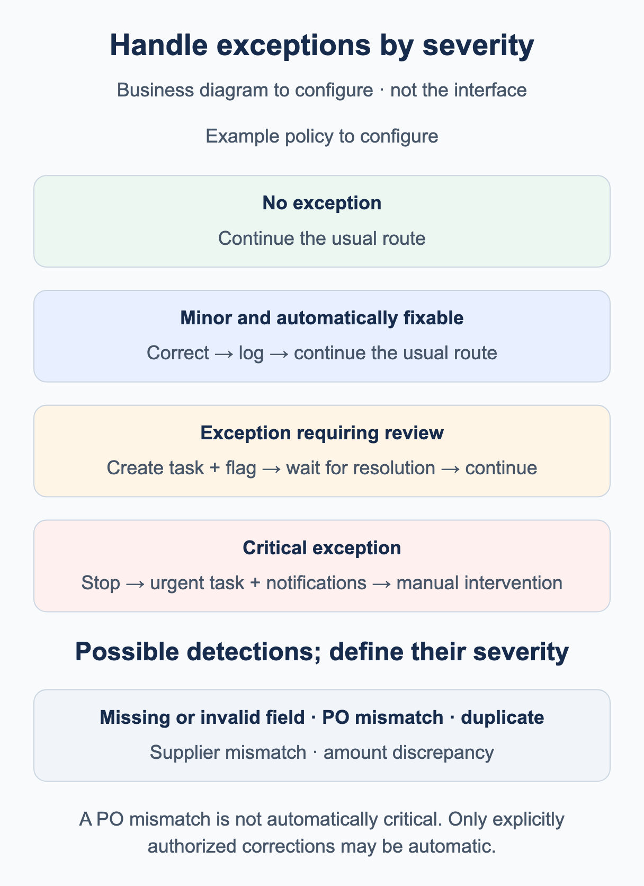<figcaption><p>Example severity policy: continue only after the configured correction or expected resolution. A critical exception stops processing. Detection examples alone do not determine severity.</p></figcaption></figure>

<details>
<summary>Exception severity policy</summary>

```
Exception Detection:

  No Exception:
    → Standard workflow

  Minor Exception (Auto-fixable):
    → Auto-correct
    → Log correction
    → Continue standard workflow

  Medium Exception (Needs review):
    → Create review task
    → Flag document
    → After fix: Continue workflow

  Major Exception (Requires escalation):
    → Stop processing
    → Create urgent task
    → Notify multiple levels
    → Manual intervention required

Exception Types:
  - Missing required field
  - Invalid field value
  - PO mismatch
  - Duplicate invoice
  - Supplier mismatch
  - Amount discrepancy
```

</details>

***

## Complete Decision Logic Diagram

The diagrams present the essential steps. The detailed text tree below retains the technical example; its destinations still require configuration.


Visual explanation: [overview](#diagram-overview), [amount bands](#diagram-amount-bands), [supplier analysis](#diagram-supplier-analysis), [sequential approvals](#diagram-sequential-approvals), [automatic route](#diagram-automatic-route), [manager task](#diagram-manager-task), [executive approval](#diagram-executive-approval).

<details>
<summary>Complete example: detailed text tree</summary>

```
INVOICE ARRIVES
│
├─ LEVEL 1: EXCEPTION CHECK
│  │
│  ├─ Critical exception or BLOCKED supplier?
│  │  (Criticality must be configured; not every PO mismatch is critical.)
│  │  │
│  │  ├─ YES → Stop & Escalate
│  │  │        Create urgent task
│  │  │        Notify admin
│  │  │        → END (Exception Handling)
│  │  │
│  │  └─ NO → Continue to Level 2
│
├─ LEVEL 2: DOCUMENT TYPE
│  │
│  ├─ Type = Invoice?
│  │  └─ YES → Continue to Level 3
│  │
│  ├─ Type = Credit Note?
│  │  └─ YES → Branch to Credit Note workflow
│  │           → END (Credit Note Path)
│  │
│  └─ Other Type?
│     └─ YES → Branch to appropriate workflow
│              → END (Other Type Path)
│
├─ LEVEL 3: URGENCY CHECK (for Invoices)
│  │
│  ├─ Urgent Flag = TRUE?
│  │  │
│  │  ├─ YES → Expedited Workflow
│  │  │        Priority: URGENT
│  │  │        Deadline: 1 day
│  │  │        Assign to: Senior Approver
│  │  │        → END (Expedited Path)
│  │  │
│  │  └─ NO → Continue to Level 4
│
├─ LEVEL 4: AMOUNT THRESHOLDS
│  │
│  ├─ Amount missing or invalid?
│  │  ├─ YES → Manual review (explicit example policy)
│  │  └─ NO → Continue to amount thresholds below
│  │
│  ├─ Amount < €1,000?
│  │  │
│  │  ├─ YES → AUTO-APPROVE PATH
│  │  │        Set Approval_Type = "AUTO"
│  │  │        Approve immediately
│  │  │        Export to ERP
│  │  │        → END (Auto-Approved)
│  │  │
│  │  └─ NO → Continue
│  │
│  ├─ Amount < €10,000?
│  │  │
│  │  ├─ YES → MANAGER APPROVAL PATH
│  │  │        Create task for Manager
│  │  │        Priority: Medium
│  │  │        Deadline: 3 days
│  │  │        → WAIT for result; pending must not continue
│  │  │           → Approved: Continue configured processing
│  │  │           → Rejected: Stop chain & handle rejection as configured
│  │  │
│  │  └─ NO → Continue
│  │
│  ├─ Amount < €50,000?
│  │  │
│  │  ├─ YES → DIRECTOR APPROVAL PATH
│  │  │        Continue to Level 5 (Supplier Check)
│  │  │
│  │  └─ NO → Continue
│  │
│  └─ Amount ≥ €50,000?
│     │
│     └─ YES → EXECUTIVE APPROVAL PATH
│              Create sequential tasks:
│              - Finance Director
│              - CFO
│              - CEO (if > €100,000)
│              Priority: URGENT
│              Deadline: 1 day each
│              → WAIT for all required results
│                 → All approved: Continue configured processing
│                 → Pending: Do not continue
│                 → Any rejection: Stop chain & handle rejection as configured
│
├─ LEVEL 5: SUPPLIER ANALYSIS (€10,000 ≤ Amount < €50,000)
│  │
│  ├─ Supplier Status = "BLOCKED"?
│  │  │
│  │  ├─ YES → BLOCK & ESCALATE
│  │  │        Stop processing
│  │  │        Create urgent task
│  │  │        Notify procurement & finance
│  │  │        → END (Blocked Supplier)
│  │  │
│  │  └─ NO → Continue
│  │
│  ├─ Supplier Age < 180 days (New)?
│  │  │
│  │  ├─ YES → DUAL APPROVAL REQUIRED
│  │  │        Task 1: Director (2 days)
│  │  │        → WAIT for Task 1
│  │  │           IF Task 1 Approved:
│  │  │             Task 2: CFO (2 days)
│  │  │             → WAIT for Task 2
│  │  │                → Pending: Do not continue
│  │  │                → Approved: Continue only after both positive approvals
│  │  │                → Rejected: Stop chain & handle rejection as configured
│  │  │           IF Task 1 Rejected:
│  │  │             → Stop chain & handle rejection as configured
│  │  │           IF Task 1 Pending:
│  │  │             → Do not create Task 2 or continue
│  │  │
│  │  └─ NO → Continue
│  │
│  ├─ Supplier Risk Rating = "HIGH"?
│  │  │
│  │  ├─ YES → ENHANCED APPROVAL
│  │  │        Additional fraud checks
│  │  │        Manager pre-approval, then Director approval
│  │  │        Wait for each positive result; pending or rejection must not continue
│  │  │        Configure risk-check deadlines; Path C approval tasks indicate 2 days
│  │  │        → END (Enhanced Path)
│  │  │
│  │  └─ NO → STANDARD DIRECTOR APPROVAL
│  │           Create task for Director
│  │           Priority: High
│  │           Deadline: 2 days
│  │           → WAIT for result; pending must not continue
│  │              → Approved: Continue configured processing
│  │              → Rejected: Stop chain & handle rejection as configured
│  │
│  └─ [Supplier analysis complete]
│
└─ [All decision levels processed]
```

</details>


***

## Configuration Best Practices

### 1. Keep Logic Clear and Maintainable

The comparison below presents a simple condition, a dense condition and a different policy in stages. The diagram distinguishes their purposes without claiming equivalence.

#### Diagram: Maintainable decisions

<figure>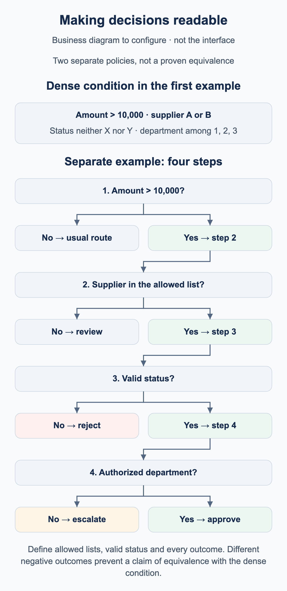<figcaption><p>The four-step example illustrates a policy separate from the dense condition. It makes each negative result visible; it is not a proven equivalent logical transformation. Define allowed lists and exit handling.</p></figcaption></figure>

✅ **Good:**

Visual explanation: [simple condition](#diagram-simple-condition).

<details>
<summary>Simple example: high-value route</summary>

```
IF Amount > 10000:
  → High value path
ELSE:
  → Standard path
```

</details>

❌ **Bad (Too Complex):**

Visual explanation: [maintainable decisions](#diagram-maintainable-decisions).

<details>
<summary>Dense condition example</summary>

```
IF (Amount > 10000 AND (Supplier = "A" OR Supplier = "B") AND NOT (Status = "X" OR Status = "Y") AND Department IN [1,2,3]):
  → Complex path
```

</details>

**Another example: a distinct policy in four stages:**

This example distinguishes the outcomes at each stage. It is not a logically equivalent rewrite of the dense condition above: supplier lists, valid statuses, permitted departments and negative-result handling must be defined for this second example.

Visual explanation: [maintainable decisions](#diagram-maintainable-decisions).

<details>
<summary>Another example: four-step policy</summary>

```
Step 1: IF Amount > 10000: Continue, ELSE: Standard path
Step 2: IF Supplier in allowed list: Continue, ELSE: Review
Step 3: IF Status valid: Continue, ELSE: Reject
Step 4: IF Department authorized: Approve, ELSE: Escalate
```

</details>

***

### 2. Document Decision Logic

**Always include:**

* Purpose of each decision point
* Business rule being implemented
* Expected outcomes
* Exception handling

**Example Documentation:**

#### Diagram: Rule record

<figure>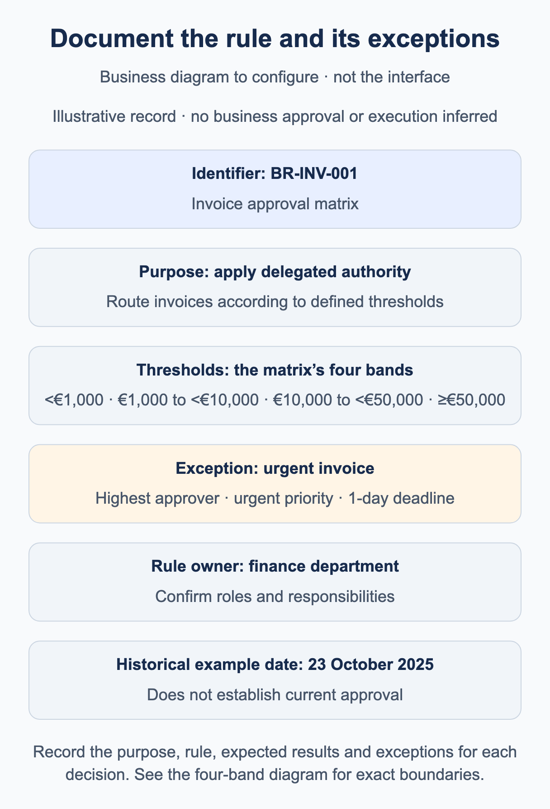<figcaption><p>Illustrative BR-INV-001 rule record: purpose, thresholds, exception, owner and reference date. Referring to the four bands avoids duplicating the rule; this record proves neither approval nor execution.</p></figcaption></figure>

<details>
<summary>Illustrative BR-INV-001 rule record</summary>

```
Decision Point: Amount Threshold Check
Business Rule: BR-INV-001 (Invoice Approval Matrix)
Purpose: Route invoices based on amount thresholds per company policy
Thresholds:
  < €1,000: Auto-approve (CFO approved threshold)
  €1,000 ≤ Amount < €10,000: Manager approval (Delegation matrix)
  €10,000 ≤ Amount < €50,000: Director approval with supplier checks
  Amount ≥ €50,000: Executive approval
Exceptions: Urgent invoices skip to highest level
Updated: 2025-10-23
Owner: Finance Department
```

</details>

***

### 3. Test All Paths

**Proposed test matrix — expected results, not executed tests:**

Verify these expected results in your configuration and record what you observe.

| Test Case | Amount   | Type        | Supplier | Expected Path   | Verification |
| --------- | -------- | ----------- | -------- | --------------- | ------ |
| TC1       | €500     | Invoice     | Existing | Auto-approve    | To test      |
| TC2       | €5,000   | Invoice     | Existing | Manager         | To test      |
| TC3       | €15,000  | Invoice     | New      | Director then CFO    | To test      |
| TC4       | €60,000  | Invoice     | Existing | Executive       | To test      |
| TC5       | €2,000   | Credit Note | Existing | Credit workflow | To test      |
| TC6       | €100,000 | Invoice     | Blocked  | Stop & Escalate | To test      |
| TC7 | €999.99 | Invoice | Existing | Auto-approve | To test |
| TC8 | €1,000 | Invoice | Existing | Manager | To test |
| TC9 | €9,999.99 | Invoice | Existing | Manager | To test |
| TC10 | €10,000 | Invoice | Existing | Director + supplier checks | To test |
| TC11 | €49,999.99 | Invoice | Existing | Director + supplier checks | To test |
| TC12 | €50,000 | Invoice | Existing | Executive | To test |
| TC13 | Missing or invalid | Invoice | Existing | Manual review chosen for this example | To test |
| TC14 | €15,000 | Invoice | New | Director pending: do not create next task | To test |
| TC15 | €15,000 | Invoice | New | Director or CFO rejected: stop chain and handle rejection | To test |
| TC16 | €15,000 | Invoice | New | Both positive approvals: continue configured processing | To test |

***

### 4. Monitor Decision Metrics

**Track:**

* Distribution across decision paths
* Auto-approval rate
* Manual review rate
* Average processing time per path
* Exception rates
* Path utilization

**Fictional example metrics:** These values illustrate a report; they do not prove current performance or execution of this workflow.

#### Diagram: Fictional metrics

<figure>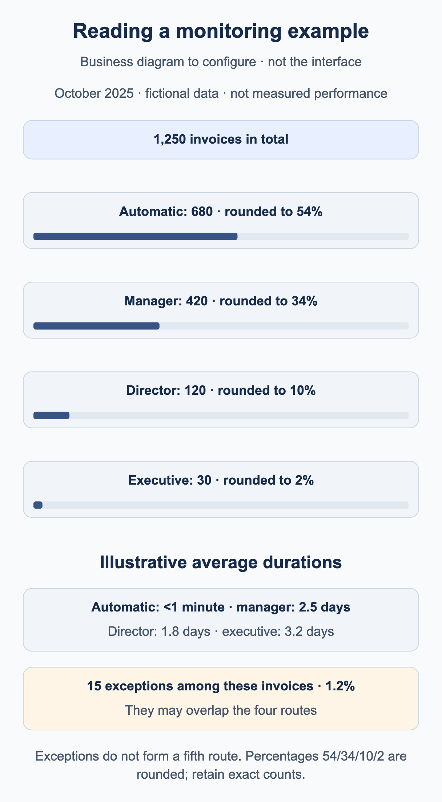<figcaption><p>Fictional example: the four routes total 1,250 invoices. Route percentages are rounded. The 15 exceptions, or 1.2%, may concern these same invoices; they do not form a fifth route. Durations are not measured DocBits performance.</p></figcaption></figure>

<details>
<summary>Fictional distribution and duration example</summary>

```
Month: October 2025
Total Invoices: 1,250

Decision Path Distribution:
- Auto-approved (< €1k): 680 (54%)
- Manager path (€1k ≤ Amount < €10k): 420 (34%)
- Director path (€10k ≤ Amount < €50k): 120 (10%)
- Executive path (Amount ≥ €50k): 30 (2%)

Processing Time:
- Auto-approve: < 1 minute
- Manager path: 2.5 days average
- Director path: 1.8 days average
- Executive path: 3.2 days average

Exceptions: 15 (1.2%)
```

</details>

***

## Related Patterns

### Patterns That Work Well Together:

* [**Task Management Pattern**](task-management-pattern.md) - Create tasks based on decisions
* [**API Integration Pattern**](api-integration-pattern.md) - Fetch data for decision-making
* [**PO Matching Pattern**](po-matching-pattern.md) - Use PO results in decisions
* [**Data Transformation Pattern**](data-transformation-pattern.md) - Transform data before decisions

***

## Related Guides

### Prerequisites

* [Condition Cards Complete Guide](../condition-cards-complete-guide.md) - All condition cards
* [Field Manipulation Guide](../field-manipulation-guide.md) - Field operations
* [Assignment User Guide](../assignment-user-guide.md) - Routing logic

### Related Cards

* **CONDITION\_DOC\_FIELD\_AMOUNT** - [Condition Cards Guide](../condition-cards-complete-guide.md)
* **CONDITION\_DOC\_TYPE\_IS\_ISNOT** - [Condition Cards Guide](../condition-cards-complete-guide.md)
* **CONDITION\_SUPPLIER\_STATUS\_IS\_ISNOT** - [Condition Cards Guide](../condition-cards-complete-guide.md)
* **ACTION\_ASSIGN\_TO\_USER** - [Assignment Guide](../assignment-user-guide.md)
* **tasks\_create** - [Task Assignment Guide](../task-assignment-guide.md)

### Next Steps

* Create tasks: [Task Management Pattern](task-management-pattern.md)
* Add complex matching: [PO Matching Pattern](po-matching-pattern.md)
* Integrate APIs: [API Integration Pattern](api-integration-pattern.md)

***

**Historical example metadata:**

**Pattern Version:** 1.0 **Last Updated:** October 23, 2025 **Difficulty:** Medium **Estimated Time:** 30-45 minutes
