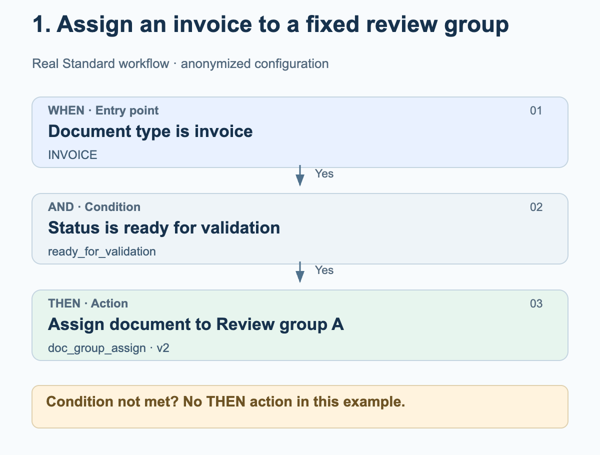
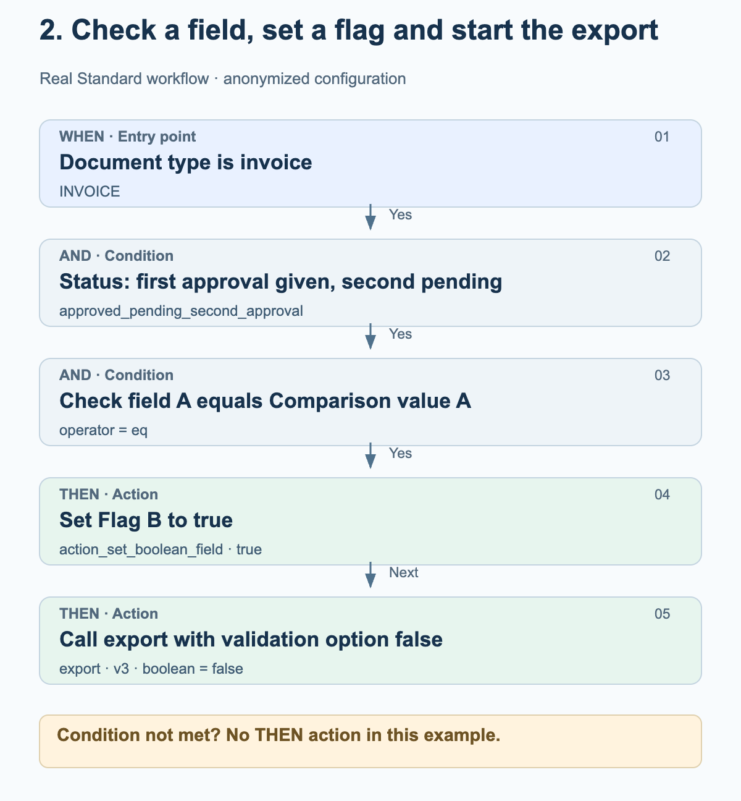
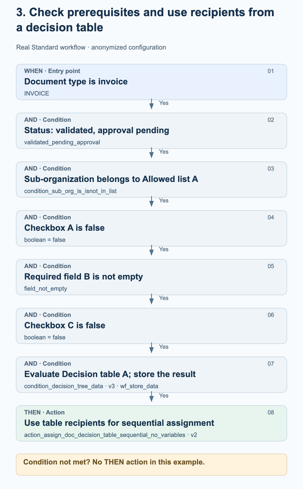

# Real workflow examples from production

These three examples come from enabled Standard workflows in the production environment. They show the actual configured order of WHEN, AND and THEN. Groups, organizations, field names, comparison values and decision tables have been replaced with neutral names. The diagrams explain the configuration; they are not screenshots.

As of October 27, 2026. The cards, versions, parameters and their order were checked against the saved configurations of successful production runs. A workflow log with the result success confirms neither human approval nor receipt in the ERP system. No workflows were changed or run for testing.

## How to read the diagrams

These examples use Standard mode. WHEN limits the document type; all AND conditions must be met before the THEN actions follow. If a condition is not met, no THEN action follows in these examples. Arrows between actions show their configured order. They do not add a success check or an approval step. A run can also end with an error.

## 1. Assign an invoice to a fixed review group

An invoice should be sent to a fixed, configured group for review once it reaches the ready for validation status. This example does not require a decision table.

<figure><figcaption>Invoice with the matching status: the document is assigned to the fixed, configured Review group A. Assignment does not constitute approval.</figcaption></figure>

Cards and settings

| Phase / card | Setting in this example | Meaning |
| --- | --- | --- |
| WHEN · condition_doc_type_is_isnot_list · v2 | operator = is; doc_type = INVOICE | Only invoices meet this condition. |
| AND · condition_doc_status_is_isnot · v2 | operator = is; status = ready_for_validation | The document is ready for validation. |
| THEN · doc_group_assign · v2 | groups = Review group A | Version 2 uses the configured group. The decision table option does not determine behavior in this card version. |

### What to check when adapting this example

- Review group A is an anonymized name. Choose a group in your organization and check its responsibilities.
- Check the document type and status separately: an invoice with a different status does not meet this example's conditions.
- Document assignment, tasks and approval are different operations. This configuration contains only the assignment.

## 2. Check a field, set a flag and start the export

An invoice in a specific approval status is processed further only if its Check field A exactly matches Comparison value A. The workflow then attempts to set Flag B to true and subsequently calls the export. The original field names and comparison value are anonymized.

<figure><figcaption>The field check enables the two actions. Setting the flag is called first, followed by the export call. The status and disabled validation checks are part of this specific configuration.</figcaption></figure>

Cards and settings

| Phase / card | Setting in this example | Meaning |
| --- | --- | --- |
| WHEN · condition_doc_type_is_isnot_list · v2 | operator = is; doc_type = INVOICE | Only invoices meet this condition. |
| AND · condition_doc_status_is_isnot · v2 | operator = is; status = approved_pending_second_approval | The configured status means “first approval given, second approval pending.” It is not replaced here with a more general approval status. |
| AND · condition_docfield_operator_value · v2 | field_name = Check field A; operator = eq; field_value = Comparison value A | The field content must match the configured value; this condition does not merely check that the field is populated. |
| THEN 1 · action_set_boolean_field · v2 | field_name = Flag B; boolean = true | Attempts to set the configured Boolean field to true. |
| THEN 2 · export · v3 | boolean = false | Starts the export with ignore_field_validation_errors = true and validate_po_match = false. Here, false disables validation checks, not the export. |

### What to check when adapting this example

- The false export option is a customer-specific setting, not a general recommendation. Before adapting the example, check field validation, PO matching and approval requirements in particular.
- No additional condition is configured between setting the flag and exporting. The order alone does not guarantee that the first action succeeded; exceptions and action errors must be checked separately.
- The workflow contains no wait step for a second human approval. A successful workflow run does not replace evidence of receipt in the ERP system.

## 3. Check prerequisites and use recipients from a decision table

An invoice should be assigned through a decision table only when the organization, status, two checkboxes and a required field meet the conditions. The workflow stores the data returned by the decision table so that the subsequent sequential assignment can use it.

<figure><figcaption>All six AND conditions must be met. The data returned by the decision table is stored and then used for sequential document assignment. The diagram does not invent recipients or approval levels.</figcaption></figure>

Cards and settings

| Phase / card | Setting in this example | Meaning |
| --- | --- | --- |
| WHEN · condition_doc_type_is_isnot_list · v2 | operator = is; doc_type = INVOICE | Limits this example to invoices. |
| AND 1 · condition_doc_status_is_isnot · v2 | operator = is; status = validated_pending_approval | The document is validated; approval is pending. |
| AND 2 · condition_sub_org_is_isnot_in_list · v2 | operator = is; sub_org_id = Allowed list A | Only the configured sub-organizations are in scope. |
| AND 3 · condition_checkbox_is · v2 | field_name = Checkbox A; boolean = false | The first configured checkbox must be false. |
| AND 4 · condition_docfield_status · v2 | field_name = Required field B; field_status = field_not_empty | The configured field must be populated. |
| AND 5 · condition_checkbox_is · v2 | field_name = Checkbox C; boolean = false | The second checkbox must also be false. |
| AND 6 · condition_decision_tree_data · v3 | decision_table = Decision table A; store_data = wf_store_data | The table is evaluated for the document. The returned data is stored for subsequent cards. The additional legacy boolean field is empty and does not control this version. |
| THEN · action_assign_doc_decision_table_sequential_no_variables · v2 | no card variables of its own | Uses recipients from the stored table result for sequential assignment. Recipients and priorities depend on the table. |

### What to check when adapting this example

- Checkbox A, Required field B and Checkbox C refer to three different configured fields. The neutral names replace the original names.
- A non-empty field check does not confirm that the field content is correct for the business process.
- Check the actual decision table, including its recipients and priorities. Its rules are not published here; no amount thresholds or roles have been invented.
- A successful table evaluation does not guarantee usable recipients. The subsequent assignment requires valid user or group outputs.
- Sequential assignment does not prove that human approval has been completed. This workflow contains no export call.

## Adapt the examples to your configuration

Define the appropriate fields, groups and decision tables in your own organization. Do not assume that the neutral names refer to existing product fields. Check every positive and negative condition case, as well as action errors, in a suitable test environment. Verify approvals and exports against their actual results; enable a workflow only after business acceptance.

[Advanced production workflow examples](advanced-production-workflow-examples.md)
