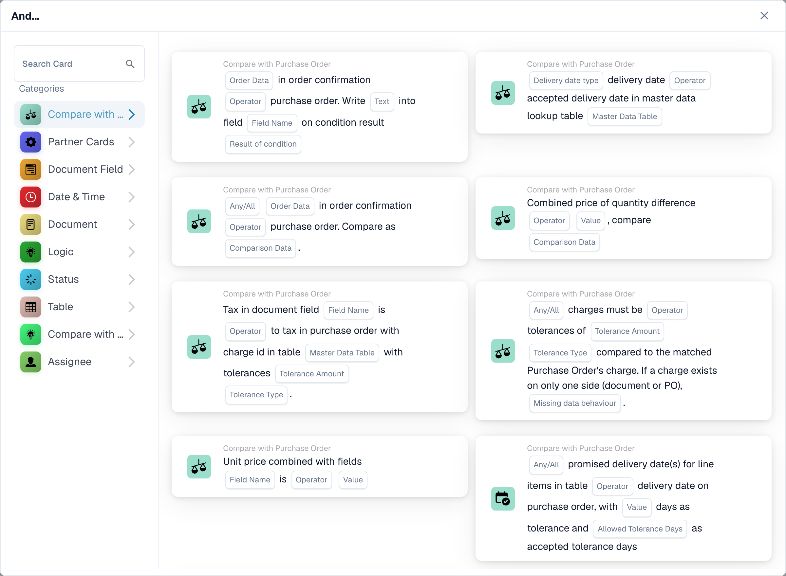

# PO comparisons: direction, tolerance and card versions

<figure><figcaption>
Available cards in the selected category. Configure the placeholders before use.
</figcaption></figure>

PO comparison cards compare a chosen side against a reference side. The reference determines the base for a percentage tolerance. First complete purchase-order matching, then select the comparison, operator, Any/All and tolerance requested by the specific card.

## Comparison directions

| Stored option | Compared side | Reference side |
| --- | --- | --- |
| `po_document` | Purchase order | Document |
| `received_document` | Received data | Document |
| `po_received` | Purchase order | Received data |
| `document_po` | Document | Purchase order |
| `document_received` | Document | Received data |
| `received_po` | Received data | Purchase order |

The received side is derived from the matched purchase-order data. A received comparison on the unit-price card can use quantities to derive a comparable amount; it is not a direct comparison of a quantity with a currency price. Use the values recorded by that card in the log when checking the calculation.

## Why direction matters

For a reference of `100` and a compared value of `110`, a percentage tolerance of `5` corresponds to `5` around the reference. If the document is the reference and its value is editable, changing the document also changes that tolerance base. Choose the reference deliberately, especially for automatic approval.

Reversing the sides reverses ordering operators: `>` becomes `<`, `>=` becomes `<=`, and vice versa. Equality and inequality retain their meaning. Do not reverse an operator without also inspecting the chosen sides.

Releases containing the comparison migration move affected saved cards from `po_document` to `document_po`, and from `received_document` to `document_received`, while reversing the ordering operator. The affected versions are quantity-tolerance v4, order-confirmation-to-PO v4 and unit-price v4/v5. Combined price of quantity difference is excluded from that saved-card migration. Inspect the saved configuration and test its business outcome after a release; do not manually reverse it a second time.

## Unit-price card versions

| Version | Configuration |
| --- | --- |
| v3 | Uses the earlier comparison behavior. Do not assume it exposes the newer direction and tolerance fields. |
| v4 | Adds the comparison-side selection. |
| v5 | Includes Any/All, operator, tolerance amount, tolerance type and comparison-side selection. |

Choose an absolute tolerance for a fixed amount and a percentage tolerance for a variance relative to the selected reference. Use the operator offered by the card; exact equality and being within a tolerance are different decisions. There is no universal business tolerance suitable for every supplier or document type.

## Verification example

1. Use a matched PO reference of `100` and document value `110`.
2. Select Document to Purchase Order, a within-tolerance comparison where offered, and `5` percent. Expect an out-of-band comparison.
3. Test the exact tolerance boundary, values on either side and a missing matched PO.
4. With several lines, verify Any versus All using one passing and one failing line.
5. Inspect the log's compared values, selected sides, operator and tolerance, then verify the resulting workflow branch.

An unmatched PO, a nonnumeric value and a false business condition are different results. Do not treat missing data as a successful match. For charges, use [Any / All Charges](and/compare-with-purchase-order/any-all-charges.md), which separately explains missing-charge behavior and v2/v3.

Continue with the [PO Matching Guide](po-matching-complete-guide.md) and the individual card reference for its remaining fields.
