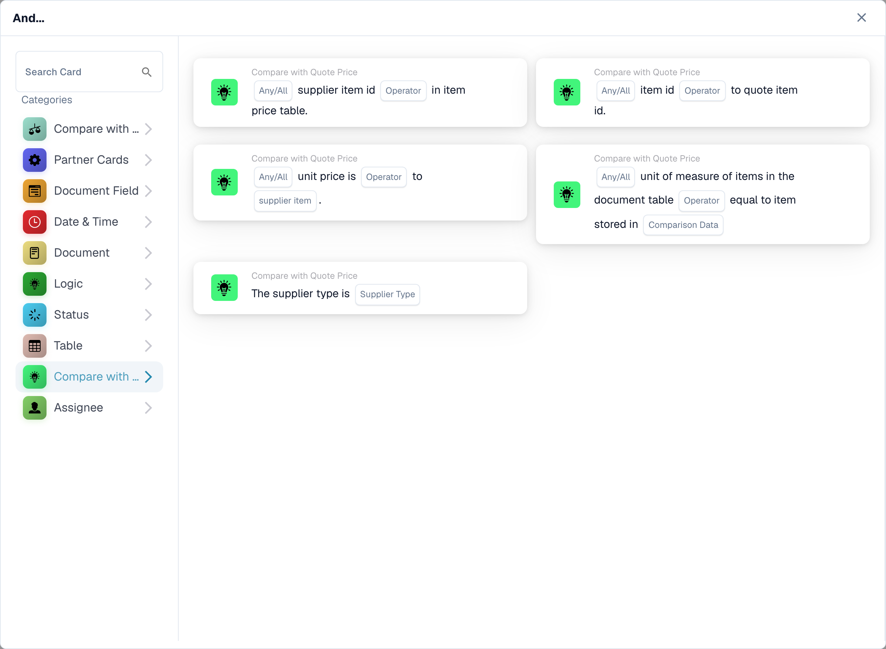

# Quote comparison cards

<figure><figcaption>
Available cards in the selected category. Configure the placeholders before use.
</figcaption></figure>

These And conditions use the quote or supplier-item data available on the document. Configure and test them after the required quote data has been loaded. A matching item identifier does not by itself prove that its price or unit of measure is correct.

## Select the check

| Card type | Check and configuration |
| --- | --- |
| `CONDITION_QUOTES_ITEM_NUMBER_COMPARISON` | Checks the item identifier against the item-price data. Select the comparison and Any/All fields offered by the card. |
| `CONDITION_SPECIFY_SUPPLIER_TYPE` | Compares the supplier type from the quote data with `supplier_type`. This is a supplier classification check, not a price comparison. |
| `CONDITION_QUOTE_SUPPLIER_ITEM_NUMBER_EXISTS` | Checks whether the supplier item ID is or is not present in the item-price data; choose the operator and Any/All. Missing quote or item data must be investigated in the log. |
| `CONDITION_QUOTE_PRICE_MATCH` | Compares a unit price with the selected supplier price: `ManagedPrice` or `LastPrice`. Choose Any/All and the numeric comparison operator. Lines without a comparable number on either side are skipped and logged; if no line is comparable, the card reports missing document data. |
| `CONDIITON_UNIT_OF_MEASURE_EQUAL` | Checks the unit of measure against the related data. The technical type contains a retained spelling error; do not change it in stored workflow JSON. A price expressed per different units needs separate attention. |
| `CONDITION_ITEM_QUOTES_TO_CONTRACTED_PRICE` | Compares quoted and contracted prices. Version 3 adds Any/All; see below. |

Visible labels can differ by release and UI language. Select by the actual check, not only by the category name. For example, Quoted Item Price may appear under Logic while the other quote checks appear in Compare with Quote Price.

## Quoted Item Price: version 3

Choose the equality or inequality operator and whether any compared line or every compared line must satisfy it:

- `match_any`: one successful comparable line is sufficient.
- `match_all`: every compared line must satisfy the selected operator.

Version 2 retains the All behavior. An unset Any/All setting on v3 falls back to All and is logged. A card with no comparable lines reports missing data; absence of a price is not proof of equality or inequality. Inspect skipped lines and their missing side in the log.

For example, two comparable lines produce results true and false for equality. Any passes; All fails. With inequality the comparison result for each line changes first, and Any/All then combines those results. It does not invert the final All result to implement Any.

## Test cases

Use exact item and supplier IDs, the intended price source and matching units. Test all lines matching, a mixed result, no comparable prices, missing quote data and a wrong supplier ID. Verify both the comparison result and which lines were skipped. Keep approval or export behind the business checks that are actually required; a successful identifier check is not a complete procurement validation.

See [PO Matching](po-matching-complete-guide.md) for purchase-order comparisons and [Workflow Logs](../workflow-logs.md) for troubleshooting.

<!-- workflow-card-complete-example-20261021 condition_quotes_item_number_comparison -->

### Item-number comparison example

**Configuration:** Prepare two comparable quote lines: supplier item `DEMO-S1` maps to item `DEMO-I1` on both sides; supplier item `DEMO-S2` has document item `DEMO-I2` and matrix item `DEMO-I9`. Choose equality and `match_all`.

**Expected result and counterexample:** The condition result is false with `match_all`, because one comparable item number differs. The result is true with `match_any`, because the first item number matches. The lookup uses the supplier item number. A matrix entry without an item number is skipped and logged; if no line is comparable, the condition result is false. A date-range log alone is not a separate validity condition.

This is an illustrative test configuration and expected outcome; it was not executed. Use data and recipients configured in your test organization.

<!-- workflow-card-complete-example-20261021 condition_quote_supplier_item_number_exists -->

### Supplier item existence example

**Configuration:** The document has supplier item numbers `DEMO-S1` and `DEMO-S2`; the loaded supplier item-price data contains only `DEMO-S1`. Choose the presence operator and `match_all`.

**Expected result and counterexample:** The condition result is false with `match_all` and true with `match_any`. With the absence operator, the second line is a positive absence result. Existence does not prove that item price, unit or supplier classification is correct. Load valid quote data first and inspect missing-data errors.

This is an illustrative test configuration and expected outcome; it was not executed. Use data and recipients configured in your test organization.

<!-- workflow-card-complete-example-20261021 condition_quote_price_match -->

### Supplier price example

**Configuration:** For two matched lines choose `ManagedPrice`, equality and `match_all`. Document prices are `10` and `12`; the corresponding managed prices are `10` and `13`, in matching currencies and units.

**Expected result and counterexample:** The condition result is false with `match_all` and true with `match_any`. Switching to `LastPrice` uses a different source and must be tested independently. A line without a comparable numeric price is skipped and logged; if no line is comparable, the card reports missing document data, not equality.

This is an illustrative test configuration and expected outcome; it was not executed. Use data and recipients configured in your test organization.

<!-- workflow-card-complete-example-20261021 condition_specify_supplier_type -->

### Supplier classification example

**Configuration:** Choose supplier type `Contract`. Prepare two loaded quote-supplier entries with `managed_class` equal to `contract`.

**Expected result and counterexample:** The condition is true when every loaded entry has that classification. The condition is false if one entry has classification `managed`. The selectable `Nonmanaged` value is normalized to `unmanaged` by the backend. This classification is unrelated to a supplier legal form. Missing quote data is not a match.

This is an illustrative test configuration and expected outcome; it was not executed. Use data and recipients configured in your test organization.

<!-- workflow-card-complete-example-20261021 condiiton_unit_of_measure_equal -->

### Unit-of-measure example

**Configuration:** Prepare matched quote rows with document unit `EA` and supplier comparison unit `EA`. Choose equality and `match_all`; retain the card version being tested.

**Expected result and counterexample:** The condition is true for matching comparable units; a second comparable row using `KG` instead of `EA` makes the condition false with `match_all`. Missing comparison units are skipped and logged; if none is comparable, the card reports missing data. Version 3 may apply the configured unit mapping, so verify that mapping separately. Matching prices alone does not establish matching units.

This is an illustrative test configuration and expected outcome; it was not executed. Use data and recipients configured in your test organization.
