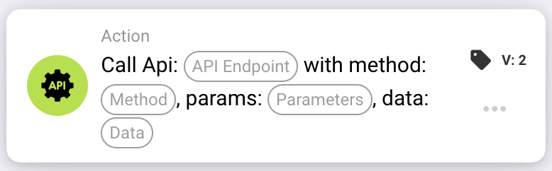

# Call Api

<figure><figcaption></figcaption></figure>

<!-- workflow-card-call-api-contract-20261022 -->

## Purpose

Use `call_api` to call an endpoint within the configured DocBits API. The endpoint is a relative path appended to the DocBits API base address. Entering an arbitrary external URL does not configure a third-party API integration.

## Configuration

Set the endpoint path, HTTP method, query parameters and request data supported by that endpoint. The request uses the current DocBits user context. Missing `org_id` and `triggered_by_docflow` values are added automatically. Parameter and data objects, or their supported text representation, must be valid for this card version. This version does not provide a general JSON response-field mapping.

## Result and limits

The response body is converted to a Boolean: plain `true`, `1`, `yes` or `on` becomes true; an unrecognized response, including an arbitrary JSON object, defaults to false. HTTP status alone does not determine the Boolean result. A timeout or request exception returns false. In card-testing mode the call is simulated and returns true without sending the request; this does not prove authentication, reachability or endpoint behavior.

<!-- workflow-card-practical-example-20261021 -->

## Practical example

When I need a Boolean result from a configured DocBits API endpoint, I use this card after the required conditions. In an isolated test, select an existing, documented, read-only DocBits endpoint with the intended Boolean response contract and the appropriate method, for example `GET`. Use only its supported demo parameters.

Expected result and counterexample: for a hypothetical HTTP `200` response whose complete body is `true`, the card result is true. With body `false`, it is false. A body such as `{"approved": true}` is not automatically mapped to true. Check the actual response and logs separately. This is a source-reviewed worked example; no request or workflow was executed.
