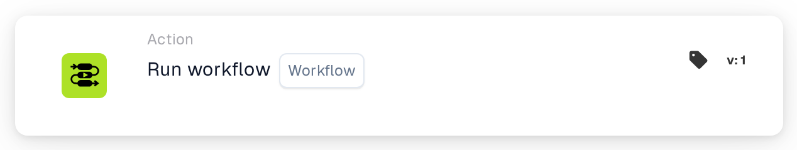

# Run Workflow

<figure><figcaption>
Version 1
</figcaption></figure>

<figure><figcaption>
Version 2
</figcaption></figure>

## Purpose:

The **"Run Workflow"** card allows users to dynamically execute a selected workflow from a list of available workflows. This card is useful for automating processes where multiple workflows are interconnected, enabling streamlined operations.

## Components of the Card:

1. **Workflow**
   * **Description:** Specifies the workflow to be executed when the conditions evaluate as true.
   * **Detail:** A dropdown list of all available workflows is provided for selection.

## Functionality:

* **Condition Evaluation:** The card executes the selected workflow only if both the **"When"** and **"And"** evaluate as true.
  * If either condition is false, no action is taken, and the workflow remains untriggered.
* **Workflow Execution:**
  * When the conditions are met, the specified workflow is triggered automatically.
  * If the conditions are not met, no workflow is executed.

## Setup and Configuration:

1. **Select Workflow:** Choose the workflow to be triggered from the **dropdown list** of available workflows.
2. **Define Conditions:** Configure the **"When"** and **"And"** to specify the criteria that must be met for the workflow to execute.

## Conclusion:

The **"Run Workflow"** card offers a convenient and efficient way to link workflows, automating multi-step processes with ease. By ensuring the conditions in the **"When"** and **"And"** are met, users can execute workflows dynamically and reduce manual intervention.

<!-- workflow-card-practical-example-20261021 -->

## Practical example

**When to use:** Reuse an existing validation workflow.

**Configuration:** Select a configured demo child workflow that sets `routing_result` to `checked`.

**Expected result and counterexample:** The selected workflow is invoked in its supported execution context. Verify its own log and field result; do not link it back to the parent in a loop.

This is an illustrative configuration and expected outcome. Use fields, users and groups configured in your test organization; it is not a claim that this example was executed.
