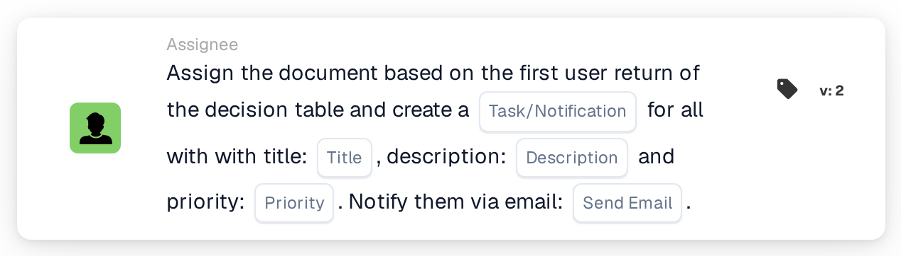

# Assign Document to First Decision Table User and Create Tasks

<figure><figcaption>
Version 2
</figcaption></figure>

## Purpose:

This workflow card uses the users returned by a decision table in two ways: the document is assigned to the first returned user, and every returned user, including the first, receives a task or notification about the document. This way one person becomes responsible for the document while the others are informed or asked to act as well.

The users come from a decision table that is evaluated earlier in the same workflow, for example with the card **Decision Table has Returns**, set to use the returned data in subsequent cards.

## Components of the Card:

1. **Task/Notification**
   * **Description:** Defines whether a task or a notification is created for the returned users.
   * **Options:**
     * **Task:** A task is created for each user.
     * **Notification:** A notification is created for each user.
2. **Title**
   * **Description:** The title of the task or notification.
   * **Detail:** A short text that identifies the task or notification.
3. **Description**
   * **Description:** Further details about the task or notification.
   * **Detail:** A text that describes what should be done or why the users are informed.
4. **Priority**
   * **Description:** The urgency of the task or notification.
   * **Options:**
     * **high weight:** The task or notification is created with high priority.
     * **medium weight:** The task or notification is created with medium priority.
     * **low weight:** The task or notification is created with low priority.
5. **Send Email**
   * **Description:** Defines whether the users are also informed about the task or notification by email.
   * **Options:**
     * **True:** An email notification is sent.
     * **False:** No email notification is sent.

## Functionality:

* **Reading the Decision Table:** The card reads the users returned by the decision table earlier in the workflow. Only returned users are taken into account, not groups.
* **Document Assignment:** The document is assigned to the first returned user.
* **Task Creation:** For every returned user, a task or notification is created with the title, description and priority from the card. Each user receives their own task. The tasks are created even if the assignment of the document did not succeed; the workflow log shows the result of the assignment and of every task.
* **Default Values:** If no priority is set, **medium weight** is used. If **Send Email** is not set, no email is sent. If **Task/Notification** is not set, a task is created and the workflow log notes the missing setting.
* **Missing Data:**
  * If the decision table returned no user, nothing is assigned and the card reports the missing data in the workflow log.
  * If the title or the description is empty, the document is not assigned, no task is created and the card reports the missing data.

## Setup and Configuration:

* A decision table that returns users should be evaluated earlier in the workflow, for example with the card **Decision Table has Returns**. The order of the returned users matters, because the first one receives the document.
* The card can be added from the **Assignee** category. After that, the type (**Task** or **Notification**), the title, the description, the priority and the email setting can be configured.

## Conclusion:

The "Assign Document to First Decision Table User and Create Tasks" workflow card combines a clear responsibility for the document with information for everyone the decision table names. It is useful when one person should own the document while others need to be involved or kept up to date.
