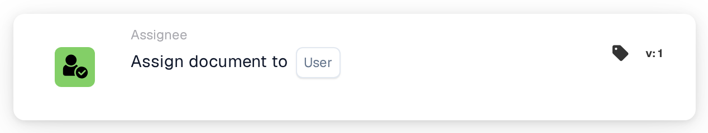
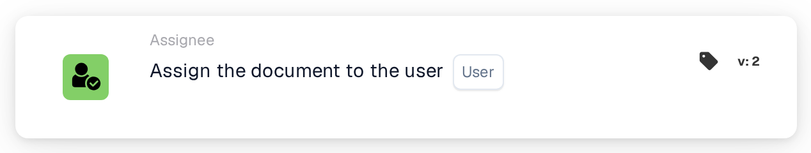
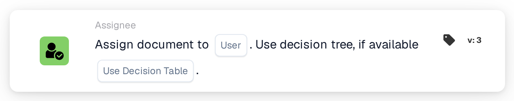

# Assign document to User

<figure><figcaption>
Version 1
</figcaption></figure>

<figure><figcaption>
Version 2
</figcaption></figure>

<figure><figcaption>
Version 3
</figcaption></figure>

## **Purpose:**

The **"Assign Document to User"** workflow card allows users to assign a document to a specific user, ensuring smooth workflow management by routing documents to the appropriate person. Version 3 adds the capability to use a decision tree to dynamically determine the user assignment based on available conditions.

## **Components of the Card:**

1. **User**
   * **Description:** Specifies the user to whom the document will be assigned.
   * **Detail:** A dropdown list of all available users is provided for selection. The selected user will be assigned the document for further action.

## **Additional Components in Version 3:**

1. **Use Decision Tree**
   * **Description:** If enabled, the card uses a decision tree to dynamically determine the user assignment.
   * **Options:**
     * **True:** Uses the decision tree for dynamic user assignment.
     * **False:** Assigns the document to the selected user without using the decision tree.

## **Functionality:**

* **Condition Evaluation:**\
  The card only executes its action if both the **"When"** and **"And"** evaluate as true.
* **Document Assignment:**\
  The card assigns the document to the selected user, ensuring that the task is routed to the appropriate person for action. This helps with accountability and effective document management.
* **Decision Tree (Version 3):**\
  If the decision tree is enabled, the card evaluates the conditions defined within the tree to dynamically select the user for document assignment.

## **Setup and Configuration:**

* **Select User:**\
  Choose the **user** from the dropdown list to whom the document will be assigned.
* **Use Decision Tree (Version 3):**\
  Enable or disable the use of the decision tree to dynamically select the user.

## **Conclusion:**

The **"Assign Document to User"** workflow card facilitates efficient document routing by assigning it to the selected user, with the added flexibility in Version 3 to dynamically determine the user using a decision tree. This ensures a more adaptive and efficient workflow process.

<!-- workflow-card-practical-example-20261021 -->

## Practical example

**When to use:** Send invoices needing manual review to one responsible person.

**Configuration:** Select configured user `Demo Reviewer A`.

**Expected result and counterexample:** The document is assigned to that user. Confirm the resulting document assignment; this card does not by itself create a separate review task.

This is an illustrative configuration and expected outcome. Use fields, users and groups configured in your test organization; it is not a claim that this example was executed.
