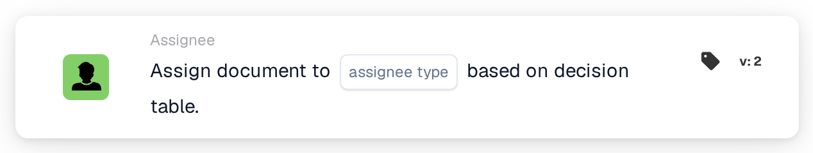

# Assign document to

<figure><figcaption>
Version 2
</figcaption></figure>

## Purpose:

The **"Assign document to \[User/group] based on decision table"** workflow card dynamically assigns documents to users or groups based on the outcome of a **decision table**. This feature ensures that document assignment is handled efficiently and consistently based on predefined conditions.

## Components of the Card:

1. **User/Group**
   * **Description:** Specifies the **user** or **group** to whom the document will be assigned.
   * **Detail:** Selected based on the outcome of the **decision table**.
2. **Decision Table**
   * **Description:** A **decision table** is used to determine the appropriate **user** or **group** for document assignment.
   * **Detail:** Uses the decision table defined in the **"and"** section.

## Functionality:

* **Condition Evaluation:** The card only executes its action if both the **"When"** and **"And"** evaluate as true.
* **Dynamic Document Assignment:** The document is assigned to the **user** or **group** determined by the **decision table**.

## Setup and Configuration:

* **Define Decision Table:** Set up the **decision table** to include the conditions for determining the target **user** or **group**.
* **Assign Document to User/Group:** The document will be dynamically assigned based on the decision table's outcome.

## Conclusion:

The **"Assign document to \[User/group] based on decision table"** workflow card provides dynamic document assignment capabilities based on decision logic. This ensures accurate and efficient processing by automatically directing documents to the appropriate **user** or **group**, enhancing workflow automation.

<!-- workflow-card-practical-example-20261021 -->

## Practical example

**When to use:** Choose a document assignee from a decision table.

**Configuration:** Select a demo decision table whose matching rule returns the configured reviewer, and choose the assignee type offered by this card version.

**Expected result and counterexample:** The returned user or group becomes the document assignee. An empty decision-table result must be diagnosed separately.

This is an illustrative configuration and expected outcome. Use fields, users and groups configured in your test organization; it is not a claim that this example was executed.
