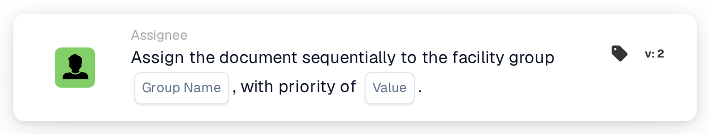

# Assign Sequentially to Facility Group

<figure><figcaption>
Version 2
</figcaption></figure>

## Purpose:

This workflow card adds the group responsible for the facility of the document's purchase order to the sequential assignment of the document. Like **Assign Document to Facility Group**, it finds the group through the facility code of the matched purchase orders. Instead of assigning the document right away, it adds the group to the order of approvers with a priority, so that several sequential cards in a workflow can build a chain of assignments.

## Components of the Card:

1. **Group Name**
   * **Description:** The name part that the facility groups have in common.
   * **Detail:** A text that is compared with the names of the user groups of the organization. A group matches if its name contains this text and the facility code of the purchase order. The comparison ignores upper and lower case. For example, with the group name **Approver** and a purchase order for facility **1000**, a group called **Approver 1000** would match.
2. **Value**
   * **Description:** The priority of the group within the sequential assignment.
   * **Detail:** A whole number. Lower numbers come first, with 0 as the highest priority. If no value is entered, or a negative value is entered, the priority 1 is used.

## Functionality:

* **Finding the Facility:** The card reads the purchase orders the document is matched with and collects the facility code (the location of the purchase order) of each of them.
* **Finding the Group:** For every facility code, the card looks for user groups whose name contains both the **Group Name** from the card and the facility code. Facility codes for which no group is found are listed in the workflow log.
* **Action Execution:** Every matching group is added to the sequential assignment with the priority from the **Value** field. The assignment itself happens at the end of the workflow run: the entry with the lowest priority number is assigned first, and all entries, including the first, are stored on the document as its approval requests. The following steps of the sequence are taken from them in ascending order of priority. If another card has already assigned the document directly in the same run, this first sequential assignment is skipped.
* **Missing Data:**
  * If no group name is entered on the card, the card does not run and reports the missing data in the workflow log.
  * If the document is not matched with a purchase order, the card reports the missing data instead of adding a group.
  * If no group matches any of the facility codes, no group is added and the workflow log notes that no matching group was found.

## Setup and Configuration:

* The user groups should be named so that each name contains the common name part and the facility code, for example **Approver 1000**, **Approver 2000**.
* The card can be added from the **Assignee** category. After that, the common name part of the groups is entered in the **Group Name** field and the priority in the **Value** field.
* To build a chain of approvers, several sequential cards can be combined in the workflow, each with its own priority, for example the facility group with priority 1 and a central group with priority 2.

## Conclusion:

The "Assign Sequentially to Facility Group" workflow card places the responsible facility team at a defined position in a sequential approval. Together with other sequential cards it allows approval chains in which the facility team is one of several steps.
