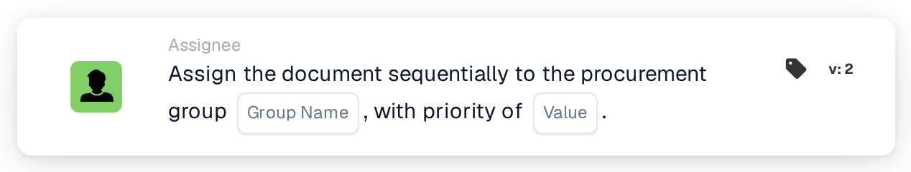

# Assign Sequentially to Procurement Group

<figure><figcaption>
Version 2
</figcaption></figure>

## **Purpose**

The "**Assign the Document Sequentially to the Procurement Group**" workflow card enables the sequential assignment of documents to a specified procurement group. The priority value determines the order of assignment, where lower numbers represent higher priority.

## **Components of the Card**

1. **Group**
   * **Description**: A text input field where the name of the procurement group can be entered.
   * **Detail**: Specifies the procurement group to which the document will be assigned.
2. **Priority (Value)**
   * **Description**: A numeric input field where the priority level for the group can be set.
   * **Detail**: Lower numbers signify higher priority, ensuring that documents are assigned to groups in ascending order of priority.

## **Functionality**

* **Document Assignment**:\
  The card assigns documents to the specified procurement group in a sequential manner.\
  Priority values dictate the assignment order, with lower numbers being processed first.

## **Setup and Configuration**

1. Add the **Assign the Document Sequentially** card to your workflow.
2. Configure the **Group** field:
   * Enter the name of the procurement group in the text field.
3. Configure the **Priority (Value)** field:
   * Enter a numeric value to set the assignment priority.
4. Save and activate the workflow to apply the configuration.

## **Conclusion**

The "Assign the Document Sequentially to the Procurement Group " workflow card ensures effective document allocation to procurement groups based on priority. This enhances organizational efficiency and task management.

<!-- workflow-card-practical-example-20261021 -->

## Practical example

**When to use:** Prioritize a procurement group within document review.

**Configuration:** Select `Demo Procurement` and priority `10`.

**Expected result and counterexample:** The document receives the procurement-group assignment at priority `10`. Check that later assignments use the intended higher numeric priorities.

This is an illustrative configuration and expected outcome. Use fields, users and groups configured in your test organization; it is not a claim that this example was executed.
