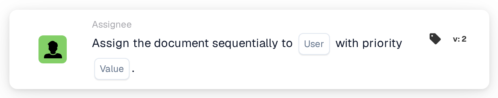

# Assign Sequentially to User

<figure><figcaption>
Version 2
</figcaption></figure>

## **Purpose**

The "**Assign Sequentially to User**" workflow card automates the assignment of documents to a selected user in a sequential manner. The priority value determines the order of assignment, with lower numbers representing higher priority.

## **Components of the Card**

1. **User**
   * **Description**: The selected user will be assigned the document based on the workflow sequence.
   * **Detail**: A dropdown menu that lists all available users for assignment.
2. **Priority (Value)**
   * **Description**: A numeric input field where the priority level for the user can be set.
   * **Detail**: Lower numbers signify higher priority. Documents are assigned to users in ascending order of priority.

## **Functionality**

* **Document Assignment**:\
  The card assigns documents to the selected user sequentially, considering the priority level.\
  If multiple users have the same priority, the documents are assigned in the order users appear in the dropdown menu.

## **Setup and Configuration**

1. Add the **Assign the Document Sequentially** card to your workflow.
2. Configure the **User** field:
   * Select a user from the dropdown menu.
3. Configure the **Priority (Value)** field:
   * Enter a numeric value to set the assignment priority.
4. Save and activate the workflow to apply the configuration.

## **Conclusion**

The "Assign the Document Sequentially to User" workflow card ensures organized document distribution by assigning documents in a prioritized sequence. This enhances task management and reduces delays in processing.

<!-- workflow-card-practical-example-20261021 -->

## Practical example

**When to use:** Add a user to a prioritized document-approval sequence.

**Configuration:** Select `Demo Reviewer A` and priority `10`. Add a separate assignment at priority `20` when a later reviewer is needed.

**Expected result and counterexample:** The assignments carry the configured priorities; the lower numeric value has higher priority. Check the assignment sequence, not just the order of cards on the canvas.

This is an illustrative configuration and expected outcome. Use fields, users and groups configured in your test organization; it is not a claim that this example was executed.
