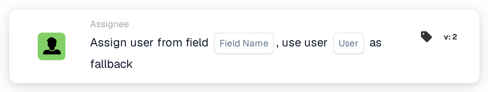

# Assign user from field

<figure><figcaption>
Version 2
</figcaption></figure>

## **Purpose:**

The **"Assign User from Field with Fallback"** workflow card dynamically assigns a user based on the value found in a specified document field. If the field does not contain a valid user, a fallback user is selected from a predefined list of available users to ensure the task or action is properly assigned.

## **Components of the Card:**

1. **Field Name**
   * **Description:** Specifies the **document field** that contains the user information to be assigned.
   * **Detail:** This field is evaluated to determine which user should be assigned. If the field contains a valid user, that user will be assigned the task. If the field is empty or invalid, the fallback user will be assigned.
2. **User (Fallback)**
   * **Description:** Specifies the **fallback user** to be assigned if the document field does not contain a valid user.
   * **Detail:** A dropdown list of all available users is provided for selection. This user will be assigned if the document field is empty or does not contain a valid user.

## **Functionality:**

* **Condition Evaluation:**\
  The card only executes its action if both the **"When"** and **"And"** evaluate as true.
* **Field-Based User Assignment:**\
  The card first attempts to assign the task or action to the user identified in the **Field Name**.
* **Fallback User Assignment:**\
  If the field does not contain a valid user (or is empty), the card assigns the task to the fallback user selected from the **User (Fallback)** dropdown list.

## **Setup and Configuration:**

* **Select Field Name:**\
  Choose the **document field** that specifies the user for assignment.
* **Select Fallback User:**\
  Choose the **fallback user** from the dropdown list. This user will be assigned the task if the document field does not contain a valid user.

## **Conclusion:**

The **"Assign User from Field with Fallback"** workflow card ensures that a task or action is always assigned to a valid user. If the user in the document field is not available, the fallback user is automatically assigned, providing flexibility and ensuring task completion.

<!-- workflow-card-practical-example-20261021 -->

## Practical example

**When to use:** Assign the reviewer named by document data.

**Configuration:** Select field `reviewer_name` and fallback user `Demo Reviewer A`. Supply a resolvable demo user name in the first test.

**Expected result and counterexample:** A valid field value selects that user. An empty or unresolvable value uses the configured fallback; verify both cases.

This is an illustrative configuration and expected outcome. Use fields, users and groups configured in your test organization; it is not a claim that this example was executed.
