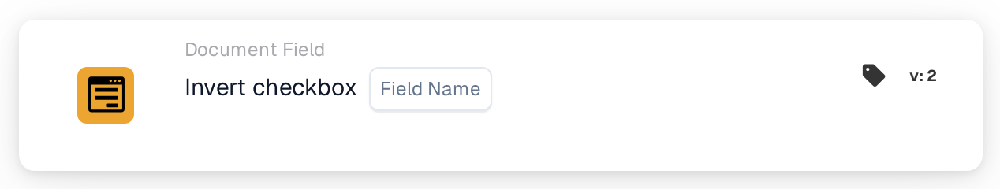

# Invert Checkbox

<figure><figcaption>
Version 2
</figcaption></figure>

## **Purpose:**

This workflow card is designed to invert the current state of a checkbox field. If the checkbox is checked (true), it will be unchecked (false), and vice versa. The inversion occurs based on the conditions set in the **"When"** and **"And."** This card helps automate workflows where a condition requires toggling a checkbox based on specific criteria.

## **Components of the Card:**

1. **Field Name**
   * **Description**: Specifies the checkbox field to be inverted.
   * **Detail**: The selected checkbox field will have its state toggled from true to false or from false to true based on its current state.

## **Functionality:**

* **Condition Evaluation**: The system evaluates the conditions defined in the **"When"** and **"And"**:
  * If **both conditions are true**, the **"Then Section"** action will execute, which in this case means the checkbox field will be toggled.
  * If **either condition is false**, the card will not execute and no change will be made to the checkbox field.
* **Action Execution**: If the conditions in the **"When"** and **"And"** evaluate to true, the checkbox field's state will be inverted:
  * If the checkbox is checked (true), it will be unchecked (false).
  * If the checkbox is unchecked (false), it will be checked (true).

## **Setup and Configuration:**

To configure this card, users need to:

1. **Select the checkbox field** (Field Name) that will be inverted. The available checkbox fields in the document are listed for selection.
2. The checkbox field will only be inverted if the conditions in both the **"When"** and **"And"** are true.

## **Conclusion:**

The **"Invert checkbox \[Field Name]"** workflow card offers a simple yet powerful automation tool to toggle checkbox values based on specific conditions. By reducing the need for manual checkbox adjustments, this card enhances efficiency in document processing and ensures consistency across workflows.

<!-- workflow-card-practical-example-20261021 -->

## Practical example

**When to use:** Toggle a Boolean value when that is the intended business operation.

**Configuration:** Select checkbox `demo_flag` with initial value `false`.

**Expected result and counterexample:** One execution makes it `true`; a second execution makes it `false` again. Use Set checkbox instead when retries must always leave the same value.

This is an illustrative configuration and expected outcome. Use fields, users and groups configured in your test organization; it is not a claim that this example was executed.
