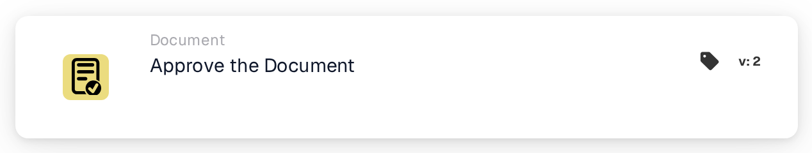

# Approve the Document

<figure><figcaption>
Version 1
</figcaption></figure>

<figure><figcaption>
Version 2
</figcaption></figure>

## **Purpose:**

The **"Approve the Document"** workflow card is used to mark a document as approved. It allows the document to progress to the next stage in the workflow, enabling automated processing or approval workflows to be executed. This card helps streamline document management processes, ensuring that only approved documents move forward for further actions.

## **Components of the Card:**

1. **Approval Status**
   * **Description**: This component marks the document as approved.
   * **Detail**: When this card is triggered, the document's approval status is updated to indicate approval. This action can be set based on the conditions defined in the **"When"** and **"And."**

## **Functionality:**

* **Condition Evaluation**: The system evaluates the conditions set in the **"When"** and **"And"**.
  * If **both conditions are true**, the document will be marked as approved.
  * If **either condition is false**, the card will not execute, and the document’s approval status will remain unchanged.
* **Action Execution**: When the conditions are met, the document is approved. This change is reflected in the document status, allowing it to continue further in the workflow.

## **Conclusion:**

The **"Approve the Document"** workflow card is a key component for automating document approval in business workflows. By ensuring that only documents that meet specific criteria are approved, it helps maintain consistency, reduces manual oversight, and allows for smoother document processing.

<!-- workflow-card-practical-example-20261021 -->

## Practical example

**When to use:** Approve a document after all required review conditions have passed.

**Configuration:** Place this action after the review conditions in the successful branch. Use a demo document awaiting approval.

**Expected result and counterexample:** The action approves that document. A document failing an earlier condition never reaches this action; approval alone is not proof of a completed ERP export.

This is an illustrative configuration and expected outcome. Use fields, users and groups configured in your test organization; it is not a claim that this example was executed.
