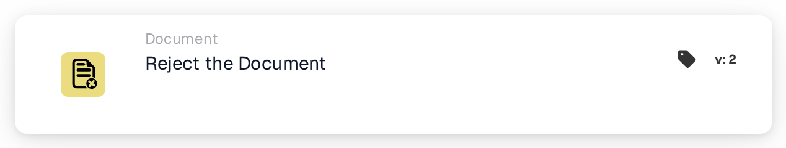

# Reject the Document

<figure><figcaption>
Version 1
</figcaption></figure>

<figure><figcaption>
Version 2
</figcaption></figure>

## **Purpose:**

The **"Reject the Document"** workflow card is used to mark a document as rejected within a workflow. This action halts the document’s progress and prevents it from moving to the next stage in the workflow. It ensures that documents which do not meet the necessary conditions or criteria are flagged and prevented from further processing.

## **Components of the Card:**

1. **Rejection Status**
   * **Description**: This component marks the document as rejected, signaling that it did not meet the required conditions for approval.
   * **Detail**: When triggered, this card updates the document’s status to "rejected." This decision is made based on the conditions set in the **"When"** and **"And."**

## **Functionality:**

* **Condition Evaluation**: The system evaluates the conditions set in the **"When"** and **"And"**.
  * If **both conditions are true**, the document will be rejected.
  * If **either condition is false**, the card will not execute, and the document’s status will remain unchanged.
* **Action Execution**: When the conditions are satisfied, the document is marked as rejected. This action ensures that only documents that meet specific criteria proceed further, while others are flagged and halted for review or correction.

## **Conclusion:**

The **"Reject the Document"** workflow card is an essential tool for controlling document flow in automated processes. By allowing rejection of non-compliant documents, it ensures that only valid and accurate documents continue through the workflow, improving efficiency and accuracy in document management.

<!-- workflow-card-practical-example-20261021 -->

## Practical example

**When to use:** Reject a document that meets a defined rejection rule.

**Configuration:** Route a deliberately invalid demo document into this action, for example after an explicit rejection decision.

**Expected result and counterexample:** The document is rejected. A valid document must follow a different branch and must not execute this action.

This is an illustrative configuration and expected outcome. Use fields, users and groups configured in your test organization; it is not a claim that this example was executed.
