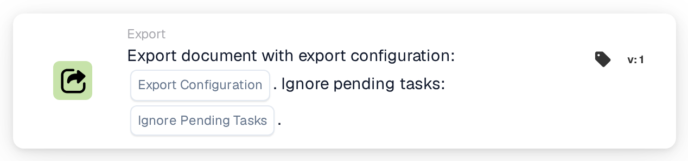
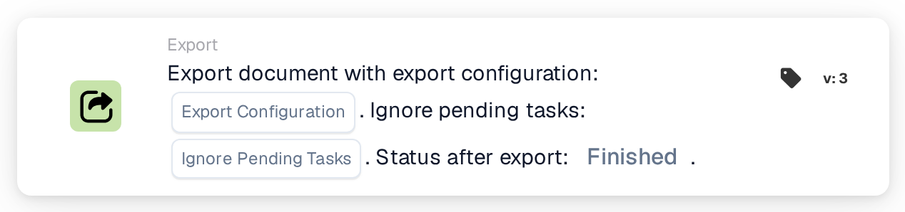
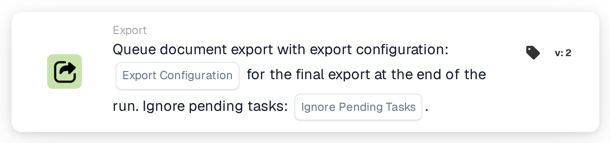
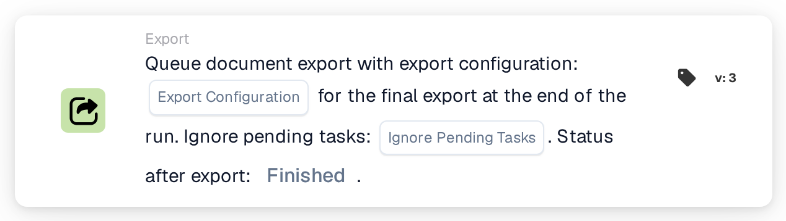

# Export with Export Configuration

<figure><figcaption>
Version 1
</figcaption></figure>

<figure><figcaption>
Version 3
</figcaption></figure>

<figure><figcaption>
Queue document export with export configuration: … for the final export at the end of the run. Ignore pending tasks: …. — Version 2
</figcaption></figure>

<figure><figcaption>
Queue document export with export configuration: … for the final export at the end of the run. Ignore pending tasks: …. Status after export: …. — Version 3
</figcaption></figure>

## **Purpose:**

The **"Export Document with Export Configuration"** workflow card is designed to export a document using a specified export configuration. It provides the flexibility to ignore any pending tasks associated with the document, ensuring a smooth export process regardless of its current state.

## **Components of the Card:**

1. **Export Configuration**
   * **Description**: Specifies the export configuration to be used for processing the document.
   * **Detail**: This configuration determines the format, structure, and destination of the exported document.
2. **Ignore Pending Tasks**
   * **Description**: Determines whether pending tasks linked to the document should be disregarded during the export process.
   * **Options**:
     * **True**: Exports the document regardless of pending tasks.
     * **False**: Ensures pending tasks are completed before the export.

## **Functionality:**

* **Condition Evaluation**: The system evaluates the conditions set in the **"When"** and **"And"** of the workflow. If both conditions are true, the export process is initiated.
* **Document Export**: Using the specified **Export Configuration**, the document is processed and exported in the defined format and destination.
* **Pending Tasks Handling**: If **Ignore Pending Tasks** is set to **True**, the export process bypasses any outstanding tasks linked to the document. If set to **False**, pending tasks can prevent the export. Resolve them and arrange the intended workflow trigger or retry.

## **Setup and Configuration:**

To configure this card, users need to:

1. Select the desired **Export Configuration** to define how the document will be exported.
2. Choose whether to **Ignore Pending Tasks** by setting the value to **True** or **False.**
3. Ensure the conditions in the **"When"** and **"And"** are correctly set, as the card only executes its action when these conditions are true.

## **Conclusion:**

The **"Export Document with Export Configuration"** workflow card ensures documents are exported efficiently and according to predefined configurations. With the ability to ignore pending tasks, this card offers flexibility in handling documents at various stages, reducing delays and streamlining the export process.

## Current versions and pending tasks

On v3, also choose **Status after export**: `finished` closes the document after a successful export; `exported` leaves it open for further processing. Earlier versions retain `finished`. A missing selection defaults to `finished`; an invalid selection is rejected.

If open tasks prevent export, the card reports the refusal. Resolve the tasks and arrange the intended trigger or retry; automatic waiting and resumption are not guaranteed by this card. The separate queued-export card collects a configuration for final export at the end of the run. See [Export cards and result status](../../export-cards-guide.md).

<!-- workflow-card-practical-example-20261021 -->

## Practical example

**When to use:** Choose a specific export configuration for a validated document.

**Configuration:** Select the configured demo exporter and set Ignore pending tasks to `false`. Use a document with an open task, then a separate test without open tasks.

**Expected result and counterexample:** The open-task case must not be assumed to resume automatically. After resolving the task, trigger the intended export again and verify the exporter result and supported status.

This is an illustrative configuration and expected outcome. Use fields, users and groups configured in your test organization; it is not a claim that this example was executed.
