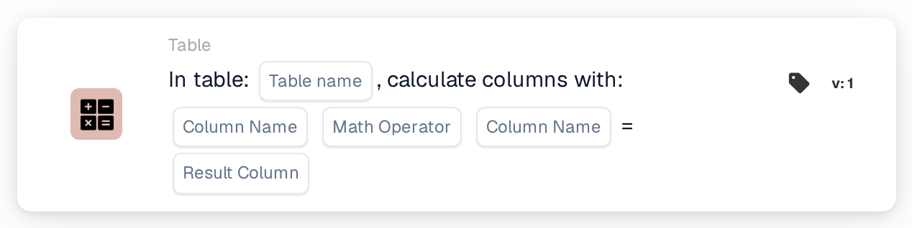
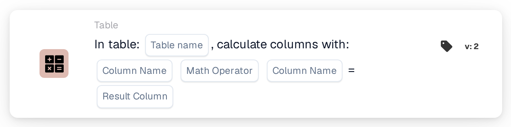

# Calculate Columns with

<figure><figcaption>
Version 1
</figcaption></figure>

<figure><figcaption>
Version 2
</figcaption></figure>

## Purpose:

This workflow card calculates a value from two columns of a table on the document, row by row, and saves the result in a result column. It can be used, for example, to calculate line totals from quantity and unit price.

## Admin video:



[Watch with English subtitles](https://docbits-videos.fra1.cdn.digitaloceanspaces.com/settings-assistant/workflow-card-calc-columns-admin/v1/en.html) · [Read the transcript](https://docbits-videos.fra1.cdn.digitaloceanspaces.com/settings-assistant/workflow-card-calc-columns-admin/v1/en.txt)

## Components of the Card:

1. **Table**
   * **Description:** The table on the document the calculation runs in.
2. **First Column**
   * **Description:** The column with the first value of each row.
3. **Operation**
   * **Options:**
     * **+** adds the second value to the first.
     * **-** subtracts the second value from the first.
     * **\*** multiplies the two values.
     * **/** divides the first value by the second.
4. **Second Column**
   * **Description:** The column with the second value of each row.
5. **Result Column**
   * **Description:** The column the result of each row is saved in.
   * **Detail:** The name is saved in capital letters, with spaces replaced by underscores (`total amount` becomes `TOTAL_AMOUNT`). If the column does not exist yet, the card adds it; if it exists, its values are replaced.

Versions 1 and 2 of the card have the same settings and work the same way.

## Functionality:

* **Calculation:** For every row of the table, the card reads the two columns (capitalisation of the column names does not matter), applies the operation and writes the result into the result column. Results are rounded to four decimal places. Afterwards the document is saved with the new values.
  * An empty or missing value counts as `0`. If both values of a row are empty, the result of that row stays empty.
  * A division by zero leaves the result of that row empty.
  * With **+**, two values that are not numbers are joined with a space instead of added. With the other operations, a value that is not a number causes an error, and no results are saved.
* **Action Execution:** If the calculation and the save succeed, the workflow continues with the next cards. If the table does not exist on the document, a value cannot be calculated or the document cannot be saved, the card reports an error in the workflow log.
* **Test Card:** When the card is run with **Test Card**, the calculation is only simulated and the document is not changed.

## Setup and Configuration:

* The card can be added as a Then action from the **Table** category. Then the table, the two columns, the operation and the result column are selected.
* **Example:** Table `INVOICE_TABLE`, `QUANTITY` **\*** `UNIT_PRICE`, result column `TOTAL_AMOUNT`. A row with quantity 2 and unit price 10 gets 20, a row with 3 and 4 gets 12.
* Because an empty value counts as `0`, a missing price gives a result of `0`. Checking that the input columns are filled, for example with a condition before this card, can help to avoid wrong totals.
* For subtraction and division, the order of the two columns matters.

## Conclusion:

The "Calculate Columns with" workflow card adds calculated values to table rows automatically. Line totals and similar values are available for the following cards and for the export without manual calculation.
