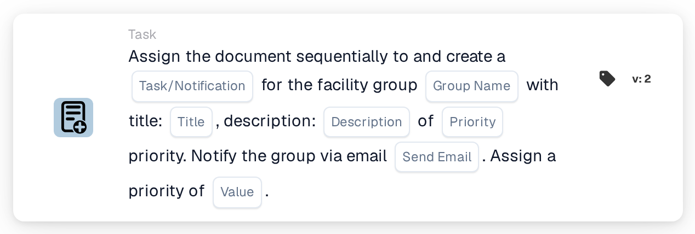

# Assign to Facility Group and Create a Task/Notification

<figure><figcaption>
Version 2
</figcaption></figure>

## Purpose:

This workflow card adds the group responsible for the facility of the document's purchase order to the sequential assignment of the document and attaches a task or notification to this step. The facility is taken from the purchase orders the document is matched with, and the group is found by its name, which contains both the group name entered on the card and the facility code. The task or notification belongs to the group's step in the sequence.

## Components of the Card:

1. **Task/Notification**
   * **Description:** Defines whether a task or a notification is created for the group.
   * **Options:**
     * **Task:** A task is created.
     * **Notification:** A notification is created.
2. **Group Name**
   * **Description:** The name part that the facility groups have in common.
   * **Detail:** A text that is compared with the names of the user groups of the organization. A group matches if its name contains this text and the facility code of the purchase order. The comparison ignores upper and lower case. For example, with the group name **Approver** and a purchase order for facility **1000**, a group called **Approver 1000** would match.
3. **Title**
   * **Description:** The title of the task or notification.
   * **Detail:** A short text that identifies the task or notification.
4. **Description**
   * **Description:** Further details about the task or notification.
   * **Detail:** A text that describes what should be done or why the group is informed.
5. **Priority**
   * **Description:** The urgency of the task or notification.
   * **Options:**
     * **high weight:** The task or notification is created with high priority.
     * **medium weight:** The task or notification is created with medium priority.
     * **low weight:** The task or notification is created with low priority.
6. **Send Email**
   * **Description:** Defines whether the group is also informed about the task by email.
   * **Options:**
     * **True:** An email notification is sent to the group.
     * **False:** No email notification is sent.
7. **Value**
   * **Description:** The priority of the group within the sequential assignment.
   * **Detail:** A whole number. Lower numbers come first, with 0 as the highest priority. If no value is entered, or a negative value is entered, the priority 1 is used.

## Functionality:

* **Finding the Facility:** The card reads the purchase orders the document is matched with and collects the facility code (the location of the purchase order) of each of them.
* **Finding the Group:** For every facility code, the card looks for user groups whose name contains both the **Group Name** from the card and the facility code. Facility codes for which no group is found are listed in the workflow log.
* **Action Execution:** Every matching group is added to the sequential assignment with the priority from the **Value** field, together with the task or notification. The assignment itself happens at the end of the workflow run: the entry with the lowest priority number is assigned first and its task or notification is created. All entries, including the first, are stored on the document as its approval requests, and the following steps of the sequence are taken from them in ascending order of priority. If another card has already assigned the document directly in the same run, this first sequential assignment is skipped, and its task or notification is not created in this run.
* **Default Values:** If no task priority is set, **medium weight** is used. If **Send Email** is not set, no email is sent. If **Task/Notification** is not set, a task is created and the workflow log notes the missing setting.
* **Missing Data:**
  * If the group name, the title or the description is empty, the card does not run and reports the missing data in the workflow log.
  * If the document is not matched with a purchase order, the card reports the missing data instead of adding a group.
  * If no group matches any of the facility codes, no group is added and the workflow log notes that no matching group was found.

## Setup and Configuration:

* The user groups should be named so that each name contains the common name part and the facility code, for example **Approver 1000**, **Approver 2000**.
* The card can be added from the **Task** category. After that, the type (**Task** or **Notification**), the common name part of the groups, the title, the description, the task priority, the email setting and the position in the sequence (**Value**) can be configured.
* To build a chain of approvers, several sequential cards can be combined in the workflow, each with its own **Value**.

## Conclusion:

The "Assign to Facility Group and Create a Task/Notification" workflow card places the responsible facility team at a defined position in a sequential approval and gives it a clear task for its step. One card covers all facilities, as long as the user groups follow a consistent naming scheme with the facility code in their names.
