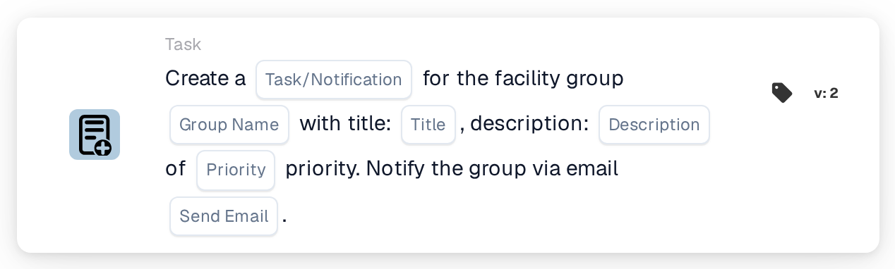

# Create a New Task and assign it to Facility Group

<figure><figcaption>
Version 2
</figcaption></figure>

## Purpose:

This workflow card creates a task or notification for the group that is responsible for the facility of the document's purchase order. The facility is not selected on the card: it is taken from the purchase orders the document is matched with. The card then looks for a user group whose name contains both the group name entered on the card and the facility code, and creates the task for that group. The document itself is not reassigned.

For a card that also assigns the document to the facility group as part of a sequential assignment, **Assign to Facility Group and Create a Task/Notification** can be used.

## Components of the Card:

1. **Task/Notification**
   * **Description:** Defines whether a task or a notification is created for the group.
   * **Options:**
     * **Task:** A task is created.
     * **Notification:** A notification is created.
2. **Group Name**
   * **Description:** The name part that the facility groups have in common.
   * **Detail:** A text that is compared with the names of the user groups of the organization. A group matches if its name contains this text and the facility code of the purchase order. The comparison ignores upper and lower case. For example, with the group name **Warehouse** and a purchase order for facility **1000**, a group called **Warehouse 1000** would match.
3. **Title**
   * **Description:** The title of the task or notification.
   * **Detail:** A short text that identifies the task or notification.
4. **Description**
   * **Description:** Further details about the task or notification.
   * **Detail:** A text that describes what should be done or why the group is informed.
5. **Priority**
   * **Description:** The urgency of the task or notification.
   * **Options:**
     * **high weight:** The task or notification is created with high priority.
     * **medium weight:** The task or notification is created with medium priority.
     * **low weight:** The task or notification is created with low priority.
6. **Send Email**
   * **Description:** Defines whether the group is also informed about the task by email.
   * **Options:**
     * **True:** An email notification is sent to the group.
     * **False:** No email notification is sent.

## Functionality:

* **Finding the Facility:** The card reads the purchase orders the document is matched with and collects the facility code (the location of the purchase order) of each of them.
* **Finding the Group:** For every facility code, the card looks for user groups whose name contains both the **Group Name** from the card and the facility code. Facility codes for which no group is found are listed in the workflow log.
* **Task Creation:** A task or notification with the title, description and priority from the card is created for the matching group and linked to the document. If several groups match, the task is created for only one of them; which one is not determined by the card.
* **Default Values:** If no priority is set, **medium weight** is used. If **Send Email** is not set, no email is sent. If **Task/Notification** is not set, a task is created and the workflow log notes the missing setting.
* **Missing Data:**
  * If the group name, the title or the description is empty, the card does not run and reports the missing data in the workflow log.
  * If the document is not matched with a purchase order, the card reports the missing data instead of creating a task.
  * If no group matches any of the facility codes, no task is created and the workflow log notes that no matching group was found.

## Setup and Configuration:

* The user groups should be named so that each name contains the common name part and the facility code, for example **Warehouse 1000**, **Warehouse 2000**.
* The card can be added from the **Task** category. After that, the type (**Task** or **Notification**), the common name part of the groups, the title, the description, the priority and the email setting can be configured.

## Conclusion:

The "Create a New Task and assign it to Facility Group" workflow card brings the team of the right facility into the process without changing who the document is assigned to. One card covers all facilities, as long as the user groups follow a consistent naming scheme with the facility code in their names.
